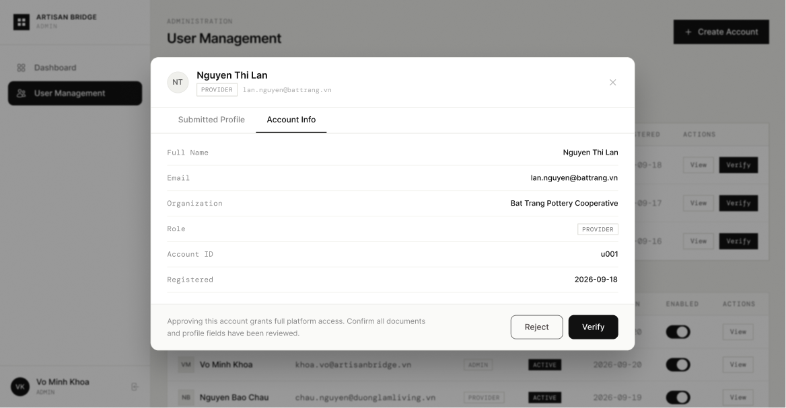

# Screen Spec: VER119 Account Information

| Field | Value |
|---|---|
| Screen ID | `VER119` |
| Screen name | Account Information |
| Actor | Admin (HDT / UBND) |
| Priority | Must |
| Belongs to module | `spec-AUT.md` |
| Mockup image | `img/VER119.png` |
| Status | Revised — pending human approval |

## 1. Purpose

Displays system-level account information — account ID, role/admin subtype, current account status,
registration date and last login — as a **read-only** reference during a review. VER119 does not make a
review decision; the Approve / Request More Information / Reject (or Request Revision) decision is taken
on **VER146 View Submitted Profile**, which VER119 links to.

## 2. Mockup

## 3. Element inventory

| # | Element | Type | Content / data source | Required | Validation |
|---|---|---|---|---|---|
| 1 | Account Information | Heading | Account Information | No | Static screen title |
| 2 | Account id | Read-only field | `user_id` — F-AUTH-21 | No | Read-only; opaque identifier |
| 3 | Role / admin subtype | Read-only field | `role`, `admin_type` — F-AUTH-21 | No | Read-only; admin_type shown only for ADMIN |
| 4 | Account status | Read-only field | `status` — F-AUTH-21 | No | Read-only; canonical account status enum |
| 5 | Organization | Read-only field | `organization` — F-AUTH-21 | No | Read-only |
| 6 | Registration / created date | Read-only field | `created_date` — F-AUTH-21 | No | Read-only date |
| 7 | Last login | Read-only field | `last_login` — F-AUTH-21 | No | Read-only; empty when never logged in |
| 8 | Account identity and current account status | Read-only panel | F-AUTH-21 — permitted output fields only | No | Actor-specific field visibility; optional missing values omitted. Never expose tokens, password hashes, session values or internal delivery diagnostics. |
| 9 | Submitted profile tab | Button / navigation | Opens the submitted profile and its review decision on VER146 | No | Enabled only when the linked permission/validation guard succeeds |
| 10 | Close | Button / navigation | No mutation | No | Enabled only when the linked permission/validation guard succeeds |

## 4. States

| State | What the user sees | Trigger |
|---|---|---|
| Default | Permitted read-only account information for the selected account | Authorized screen load |
| Empty | Optional values (e.g. last login) shown as empty with explanatory text; never infer availability from absent bookings | Successful response with missing optional values |
| Loading | Skeleton/progress while the account record is fetched | Fetch in progress |
| Error | Fetch failure with Retry; no data shown on failure | Permission or service failure |
| Success | Refreshed read-only data | Successful read |

## 5. Interactions and navigation

| # | Element | User action | System response | Goes to screen |
|---|---|---|---|---|
| 1 | Submitted profile tab | Select | Open the submitted profile and the review decision form | VER146 |
| 2 | Close | Select | No mutation | ADM095 |

Shared avatar navigation for authenticated actors: My Account → ACC129; My Business → PRF019 (Agency) / PRF127 (Provider), omitted for Admin without a business; Logout → AUT026. Agency main navigation uses EXP017/AIT121/BKG137/SCH141/COM048; Provider uses DSH018/EXP067/BKG133/SCH139/COM065; Admin uses ADM079/ADM095. Guest has EXP120 and AUT009/REG003, with no AI navigation.

## 6. Screen-level rules

| Rule ID | Rule | Source |
|---|---|---|
| SR-001 | Check action permission and resource scope on every protected request; hiding a button alone is insufficient. This is a read-only screen and exposes no mutation controls. | AUT FR-016 |
| SR-002 | Render outputs exactly as the linked module contract (F-AUTH-21); server/context fields are not editable form controls. | Linked FR table |
| SR-003 | Account status and profile verification status are distinct. VER119 shows account status only; the profile verification decision is made on VER146. | Function List and shared consistency contract |

## 7. Linked requirements

| Module | FR ID | Function ID | Screen responsibility |
|---|---|---|---|
| AUT | FR-021 | F-AUTH-21 | View user account information (read-only) |

The review decision itself (F-AUTH-18 for Agency, F-PROFILE-05 for Provider) is specified on **VER146**,
reached through the Submitted profile tab.

## 8. Responsive and accessibility notes

- Smallest supported width: 1024px (admin tool)
- What collapses or stacks on a narrow screen: the read-only fields stack to a single column; the Submitted profile tab and Close remain side by side unless very narrow
- Text that must remain readable (contrast, minimum size): account status and role labels ≥13px with sufficient contrast; not distinguished by color alone

## 9. Decisions and review

Use the approved Function List and [shared consistency contract](../docs/consistency-contract.md). VER119
is a read-only account-information reference; the review decision belongs to VER146 (no duplicate decision
form on VER119). Human approval of this revision is pending; technical Plan choices remain separately identified.

## Completion checklist

- [x] Linked functions have corresponding module FR and IO contracts.
- [x] Fields name their validation and required/optional condition.
- [x] Default, empty, loading, error and success states are defined.
- [x] Navigation targets use existing Screen IDs.
- [x] No mutation control on a read-only screen (review decision lives on VER146).
- [ ] Human approval of the revised specification.
