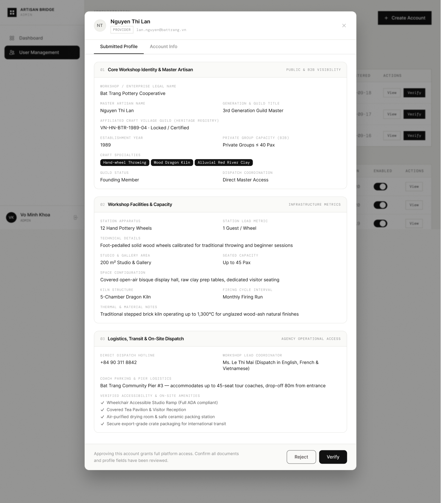

# Screen Spec: VER146 View Submitted Profile

| Field | Value |
|---|---|
| Screen ID | `VER146` |
| Screen name | View Pending Profile |
| Actor | HDT Admin / UBND Admin |
| Priority | Must |
| Belongs to module | `spec-AUT.md` and `spec-ADM.md` |
| Mockup image | `img/VER146.png` |
| Status | Approved |

## 1. Purpose

**Shown when:** Admin clicks "Verify" on a pending row in User Management (ADM095); this is the default/landing tab of the verification modal ("Submitted Profile").

**The user leaves this screen when:** They click "Reject", the (×) icon, switch to the "Account Info" tab, or click "Verify" to finalize verification.

## 2. Mockup

## 3. Element inventory

| # | Element | Type | Content / data source | Required | Validation |
|---|---|---|---|---|---|
| 1 | Avatar initials | Image/Text | Initials from `user.full_name` | No | — |
| 2 | User name | Text | `user.full_name` | No | — |
| 3 | Role badge | Badge | `user.role` e.g. PROVIDER | No | — |
| 4 | Email | Text | `user.email` | No | — |
| 5 | Close (×) | Button | Dismisses modal | No | — |
| 6 | Tab: Submitted Profile (active) | Tab | Currently selected view | No | — |
| 7 | Tab: Account Info | Tab | Switches to system-level info | No | — |
| 8 | Section 01 "Core Workshop Identity & Master Artisan" (+ visibility tag) | Card section | Workshop/enterprise legal name, master artisan name, generation/guild title, affiliated craft village guild, establishment year, private group capacity, craft specialty tags, guild status, dispatch coordination | No | — |
| 9 | Section 02 "Workshop Facilities & Capacity" (+ metrics tag) | Card section | Station apparatus, station load metric, technical details, studio/gallery area, seated capacity, space configuration, kiln structure, firing cycle interval, thermal/material notes | No | — |
| 10 | Section 03 "Logistics, Transit & On-Site Dispatch" (+ access tag) | Card section | Direct dispatch hotline, workshop lead coordinator, coach parking & pier logistics, verified accessibility & on-site amenities checklist | No | — |
| 11 | Approval disclaimer text | Text | "Approving this account grants full platform access. Confirm all documents and profile fields have been reviewed." | No | — |
| 12 | Reject | Button (secondary) | Rejects the account application | No | — |
| 13 | Verify | Button (primary) | Approves and verifies the account | No | Should only be used after reviewing all submitted sections |

### 3.1 Field set when the submitted profile belongs to a Tour Agency

The rows above show the Local Provider variant of this screen. When the account under review is a Tour Agency, the Submitted Profile tab instead shows the same three-section layout populated with Agency fields (Corporate Legal Information, Authorized Delegate & Route Scope, Initial Tour Preferences & Focus) — see `screen-spec-ADM145.md` §3.1 for the full Agency field list, which applies identically here.

## 4. States

| State | What the user sees | Trigger |
|---|---|---|
| Default | All three profile sections fully populated, Reject and Verify both enabled | Verification modal opens on the Submitted Profile tab for a pending account |
| Empty (no data) | Fields not yet submitted show "Not provided"; a section with no data shows "No information submitted for this section"; Verify may be disabled until minimum required fields are present (Reject remains available) | Provider has submitted only part of the required profile |
| Loading | Skeleton placeholders in place of section content; Reject and Verify disabled while loading | Modal just opened, before data returns |
| Error | Banner inside modal "Could not load submitted profile. Retry."; Reject and Verify disabled until data loads | Profile data fetch fails |
| Success / confirmation | On Verify: modal closes, toast "{name} verified and account activated", row moves from Pending Verification to All Accounts with status Active. On Reject: modal closes, toast "{name}'s application was rejected", account status becomes Rejected | Reject or Verify succeeds |

## 5. Interactions and navigation

| # | Element | User action | System response | Goes to screen |
|---|---|---|---|---|
| 1 | Tab: Account Info | tap | Switches modal content to system-level account info | `VER119` |
| 2 | Close (×) | tap | Closes modal without any change | `ADM095` |
| 3 | Reject | tap | Marks the account as Rejected; user is notified by email | `ADM095` (modal closes, table refreshes) |
| 4 | Verify | tap | Confirms and activates the account | `ADM095` (modal closes, table refreshes) |

## 6. Screen-level rules

| Rule ID | Rule | Source |
|---|---|---|
| SR-001 | Displays the submitted profile and supporting information required for the Admin to review before verification | Screen List Screen Overview for VER146 |
| SR-002 | Verify grants full platform access — the Admin is warned before confirming | Mockup — disclaimer text above the action buttons |
| SR-003 | This is the same underlying modal as ADM145, but entered via the "Verify" action instead of "View", which replaces the plain Close action with Reject and Verify | Comparing ADM145 (Close only) with this mockup (Reject / Verify) |
| SR-004 | Both Reject and Verify are available from either tab (Account Info or Submitted Profile) of the verification modal | Updated mockup shows Reject/Verify on both VER119 and VER146 |
| SR-005 | The submitted profile layout is specific to the account's actor type: Local Provider shows workshop/business fields; Tour Agency shows corporate/registration fields (see §3.1) | Clarification, consistent with ADM145 |
| SR-006 | The screen layout and field structure shown here (captured from [Actor X]'s view) is a shared template used by multiple actor roles. Role-specific differences (visible fields, permissions, labels) are not exhaustively illustrated by this single mockup and must be validated per actor before implementation. |

## 7. Linked requirements

| FR ID (from the module spec) | What this screen does for it |
|---|---|
| F-AUTH-18 | Displays the submitted Agency company/legal information and registration documents that HDT reviews before recording an Approve / Request More Information / Reject decision. This applies cleanly to the Tour Agency variant of this screen (§3.1); the default Local Provider content shown in §3 does not belong to F-AUTH-18 — see §9 |

Note: reviewing Local Provider business content instead maps to F-PROFILE-05 (Profile Management module, UBND actor, Approve/Request Revision actions) rather than to F-AUTH-18 — see the branching issue newly flagged in §9.

## 8. Responsive and accessibility notes

- Smallest supported width: 1024px (admin tool)
- What collapses or stacks on a narrow screen: modal becomes full-screen sheet; two-column field rows within a section stack to single column
- Text that must remain readable (contrast, minimum size): section labels ≥11px uppercase, body values ≥14px, disclaimer text ≥13px

## 9. Open questions

| # | Question | Blocking? | Status |
|---|---|---|---|
| 1 | Is there an explicit "Reject" action anywhere in this verification modal? | Yes | Resolved — yes, "Reject" appears alongside "Verify" on both tabs |
| 2 | Field set for a submitted Agency profile under verification | Yes | Resolved — see §3.1 (same as ADM145 §3.1) |
| 3 | [NEEDS CLARIFICATION: Does Reject require a reason/comment to be entered, or does it apply immediately with no additional input?] | No | Open — module spec Open Q12 confirms no review-comment is required for Reject/Request More Information, but does not resolve whether Reject needs a UI confirmation step here. |
| 4 | Module spec function F-AUTH-18 (formerly FR-018/US-6, UC-ACC-06) defines **three** HDT decisions on a pending Agency — Approve, Request More Information, and Reject — but this mockup and VER119 only offer two actions (Reject / Verify). | Yes | Still open — needs a UI mockup for the Request More Information action before F-AUTH-18 can be fully implemented; see matching flag in `screen-spec-VER119.md`. |
| 5 | This screen's default content is the Local Provider workshop/business profile (§3, Sections 01–03), but module spec `spec-AUT.md` explicitly places "Local Provider profile verification" **out of scope** for this Authentication module, assigning it to Profile Management. Local Provider accounts are also created directly `Active` (FR-020) rather than entering a "Pending" review state, so it is unclear which account type actually lands in ADM095's Pending Verification table and reaches this screen. | Yes | Partially resolved — a new function, F-PROFILE-05 (Review & Verify Local Provider Profile), now formally owns Local Provider profile review under Profile Management, with actor UBND Admin and actions Approve / Request Revision. This confirms the Local Provider content in §3 does not belong under F-AUTH-18. **New open item (#6)** captures the resulting mismatch that still needs design/BA resolution. |
| 6 | Given #5, this screen as currently mocked up cannot correctly serve both account types: an Agency under review needs F-AUTH-18's actor (HDT) and actions (Reject/Verify, standing in for Approve/Request More Information/Reject), while a Local Provider under review needs F-PROFILE-05's actor (UBND) and actions (Approve/Request Revision) — two different actor/action pairs on what the mockup shows as one modal with one button row. | Yes | Open — flagging for design/BA confirmation on how to resolve this: e.g. (a) split VER146/VER119 into an Agency-only screen (citing F-AUTH-18) and a separate Local-Provider-review screen owned by Profile Management (citing F-PROFILE-05), or (b) keep one modal shell but branch its action buttons and permitted actor by account type. Until resolved, this spec's action buttons (Reject/Verify) and actor (HDT Admin / UBND Admin) should be read as accurate for the Agency path only. |

---

## Completion checklist

- [x] The mockup is a separate cropped image file, named with the Screen ID.
- [x] Every visible element in the mockup appears in the element inventory.
- [x] Every input element has a validation rule or an explicit "none".
- [x] All five states are filled in, or marked "not applicable" with a reason.
- [x] Every navigation target is a Screen ID that exists in the Screen List.
- [x] Every element that displays data names the field it displays, matching the module spec.
