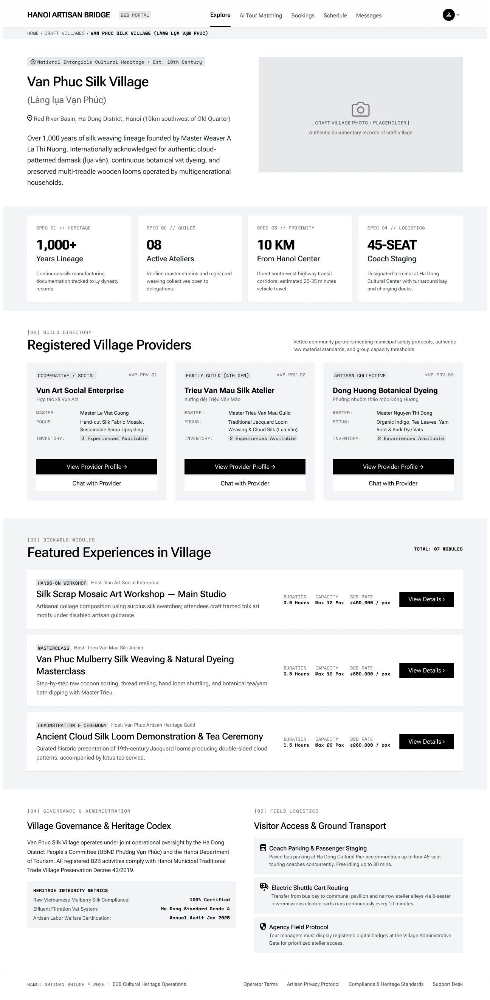

# Screen Spec: VIL030 Village Profile

| Field | Value |
|---|---|
| Screen ID | `VIL030` |
| Screen name | Village Profile |
| Actor | Tour Agency / Local Provider / Admin / Guest (masked view) |
| Priority | Must |
| Belongs to module | `spec-M04-EXPLORE.md` |
| Mockup image | `img/VIL030.png` |
| Status | Draft |

## 1. Purpose

**Shown when:** An authenticated user (Tour Agency, Local Provider, or Admin) opens a specific Village from `EXP017`, a Provider card, or an Experience's village link. A Guest can also reach this same screen (e.g. via a Village card on `EXP120`), but with B2B-only fields such as B2B Rate and Max Capacity masked. A Local Provider only ever opens this screen for their own affiliated village — never another village — and sees it rendered the same way an Agency does for that village.

**The user leaves this screen when:** they navigate to a Provider Profile, an Experience Detail, back to Explore via the breadcrumb, or open the account/avatar menu.

## 2. Mockup

## 3. Element inventory

| # | Element | Type | Content / data source | Required | Validation |
|---|---|---|---|---|---|
| 1 | Header nav | Header | Logo, Explore / AI Tour Matching / Bookings / Schedule / Messages, avatar menu | Yes | No lock icons (authenticated) |
| 2 | Breadcrumb | Text | "Home / Craft Villages / [Village name] (Vietnamese name)" | Yes | Last crumb is current page, non-clickable |
| 3 | Heritage badge | Text/Tag | e.g. "National Intangible Cultural Heritage · Est. Xth Century" | No | — |
| 4 | Village title | Header | Village name (English) + Vietnamese name | Yes | Village name field |
| 5 | Location line | Text | Region description with pin icon | Yes | Village location field |
| 6 | Description paragraph | Text | Village history/heritage summary | Yes | — |
| 7 | Hero image | Image | Village photo placeholder + caption | No | Falls back to placeholder if no photo uploaded |
| 8 | Stat card (×4) | Card | label ("Spec 0N // Category"), large stat value, title, description | Yes (per card) | Heritage/Guilds/Proximity/Logistics fields |
| 9 | "Registered Village Providers" section header | Text | "[02] Guild Directory" eyebrow + heading + intro copy | Yes | — |
| 10 | Provider card (×N) | Card | type badge, provider ID, provider name (+ Vietnamese), Master label/value, Focus label/value, Inventory badge ("N Experiences Available"), "View Provider Profile →" button, "Chat with Provider" button | Yes (per card) | Only verified providers listed under this village |
| 11 | "Featured Experiences in Village" section header | Text | "[03] Bookable Modules" eyebrow + heading + "TOTAL: NN MODULES" counter | Yes | Counter = total experiences across all providers in village |
| 12 | Experience row (×N) | List | type tag (e.g. Hands-On Workshop / Masterclass / Demonstration & Ceremony), host label, title, description, Duration/Capacity/B2B Rate stats, "View Details >" button | Yes (per row) | B2B Rate and Max Capacity are masked (shown as locked/hidden) for Guest viewers; a Local Provider only ever views this row set for their own affiliated village, rendered unmasked exactly as an Agency sees it |
| 13 | "Village Governance & Heritage Codex" section | Text | "[04]" eyebrow + heading + 2 paragraphs + metrics box (label/value rows) | No | — |
| 14 | "Visitor Access & Ground Transport" section | List | "[05]" eyebrow + heading + 3 items (icon, title, description) | No | — |
| 15 | Footer | Footer | Brand, terms, copyright, system ref | Yes | — |

## 4. States

| State | What the user sees | Trigger |
|---|---|---|
| Default | Fully populated village page as shown; for an authenticated Tour Agency, Local Provider (own village), or Admin, all fields render unmasked. For a Guest, the same layout renders with B2B Rate and Max Capacity masked/locked in each Experience row | Village data, providers, and experiences all resolve |
| Empty (no data) | Provider Directory shows "No providers are currently registered to this village."; Bookable Modules shows "No experiences are currently published for this village." | Village exists but has zero verified providers/experiences |
| Loading | Skeleton blocks for hero image, stat cards, provider cards, and experience rows; header/breadcrumb render immediately | Initial navigation into the screen, before data resolves |
| Error | Full-section banner: "We couldn't load this village's details." with a "Retry" button | Village data fetch fails or village ID is invalid |
| Success / confirmation | Not applicable — screen is view-only, no submission | — |

## 5. Interactions and navigation

| # | Element | User action | System response | Goes to screen |
|---|---|---|---|---|
| 1 | Breadcrumb "Craft Villages" | tap | — | `EXP017` |
| 2 | Provider card "View Provider Profile →" | tap | — | `DSC122` |
| 3 | Provider card "Chat with Provider" | tap | Opens/creates a chat thread with that provider | `COM048` (Tour Agency) / `COM065` (Local Provider) |
| 4 | Experience row "View Details >" | tap | — | `DSC033` |
| 5 | Avatar/account menu | tap | Opens shared dropdown | `ACC129` / `ACC130` / Logout (`AUT026`) |

## 6. Screen-level rules

| Rule ID | Rule | Source |
|---|---|---|
| SR-001 | Only verified/published providers and experiences appear on this screen | Screen List, VIL030 overview |
| SR-002 | The screen is strictly view-only; no edit controls render for any actor, including Admin | Screen List, VIL030 overview: "View-only" |
| SR-003 | "TOTAL: NN MODULES" reflects the full count of experiences across the village's providers, independent of how many rows are shown in the featured list | Inferred from mockup (3 rows shown vs "TOTAL: 07 MODULES") |
| SR-004 | A Guest can open this screen (e.g. from a Village card on `EXP120`), but B2B-only fields — B2B Rate and Max Capacity — are masked/locked in the Experience row; all other content (heritage info, provider directory, descriptions) renders the same as the authenticated view | Clarified answer, open question #1 |
| SR-005 | A Local Provider can only open this screen for their own affiliated village, never another village; when they do, the screen renders unmasked exactly as it does for an Agency | Clarified answer, open question #2 |

## 7. Linked requirements

| FR ID (from the module spec) | What this screen does for it |
|---|---|
| — | [NEEDS CLARIFICATION: module spec `spec-M04-EXPLORE.md` with FR IDs not yet available] |

## 8. Responsive and accessibility notes

- Smallest supported width: 360px
- What collapses or stacks on a narrow screen: the 4-column stat grid becomes 2 columns then 1; the 3-column provider directory stacks to 1 column; two-column Governance/Logistics footer sections stack vertically
- Text that must remain readable: metric-box values (Heritage Integrity Metrics) use small monospace-style text and need a minimum readable size on mobile

## 9. Open questions

| # | Question | Blocking? | Status |
|---|---|---|---|
| 1 | Does a Guest ever reach a restricted version of this screen, or is `VIL030` authenticated-only per the actor list? — **Answer:** Yes, a Guest can reach `VIL030` with masked information such as B2B Rate and Max Capacity. | No | Resolved |
| 2 | Does a Local Provider viewing another village see the same B2B Rate column as a Tour Agency, or is it masked for that actor? — **Answer:** A Local Provider does not view another village — only the village they belong to, rendered the same way an Agency sees it. | No | Resolved |

---

## Completion checklist

- [x] The mockup is a separate cropped image file, named with the Screen ID.
- [x] Every visible element in the mockup appears in the element inventory.
- [x] Every input element has a validation rule or an explicit "none".
- [x] All five states are filled in, or marked "not applicable" with a reason.
- [x] Every navigation target is a Screen ID that exists in the Screen List.
- [x] Every element that displays data names the field it displays, matching the module spec.

---

Template source: DBIZ3, VJCBI College - FTU, Session 4. Built on the DBIZ2 Screen Design
structure (Screen List and Screen Layout), per DBIZ3 Syllabus v3.
