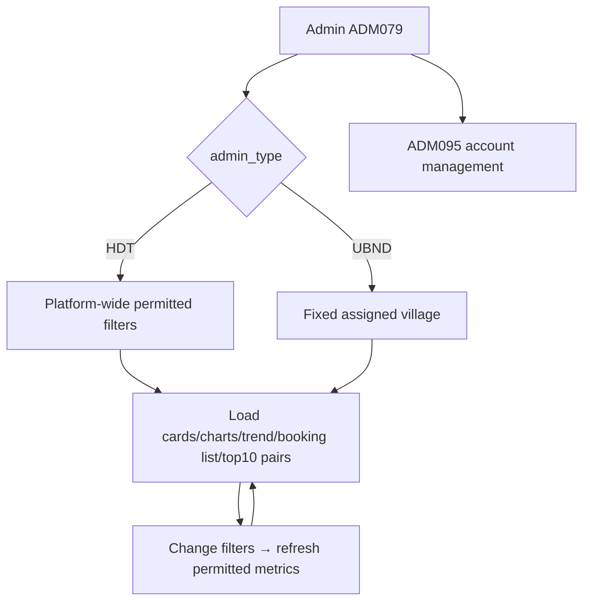
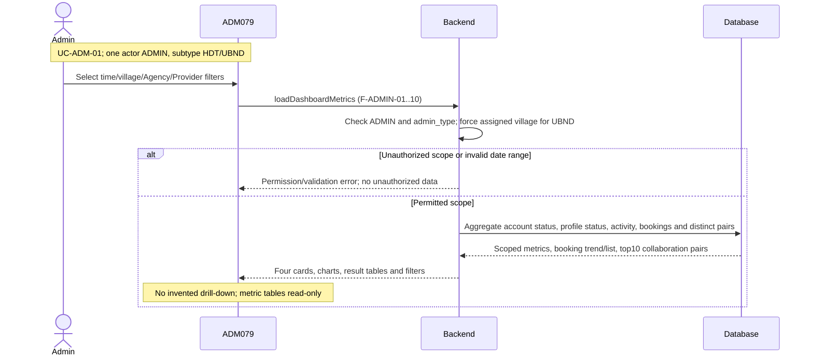

# Spec Document: Admin Dashboard

| **Field**                 | **Value**                                                                                                                      |
|---------------------------|--------------------------------------------------------------------------------------------------------------------------------|
| Module ID                 | ADM                                                                                                                            |
| Module name               | Admin Dashboard                                                                                                                |
| Spec version | v0.2 — consistency revision |
| Author (team member)      | Group G                                                                                                                        |
| Date | 28/09/2026 |
| Status | Revised — pending human approval |
| Approved by (Client role) | Pending human approval |
| DBIZ2 source              | Function List rows **F-ADMIN-01 .. F-ADMIN-10**; Use Case **UC-ADM-01**; Screen ADM095, ADM117, ADM118, VER146, VER119, ADM079 |

Shared actor/state/field definitions: [Consistency Contract](../docs/consistency-contract.md). Exact current Function contracts are in §5/5.1. Technical choices and unresolved field-design questions are explicitly separated there.

**1. Purpose and scope (mandatory)**

> The Admin Dashboard provides HDT and UBND administrators with summarized operational information about Agencies, Local Providers, Bookings and Agency–Provider collaboration within their authorized data scope. It supports role-based monitoring through metric cards, charts and filters without granting Booking lifecycle control or profile-edit authority.

**In scope**

- Display role-specific Admin Dashboard.

- Load dashboard metrics according to Admin scope.

- Show summary metric cards.

- Filter metrics by time period.

- Filter metrics by village.

- Filter lists by Agency and/or Local Provider.

- View Agency metrics.

- View Local Provider metrics.

- View Booking metrics.

- View Agency–Provider collaboration metrics.

**Out of scope**

- Creating, updating, confirming, cancelling or completing Bookings.

- Editing Agency or Local Provider profile content.

- Creating or managing user accounts; this belongs to Authentication, Access & User Management.

- Verifying Agency registration or Local Provider profile.

- Editing Experience content.

- Direct drill-down entity management unless separately defined by another module.

- Global system configuration.

- Ranking/AI analytics from Explore or AI Matching.

**Depends on**

| **Dependency**                                     | **Purpose**                                                                       |
|----------------------------------------------------|-----------------------------------------------------------------------------------|
| **AUT – Authentication, Access & User Management** | Provides HDT/UBND role and authorized data scope.                                 |
| **PRF – Profile Management**                       | Supplies Agency and Provider profile/status information used by metrics.          |
| **BKG – Schedule / Booking Management**            | Supplies Booking status, Booking records and Booking-based activity data.         |
| **CHAT – In-app Chat**                             | May contribute to Provider activity metrics where Chat interactions are included. |

**2. Actors (mandatory)**

| **Actor**               | **Role in this module**                                                                                         | **Where it comes from** |
|-------------------------|-----------------------------------------------------------------------------------------------------------------|-------------------------|
| **HDT Admin**           | Views platform-wide dashboard metrics and may select any village, Agency or Provider permitted by the dashboard | F-ADMIN-01–10           |
| **UBND Admin**          | Views dashboard metrics restricted to its assigned village                                                      | F-ADMIN-01–10           |
| **System**              | Loads, aggregates, filters, calculates and presents dashboard metrics                                           | F-ADMIN-01–03           |
| **Authentication/RBAC** | Supplies role and assigned-village scope used by dashboard filtering                                            | F-AUTH-15/16            |

**3. User scenarios and acceptance criteria (mandatory)**

Because the final Use Case contains only **one Admin Dashboard use case**, the dashboard capabilities are covered under one main user scenario.

## **US-1 (P1): View Admin Dashboard — UC-ADM-01**

**Journey.** As an HDT or UBND Admin, I want to view operational metrics within my permitted scope so that I can monitor platform or village activity.

### **Acceptance scenarios**

1.  Given an HDT Admin opens the Dashboard, when data loads, then platform-wide permitted metrics and controls are displayed.

2.  Given an UBND Admin opens the Dashboard, when data loads, then metrics are restricted to the Admin's assigned village.

3.  Given an UBND Admin views the village filter, then the assigned village is pre-selected and cannot be changed.

4.  Given an HDT Admin applies a village filter, then Provider, Booking and collaboration metrics are recalculated for that village.

5.  Given a time filter is applied, then all applicable metric cards/charts/lists refresh for that period.

6.  Given an Agency or Provider filter is applied, then the relevant Booking and collaboration lists are filtered accordingly.

7.  Agency metrics display registration/status information and Agency activity within the permitted scope.

8.  Provider metrics display Provider status, verification and activity information within the permitted scope.

9.  Booking metrics display status counts, trends and permitted Booking list records.

10. Collaboration metrics display Agency–Provider collaboration frequency within the permitted scope.

11. Dashboard monitoring must not allow HDT or UBND to manipulate Booking lifecycle or profile content.

UC-ADM-01 maps to all F-ADMIN functions.

### **Edge cases**

- No records exist for the selected time period.

- UBND has no Booking activity in its assigned village.

- A selected Agency has no collaboration with the selected Provider.

- An HDT-selected village has no Providers.

- Previous-period data does not exist, so a trend percentage cannot be calculated.

- One or more metric sources return no data.

- Filter combinations produce an empty result.

- An Admin's village assignment changes while the Dashboard is open.

- Booking/account status values change while aggregated metrics are being calculated.

### Consistency acceptance examples

| AC ID | Given / When | Expected result |
|---|---|---|
| AC-ADM-SCOPE | UBND changes village filter request to another village | Backend rejects/forces assigned scope; no cross-village data. |
| AC-ADM-PAIR | One Agency has10 Booked bookings with one Provider | Frequency10, distinct pair count1; these are not Total Bookings substitutes. |
| AC-ADM-FILTER | Admin applies Agency and Provider list filters | AND intersection; permitted booking table/top pair rows refresh. |

**4. Flows (mandatory)**

**4.1 Usage flow**

**4.2 Sequence for the main flow**

**5. Functional requirements (mandatory)**

| FR ID | Function List ID | Requirement — system MUST | Actor | Priority |
|---|---|---|---|---|
| FR-001 | F-ADMIN-01 | Load and display main dashboard interface with metric cards, charts, and filters. Layout adapts based on user role: HDT sees platform-wide view with all controls enabled. UBND sees own village view with village filter pre-set and grayed out. Dashboard shows: summary cards (agency count, provider count, booking count), charts (booking status breakdown, collaboration frequency), and filter panel. | System | Must |
| FR-002 | F-ADMIN-02 | Query and aggregate all metrics data based on user role and filter criteria. Calls backend APIs to fetch: Agency counts + status breakdown, Provider counts by village + status breakdown, Booking counts by status, Collaboration data (agency-provider pairs). HDT fetches platform-wide data. UBND fetches data for assigned village only (scoped query). | System | Must |
| FR-003 | F-ADMIN-03 | Display summary metric cards at the top of the Dashboard:  Total Agencies Total Providers Total Bookings Active Collaborations  Each card shows headline value, optional trend versus the comparable previous period, and a supporting sub-label. Active Collaboration = one unique Agency–Provider pair having at least one Booking currently in On hold or Booked status within the selected reporting scope.  Comparable previous period = the immediately preceding period with the same number of calendar days as the selected current period. | System | Must |
| FR-004 | F-ADMIN-04 | Apply time period filter to all dashboard metrics. Filter options: Last 7 days, Last 30 days, Last 90 days, Last year, Custom date range. When filter applied → all metrics recalculate and charts update. Default: Last 30 days. | Admin HDT/UBND | Should |
| FR-005 | F-ADMIN-05 | Apply village filter to relevant metrics. HDT can select any village or "All Villages". UBND has village pre-set to assigned village (cannot change). When filter applied → metrics for selected village update. Affects: Provider counts, Booking data, Collaboration data. | Admin HDT/UBND | Must |
| FR-006 | F-ADMIN-06 | Apply Agency or Provider filter to metric result tables/lists. HDT can select any Agency/Provider. UBND can select Providers in own village or Agencies that interacted with own village. When filter applied → metric lists (booking list, collaboration pairs) update. Supports search/autocomplete for quick selection.  Agency and Provider filters may be applied independently or together. When both are selected, the filters are combined using AND and the result contains only records involving the selected Agency–Provider pair. | Admin HDT/UBND | Should |
| FR-007 | F-ADMIN-07 | Display Agency account-status breakdown using the canonical statuses: Pending Approval, Approved, Rejected and Disabled. Separately display Agency activity metrics for Agencies with relevant bookings/interactions during the selected reporting period. Metric rows/charts are read-only in MVP; no drill-down/clickable-row navigation is required. | Admin HDT/UBND | Must |
| FR-008 | F-ADMIN-08 | Display Provider account-status and profile-verification metrics separately by village. Account status uses Active / Disabled. Profile verification uses Draft / Pending Verification / Verified / Revision Required. Also display Provider activity distribution by craft type and other defined activity dimensions. Metric rows/charts are read-only in MVP; no drill-down/clickable-row navigation is required. | Admin HDT/UBND | Must |
| FR-009 | F-ADMIN-09 | Display: (1) Booking status breakdown (On hold, Booked, Completed, Cancelled) with counts + percentages as stacked bar/donut chart. (2) Booking count trend line over selected time period (daily/weekly/monthly granularity) as line chart. (3) Booking list table matching filter criteria with sortable columns (Date, Agency, Provider, Experience, Status, Price). All metrics scoped by time period, village. HDT platform-wide, UBND own village only.  Trend granularity is derived automatically from the selected date range: - 1–31 days: Daily - 32–180 days: Weekly - more than 180 days: Monthly. | Admin HDT/UBND | Must |
| FR-010 | F-ADMIN-10 | Display Agency–Provider collaboration frequency as a ranked list of the top 10 collaborating pairs. Each row shows Agency name, Provider name, Booking count and last collaboration date. Collaboration frequency counts Booked and Completed Bookings only; On hold and Cancelled Bookings do not contribute to the collaboration count. The list may be sorted by Frequency or Recency. HDT sees platform-wide collaboration data; UBND sees only collaborations involving Local Providers within its assigned village. | Admin HDT/UBND | Should |

**5.1 Input / Output contract**

| FR ID | Input fields and validation | Required | Output fields | Notes |
|---|---|---|---|---|
| FR-001 | role (Enum[ADMIN]; Required — from session) admin_type (Enum[HDT, UBND]; Required — from session) assigned_village_id (ID; Optional — UBND only) | As specified per field | dashboard_view (UI View; Required — role-specific layout) | Same contract as F-ADMIN-01; optional fields are not required. |
| FR-002 | role (Enum[ADMIN]; Required — from session) admin_type (Enum[HDT, UBND]; Required — from session) assigned_village_id (ID; Optional — UBND only) date_from, date_to (Date; Optional — default last 30 days) village_id (ID; Optional) agency_id (ID; Optional) provider_id (ID; Optional) | As specified per field | metrics (Object; Required), with: - agency_counts_by_status (Map<Enum, Integer>; Required) - provider_counts_by_village_and_status (Array<Object>; Required) - booking_counts_by_status (Map<Enum, Integer>; Required) - collaboration_pairs (Array<Object>; Required) | Same contract as F-ADMIN-02; optional fields are not required. |
| FR-003 | metrics (Object; Required) | As specified per field | metric_cards (Array<Object>; Required), each with: - label (Enum[Total Agencies, Total Providers, Total Bookings, Active Collaborations]; Required) - value (Integer; Required) - trend_pct (Decimal; Optional — none without a comparable previous period) - trend_direction (Enum[Up, Down, Flat]; Optional) - sub_label (String; Required) | Same contract as F-ADMIN-03; optional fields are not required. |
| FR-004 | period_preset (Enum[Last 7 days, Last 30 days, Last 90 days, Last year, Custom]; Required — default Last 30 days) start_date (Date; Optional — Custom only) end_date (Date; Optional — Custom only) | As specified per field | filtered_metrics (Object; Required) | Same contract as F-ADMIN-04; optional fields are not required. |
| FR-005 | village_id (ID; Optional — null means All Villages for HDT; fixed to the assigned village for UBND) time_filter (Object; Required) | As specified per field | filtered_metrics (Object; Required) | Same contract as F-ADMIN-05; optional fields are not required. |
| FR-006 | agency_id (ID; Optional)  provider_id (ID; Optional)  search_query (String; Optional — autocomplete) | As specified per field | filtered_lists (Object{booking_list, collaboration_pairs}; Required) | Same contract as F-ADMIN-06; optional fields are not required. |
| FR-007 | agency_status_breakdown (Map<Enum[Pending Approval, Approved, Rejected, Disabled], Integer>; Required) activity_data (Array<Object>; Required — an Agency is Active when it performs at least one Request Quote, Chat action, or participates in at least one Booking during the selected reporting period) | As specified per field | status_chart_data (Array<Object{status, count, pct}>; Required)  activity_distribution (Array<Object>; Required)  active_agency_count (Integer; Required)  trend_pct (Decimal; Optional) | Same contract as F-ADMIN-07; optional fields are not required. |
| FR-008 | provider_account_status_by_village (Array<Object{village_id, account_status: Enum[Active, Disabled], count}>; Required) provider_verification_status_by_village (Array<Object{village_id, verification_status: Enum[Draft, Pending Verification, Verified, Revision Required], count}>; Required) activity_data (Array<Object>; Required) | As specified per field | account_status_village_matrix (Array<Object>; Required)  verification_status_village_matrix (Array<Object>; Required)  activity_distribution (Array<Object{   craft_type,   activity_type: Enum[Quote Request, Chat, Booking],   count }>; Required)  active_provider_count (Integer; Required — Provider with at least one Quote Request received, Chat interaction, or Booking during the selected reporting period)  booking_count (Integer; Required) | Same contract as F-ADMIN-08; optional fields are not required. |
| FR-009 | status_counts (Map<Enum[On hold, Booked, Completed, Cancelled], Integer>; Required) time_series (Array<Object{period_start: Date, count: Integer}>; Required — granularity derived from the selected date range) booking_records (Array<Object>; Required) | As specified per field | status_chart_data (Array<Object{status, count, pct}>; Required) trend_chart_data (Array<Object{period_start, count}>; Required) booking_table (Array<Object{date, agency_name, provider_name, experience_name, status, price}>; Required) | Same contract as F-ADMIN-09; optional fields are not required. |
| FR-010 | collaboration_data (Array<Object{   agency_id,   provider_id,   booking_count }>; Required — booking_count includes Booked and Completed Bookings only; On hold and Cancelled do not count as completed collaboration activity) | As specified per field | top_pairs (Array<Object{   agency_name,   provider_name,   booking_count,   last_date }>; Required — maximum 10 pairs)  sort_by (Enum[Frequency, Recency]; Required)  visualization_type (Enum[Ranked List]; Required — MVP) | Same contract as F-ADMIN-10; optional fields are not required. |

**5.2 Business rules**

| **Rule ID** | **Rule**                                                                                                             | **Why it exists**                                                              |
|-------------|----------------------------------------------------------------------------------------------------------------------|--------------------------------------------------------------------------------|
| **BR-001**  | HDT Dashboard scope is platform-wide.                                                                                | Reflects HDT's platform administration role.                                   |
| **BR-002**  | UBND Dashboard scope is limited to its assigned village.                                                             | Enforces administrative data scope.                                            |
| **BR-003**  | UBND's village filter is fixed to the assigned village and cannot be changed.                                        | Prevents cross-village monitoring.                                             |
| **BR-004**  | HDT may select one village or All Villages where the metric supports village filtering.                              | Supports platform-wide and local comparison.                                   |
| **BR-005**  | Dashboard metrics must respect the active time, village, Agency and Provider filters.                                | Keeps cards/charts/lists consistent.                                           |
| **BR-006**  | Dashboard access is monitoring/read-only with respect to profile and Booking lifecycle data.                         | Prevents analytics screens becoming operational-control screens.               |
| **BR-007**  | Booking metrics use the canonical Booking statuses defined by the Booking module.                                    | Maintains cross-module consistency.                                            |
| **BR-008**  | UBND Agency metrics include only Agencies relevant to/interacting with the UBND's assigned village.                  | Maintains local scope.                                                         |
| **BR-009**  | UBND Provider metrics include only Providers in the assigned village.                                                | Maintains local scope.                                                         |
| **BR-010**  | UBND Booking and collaboration metrics include only records associated with its assigned village.                    | Prevents cross-village exposure.                                               |
| **BR-011**  | Trend percentages may be omitted when a valid comparison period does not exist.                                      | Prevents misleading trend values.                                              |
| **BR-012**  | Dashboard metric rows/cards do not imply entity drill-down unless a separate screen/function explicitly supports it. | Prevents introducing F-ADMIN-11/12 functionality that is not in current scope. |
| **BR-013**  | Dashboard does not grant HDT/UBND access to F-SCHED-07 operational Booking Detail.                                   | Separates monitoring from Booking operations.                                  |
| **BR-014**  | Agency and Provider filters may be applied independently or together. When both are selected, they are combined using AND. | Keeps entity filtering consistent with F-ADMIN-06. |
| **BR-015**  | An Active Agency is an Agency that performs at least one Request Quote, Chat action, or participates in at least one Booking during the selected reporting period. | Defines activity independently from account status. |
| **BR-016**  | An Active Provider is a Provider that receives at least one Quote Request, participates in a Chat interaction, or has at least one Booking during the selected reporting period. | Defines Provider activity consistently across metrics. |
| **BR-017**  | An Active Collaboration metric-card pair is an Agency–Provider pair with at least one On hold or Booked Booking in the selected reporting scope. | Defines the current active-collaboration card metric. |
| **BR-018**  | Collaboration frequency in F-ADMIN-10 counts Booked and Completed Bookings only. On hold and Cancelled Bookings do not contribute to the collaboration count. | Separates collaboration-frequency history from the Active Collaborations card. |
| **BR-019**  | Booking trend granularity is Daily for 1–31 days, Weekly for 32–180 days, and Monthly for ranges longer than 180 days. | Keeps trend aggregation deterministic. |

**6. Key entities (mandatory)**

| **Entity**                            | **Attributes from Input/Output**                                                  | **Relationships**               |
|---------------------------------------|-----------------------------------------------------------------------------------|---------------------------------|
| **Dashboard View**                    | role, assigned_village_id, layout                                                 | belongs to Admin session        |
| **Dashboard Filter**                  | time period, village_id, agency_id, provider_id                                   | applied to Dashboard metrics    |
| **Metric Card**                       | label, value, trend_pct, trend_direction, sub_label                               | derived from aggregated metrics |
| **Agency Metric**                     | status, activity distribution, active count, trend                                | aggregates Agency records       |
| **Provider Metric**                   | village, account status, verification status, craft type, capacity, booking count | aggregates Provider records     |
| **Booking Metric**                    | Booking status, count, percentage, time-series values                             | aggregates Booking records      |
| **Booking Monitoring Record**         | date, Agency, Provider, Experience, status, price                                 | belongs to Booking metric list  |
| **Collaboration Pair**                | agency_id, provider_id, booking_count, last_date                                  | links Agency and Provider       |
| **Algorithm-independent Time Series** | period_start, count/value                                                         | supports metric trend charts    |

**7. Screens involved**

| Screen ID | Screen name | Functions in this module |
|---|---|---|
| ADM079 | Admin Dashboard | F-ADMIN-01, F-ADMIN-02, F-ADMIN-03, F-ADMIN-04, F-ADMIN-05, F-ADMIN-06, F-ADMIN-07, F-ADMIN-08, F-ADMIN-09, F-ADMIN-10 |

**8. Success criteria (mandatory)**

| **SC ID**  | **Criterion**                                                                                 | **How it is measured**                                                                   |
|------------|-----------------------------------------------------------------------------------------------|------------------------------------------------------------------------------------------|
| **SC-001** | HDT sees platform-wide metrics while UBND sees only assigned-village data.                    | Compare the same Dashboard using HDT and UBND accounts.                                  |
| **SC-002** | UBND cannot change its village scope.                                                         | Attempt to select another village from an UBND account.                                  |
| **SC-003** | HDT can switch between All Villages and a selected village.                                   | Apply village filters and compare resulting metrics.                                     |
| **SC-004** | Changing the time period updates all applicable Dashboard metrics consistently.               | Compare cards/charts/lists before and after filter change.                               |
| **SC-005** | Booking status counts equal the records shown for the same scope/filter set.                  | Reconcile summary counts with Booking source data.                                       |
| **SC-006** | Agency and Provider filters work independently and together. When both are selected, only records involving the exact selected Agency–Provider pair are returned within the Admin's authorized scope. | Apply filters independently and together against controlled test data. |
| **SC-007** | UBND never receives Provider/Booking/collaboration records outside its assigned village.      | Test with cross-village data.                                                            |
| **SC-008** | Dashboard actions cannot change Booking lifecycle or profile content.                         | Attempt operational mutations from Dashboard context.                                    |
| **SC-009** | Metrics with no valid previous comparison period do not show fabricated trend values.         | Test a first/empty comparison period.                                                    |
| **SC-010** | Collaboration ranking counts Booked and Completed Bookings only, excludes On hold and Cancelled Bookings, and returns at most the top 10 Agency–Provider pairs for the permitted scope. | Compare ranked collaboration output against known Booking records and scope. |

**9. Assumptions**

- ADM079 is the single main screen for all F-ADMIN-01–10 dashboard capabilities.

- HDT and UBND use the same Dashboard screen with role-specific layout and data scope.

- Dashboard metrics are read-only analytics outputs.

- Admin Booking monitoring does not reuse the operational Booking Detail screen F-SCHED-07.

- A missing previous comparison period results in no trend rather than an assumed 0%.

- F-ADMIN-03 references drill-down behavior in older wording, but drill-down/entity-detail functionality is not treated as part of this module because no F-ADMIN-11/12 exists.

- The current Admin sequence includes scoped filter updates and all metric outputs.

- The current Usage Flow is broader than this module and includes Account Management/Profile/Booking monitoring steps belonging partly to other modules.

- ADM095, ADM117, ADM118, VER146 and VER119 are included as related screens in the Admin journey, but their account-management and verification business logic remains owned by Authentication / Profile Management rather than F-ADMIN-01 .. F-ADMIN-10.

**10. Open questions**

| **\#** | **Question**                                                                                                                                                                   | **Blocking?** | **Owner**  | **Status** | **Answer/Question**                                                                                                                                         |
|--------|--------------------------------------------------------------------------------------------------------------------------------------------------------------------------------|---------------|------------|------------|-------------------------------------------------------------------------------------------------------------------------------------------------------------|
| 1 | What exactly defines an **Active Agency** in F-ADMIN-03/F-ADMIN-07? | No | BA | Closed | An Agency that performs at least one Request Quote, Chat action, or participates in at least one Booking during the selected reporting period. |
| 2 | F-ADMIN-07 uses Agency statuses Pending, Approved, Active, Disabled, but Authentication uses Pending Approval, Approved, Rejected, Disabled. Which status set is canonical? | No | BA | Closed | The Authentication set is canonical: Pending Approval, Approved, Rejected, Disabled. |
| 3 | Should Rejected Agencies appear in Agency metrics? | No | BA | Closed | Rejected remains part of the canonical account-status breakdown. No separate exclusion from activity metrics is defined by the current Function List. |
| 4 | Does “Active Agency” mean account status or recent Booking/interaction activity? | No | BA | Closed | It refers to recent interaction activity (Bookings/Chats), not just the account status. |
| 5 | Provider metrics mention verified vs unverified, while Profile Management uses Pending Verification / Verified / Revision Required. Which categories should Dashboard display? | No | BA | Closed | Use the Profile Management set: Draft, Pending Verification, Verified, and Revision Required. |
| 6 | How should Provider capacity be grouped in activity distribution? | No | BA | Closed | Superseded / not used in the current Function List. Provider activity distribution is reported by craft_type and activity_type [Quote Request, Chat, Booking]. |
| 7 | Can Agency and Provider filters be applied simultaneously in F-ADMIN-06? | No | BA / UI | Closed | Yes. Agency and Provider filters may be used independently or together. When both are selected, they are combined using AND and only records involving the selected Agency–Provider pair are returned. |
| 8 | How are autocomplete results scoped for UBND Agency/Provider filters? | No | BA | Closed | Scoped strictly to Providers within the assigned village and Agencies that have historically interacted with them. |
| 9 | For Booking trend charts, is daily/weekly/monthly granularity user-selected or derived automatically from date range? | No | UI/UX / BA | Closed | Derived automatically: 1–31 days = Daily; 32–180 days = Weekly; more than 180 days = Monthly. |
| 10 | Which Booking statuses count as an Agency–Provider **collaboration** in F-ADMIN-10? | No | BA | Closed | Booked and Completed. On hold and Cancelled do not count toward F-ADMIN-10 collaboration frequency. |
| 11 | Is a Quote/Chat without a Booking considered a collaboration? | No | BA | Closed | No. Only actual Bookings count as a collaboration for these metrics. |
| 12 | Should F-ADMIN-10 show top 10, top 20, or a configurable number of pairs? | No | UI/UX | Closed | Top 10 pairs. |
| 13 | Which visualization is used for Collaboration Metrics in MVP: heatmap, network graph or ranked list? | No | UI/UX | Closed | Ranked list (simplest and most effective for MVP). |
| 14 | F-ADMIN-03 and F-ADMIN-07 mention clickable/drill-down rows while entity drill-down is outside current F-ADMIN scope. Should clickability be removed? | No | BA / UI | Closed | Yes, remove clickability. Entity drill-down is out of scope for the MVP dashboard. |
| 15 | Does F-ADMIN-09 Booking list open a read-only monitoring summary, remain non-clickable, or link to another existing screen? | No | BA / UI | Closed | Remain non-clickable. It acts strictly as a read-only monitoring summary list. |
| 16 | What exactly qualifies as “account activity” mentioned in ADM079 Screen Overview? | No | BA | Closed | Logins, profile updates, and booking/chat initiations. |
| 17 | F-ADMIN-02 defaults to Last 30 days. Are all-time counts in F-ADMIN-03 exempt from that filter, or should every card respect the period? | No | BA | Closed | Every card must respect the selected time period filter to ensure data consistency across the dashboard. |
| 18 | How is “Active Collaborations” on the metric card defined? | No | BA | Closed | The number of unique Agency–Provider pairs that have at least one On hold or Booked Booking in the selected reporting scope. |
| 19 | Should Provider activity count Chat interactions, Bookings, or both? F-ADMIN-08 mentions both. | No | BA | Closed | Quote Request, Chat and Booking are separate Provider activity types. A Provider is Active when at least one of these activities occurs during the selected reporting period. |
| 20 | Should the Module 6 Sequence Diagram be expanded to include filters and F-ADMIN-07–10 metric retrieval? | No | BA | Closed | Yes. Current sequence includes scoped filter requests, metrics, booking trend/list and top10 pairs. |

**11. Traceability to DBIZ2**

| **Spec section**               | **DBIZ2 source**           | **Location**                                                                                                                                                   |
|--------------------------------|----------------------------|----------------------------------------------------------------------------------------------------------------------------------------------------------------|
| **1. Purpose**                 | Schematic design 1.1 / 1.2 | **sheet Schematic1, sections 1.1 System Objectives and 1.2 System Main Functions – Admin Dashboard**                                                            |
| **4.1 Usage flow**             | Usage Flow figure          | **sheet Schematic2, Admin flow: “View Admin Dashboard” → “Role == HDT?” → Admin actions → “View all Profiles (Read-only Mode)” → “View all Booking Statuses”** |
| **4.2 Sequence**               | Sequence Diagram figure    | **sheet Schematic2, Module 6: Admin Dashboard – UC-ADM-01 View Dashboard**                                                                                     |
| **5. Functional requirements** | Function List              | **sheet FL&Cost1, F-ADMIN-01 .. F-ADMIN-10**                                                                                                                   |
| **7. Screens**                 | Screen List                | sheet ST, ADM095, ADM117, ADM118, VER146, VER119, ADM079                                                                                                       |
