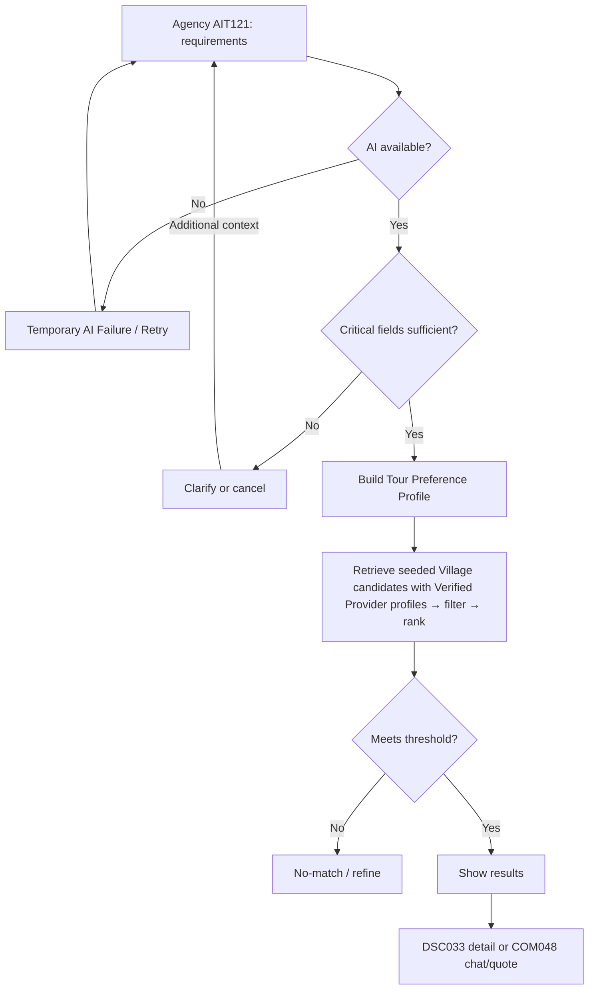
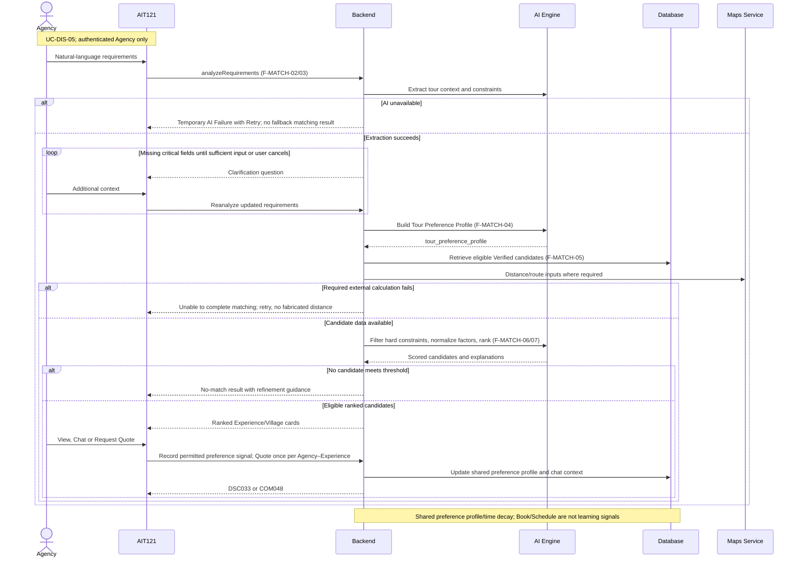

# Spec Document: AI Tour Matching

| **Field**                 | **Value**                                                                                                                   |
|---------------------------|-----------------------------------------------------------------------------------------------------------------------------|
| Module ID                 | AIT                                                                                                                         |
| Module name               | AI Tour Matching                                                                                                            |
| Spec version | v0.2 — consistency revision |
| Author (team member)      | Group G                                                                                                                     |
| Date | 28/09/2026 |
| Status | Revised — pending human approval |
| Approved by (Client role) | Pending human approval |
| DBIZ2 source              | Function List rows **F-MATCH-01 .. F-MATCH-16**; Use Case **UC-DIS-05**; Screens **AIT121, EXP017, DSC122, DSC033, COM048** |

Shared actor/state/field definitions: [Consistency Contract](../docs/consistency-contract.md). Exact current Function contracts are in §5/5.1. Technical choices and unresolved field-design questions are explicitly separated there.

**1. Purpose and scope (mandatory)**

> The AI Tour Matching module helps authenticated Tour Agencies describe tour requirements in natural language and receive ranked Local Provider/Experience recommendations that fit those requirements. It also learns Agency preferences from matching and related interactions so later recommendations and personalized discovery can become more relevant.

**In scope**

- Open AI Tour Matching for authenticated Tour Agencies.

- Capture natural-language tour requirements.

- Analyze requirements and ask follow-up questions where information is incomplete.

- Build a structured Tour Preference Profile.

- Retrieve verified Local Provider/Experience candidates.

- Check route, availability, capacity, budget and other hard constraints.

- Score and rank candidates.

- Generate recommendations and explanations.

- Allow Tour Agency to refine requirements and regenerate recommendations.

- Save Agency Preference Profile.

- Initiate Request Quote or Chat from matching recommendations.

- Handle no-match cases.

- Capture post-matching Chat signals.

- Apply time decay to historical Agency preference signals.

- Update Agency preferences and personalized Explore ranking.

**Out of scope**

- Guest access to the AI Tour Matching interface.

- Local Provider use of AI Tour Matching.

- Direct creation or confirmation of Bookings by the Tour Agency.

- Manual modification of Local Provider/Experience data.

- Provider profile verification.

- Global Explore-ranking KPI optimization, which belongs to the Explore Learning Loop.

- Chat message management itself; this belongs to the In-app Chat module.

- Booking lifecycle management after negotiation.

**Depends on**

| **Dependency**                                     | **Purpose**                                                                                                  |
|----------------------------------------------------|--------------------------------------------------------------------------------------------------------------|
| **AUT – Authentication, Access & User Management** | Ensures only authenticated Tour Agencies access AI Matching and checks permission before Request Quote/Chat. |
| **PRF – Profile Management**                       | Supplies verified Provider and Experience data, pricing, capacity, location and booking conditions.          |
| **EXP – Explore**                                  | Consumes Agency Preference Profile and receives personalized re-ranking output.                              |
| **CHAT – In-app Chat**                             | Used when Agency selects Chat or Request Quote from recommendations.                                         |
| **Schedule / Booking**                             | Supplies availability/capacity-related constraints used in matching.                                         |
| **OpenAI API**                                     | Supports natural-language understanding and AI processing.                                                   |
| **Google Maps API**                                | Supports route and distance calculation.                                                                     |

**2. Actors (mandatory)**

| **Actor**                       | **Role in this module**                                                                                                      | **Where it comes from**           |
|---------------------------------|------------------------------------------------------------------------------------------------------------------------------|-----------------------------------|
| **Tour Agency**                 | Primary user who enters requirements, receives recommendations, refines them and initiates Quote/Chat                        | F-MATCH-01, 02, 09                |
| **System / AI Matching Engine** | Analyzes requirements, creates profiles, retrieves/filter/scores candidates, generates recommendations and performs learning | F-MATCH-03 .. 08, 10 .. 16        |
| **Guest**                       | Unauthorized actor; cannot access or see the AI Matching interface                                                           | F-MATCH-01 access rule            |
| **OpenAI API**                  | External AI processing dependency                                                                                            | System Configuration              |
| **Google Maps API**             | External route/distance calculation dependency                                                                               | F-MATCH-06 / System Configuration |
| **Chat module**                 | Supplies post-matching interaction signals and receives Quote/Chat handoff                                                   | F-MATCH-11, 13, 14                |

**3. User scenarios and acceptance criteria (mandatory)**

Because the final Use Case contains **one AI Tour Matching use case**, this section contains one main user scenario with acceptance cases covering its subfunctions.

## **US-1 (P1): AI Tour Matching — UC-DIS-05**

**Journey.** As a Tour Agency, I want to describe my tour needs conversationally and receive relevant Experience recommendations so that I can identify suitable Local Providers efficiently.

### **Acceptance scenarios**

1.  Given an authenticated Tour Agency, when it opens AI Tour Matching, then the matching interface is displayed.

2.  Given a Guest attempts to access AI Tour Matching directly, then the interface is not displayed and the Guest is redirected to Login.

3.  Given the Agency enters natural-language requirements, when the system analyzes them, then a structured tour context is produced.

4.  Given critical information is missing or unclear, when analysis completes, then the system asks contextual follow-up questions instead of immediately producing final recommendations.

5.  Given the requirements are sufficiently complete, when matching runs, then only eligible verified candidates are evaluated.

6.  Given candidates violate mandatory route, budget, capacity, availability or other hard constraints, then those candidates are excluded.

7.  Given eligible candidates exist, when scoring completes, then the system displays ranked recommendations with a match explanation.

8.  Given the Agency modifies its requirements, when it continues the matching conversation, then the Tour Preference Profile and recommendations are updated.

9.  Given no acceptable candidate exists, when matching finishes, then the system presents fallback suggestions such as relaxing budget, distance or dates.

10. Given the Agency selects **Request Quote**, then permission is checked, the persistent Quote Request for that Agency–Experience pair is created or reused, the applicable Agency–Provider Chat is opened or reused, and **no Booking is created**.

11. Given the Agency selects **Chat**, then the existing/new Provider conversation is opened without automatically creating a Booking.

12. Given preference information has been captured, then the Agency Preference Profile may be saved for future matching and personalized Explore.

13. Given a matching-linked Chat interaction window produces post-matching signals, then those signals may update the Agency Preference Profile according to the defined learning rules without closing the persistent Chat itself.

14. Given old and recent preference signals coexist, then recent signals receive greater influence using the configured exponential 30-day half-life decay rule.

The Screen List describes AIT121 as a single chat-based matching screen where requirements are analyzed/refined and recommendations are returned directly in the conversation.

### **Edge cases**

- Agency submits an empty message.

- Agency enters highly ambiguous requirements.

- No verified Experiences exist.

- All candidates fail a hard constraint.

- Google Maps route/distance service is unavailable.

- AI processing service is unavailable.

- Agency changes constraints after recommendations have already been displayed.

- Same Experience has already received a Quote Request.

- Matching-linked Chat remains persistent but reaches the learning-loop inactivity threshold.

- Time-decay batch runs while new signals are being written.

### Consistency acceptance examples

| AC ID | Given / When | Expected result |
|---|---|---|
| AC-AIT-ORDER | Agency supplies complete critical tour fields | Build current profile before retrieval/ranking; no use of undefined profile. |
| AC-AIT-FAIL | AI extraction unavailable | Show Temporary AI Failure and Retry; no fabricated rule-based match. |
| AC-AIT-CLARIFY | Agency omits group_size | Ask clarification and reanalyze added context before final results. |

**4. Flows (mandatory)**

**4.1 Usage flow**

**4.2 Sequence for the main flow**

**5. Functional requirements (mandatory)**

| FR ID | Function List ID | Requirement — system MUST | Actor | Priority |
|---|---|---|---|---|
| FR-001 | F-MATCH-01 | Open a conversation session for Tour Agency to input tour requirements using natural language.  ACCESS CONTROL: - Tour Agency: Full access, AI Matching interface shown - Guest: CANNOT see AI Matching feature interface at all (button/feature not visible, not just disabled). Redirect to Login page if Guest tries to access /ai-matching URL This feature is Tour Agencies ONLY. | Tour Agency / Guest | Must |
| FR-002 | F-MATCH-02 | Capture Agency's natural language description of the tourist group, tour, requirements, and expectations. | Tour Agency | Must |
| FR-003 | F-MATCH-03 | Analyze the Agency's natural-language input to extract tour context, route/travel preferences, Experience preferences and operational requirements. Check whether critical matching information is sufficiently complete. If important information is missing or unclear, generate contextual follow-up questions and incorporate the Agency's response into the matching context. If the AI service times out or is unavailable, preserve the conversation and return Temporary AI Failure with a retry option. Do not invent extracted requirements or proceed with candidate scoring from incomplete AI output. | System | Must |
| FR-004 | F-MATCH-04 | Convert the understood tour requirements into a structured Tour Preference Profile containing hard constraints, matching attributes, inferred preferences and relative preference weights. | System | Must |
| FR-005 | F-MATCH-05 | Retrieve candidate Experiences belonging to eligible Local Providers with currently published Verified profiles from the seeded Village catalog based on the Tour Preference Profile. Providers without a currently published Verified profile version are excluded from AI Matching. Village itself has no separate verification lifecycle in MVP. | System | Must |
| FR-006 | F-MATCH-06 | Calculate route/distance compatibility and filter candidates against mandatory constraints such as date/date-range availability, capacity, budget and route feasibility. This is a preliminary hard-constraint check at day or date-range level. Exact start/end time-slot availability, operating-window fit, overlap and atomic occupancy are validated later when F-SCHED-03 creates the Booking. | System | Must |
| FR-007 | F-MATCH-07 | Evaluate eligible candidates based on Experience fit, route relevance, preference alignment, distinctiveness and other configured ranking factors. Calculate overall match scores and produce a ranked candidate list. | System | Must |
| FR-008 | F-MATCH-08 | Generate and display the highest-ranked Experience recommendations and additional suitable suggestions, together with concise explanations of why each recommendation matches the Agency's requirements. Tour Agency can View Details, Request Quote or Chat with the Provider. | System | Must |
| FR-009 | F-MATCH-09 | Allow Agency to add/modify requirements and continue the conversation.Update Tour Preference Profile and re-run matching when Agency changes requirements. | Tour Agency | Must |
| FR-010 | F-MATCH-10 | Save or update the Agency Preference Profile using preferences identified from the completed AI Matching session. The profile is Agency-specific and may be reused by future AI Matching sessions and personalized Explore ranking. | System | Should |
| FR-011 | F-MATCH-11 | When Tour Agency selects Request Quote or Chat from a recommendation, system verifies permission through F-AUTH-16. For Request Quote, create a Quote Request record and open the Chat with relevant Experience/Agency context. For direct Chat, open or create the conversation without creating a new Quote Request. Booking is created later by Local Provider through Schedule/Booking. Quote Request uniqueness is enforced per Agency–Experience pair. The first Request Quote creates the Quote Request. Subsequent Request Quote actions for the same Agency and Experience reuse the same Quote Request and do not create duplicates, including after a Booking is created or cancelled.  Chat sessions are scoped per Agency–Local Provider pair, not per Experience or Quote Request. If an Active Chat already exists between the Agency and the Local Provider, reuse that Chat and append the new Experience/Quote Request context as a message. If no Active Chat exists, create a new Active Chat. Closed Chat sessions are retained as history and are never reopened. | System | Should |
| FR-012 | F-MATCH-12 | If no matches found (score < threshold), suggest criteria relaxation (extend budget, extend distance, relax dates) or prompt to continue conversation. | System | Must |
| FR-013 | F-MATCH-13 | Detect the end of an AI-Matching-related interaction window when either: (1) the participant explicitly closes the Chat through F-CHAT-04, or (2) the conversation has been inactive for 30 minutes. Generate a post-matching learning event for subsequent signal processing. | System | Should |
| FR-014 | F-MATCH-14 | Extract signals from chat: experience interest level, questions asked, follow-up indicators. Signals are used to update the Agency Preference Profile and evaluate recommendation quality; foundational AI model retraining is outside MVP. Tour Agency CANNOT see interaction logs. Signals are extracted from Chat text using the AI semantic classifier and mapped only to the fixed signal taxonomy above. Explicit platform actions such as Request Quote are captured deterministically rather than inferred from text. | System | Should |
| FR-015 | F-MATCH-15 | Apply historical time decay to Agency preference signals so that newer matching and post-matching interaction signals receive greater influence than older signals. The background process runs periodically and produces reweighted Agency preference signals for future matching and Explore personalization. | System | Should |
| FR-016 | F-MATCH-16 | Update the Agency Preference Profile using the reweighted signals from F-MATCH-15 and re-rank Explore results for that specific Agency. The update applies only to the individual Agency and does not modify the global Explore ranking for other users. | System | Should |

**5.1 Input / Output contract**

| FR ID | Input fields and validation | Required | Output fields | Notes |
|---|---|---|---|---|
| FR-001 | page_request (HTTP request; Required) session_role (Enum; Required — used to block Guest) | As specified per field | ai_matching_view (UI View; Optional — Tour Agency)  matching_session_id (ID; Optional — created when an authorized Tour Agency successfully opens the AI Matching interface)  login_redirect_url (URL; Optional — Guest) | Same contract as F-MATCH-01; optional fields are not required. |
| FR-002 | matching_session_id (ID; Required)  message_text (Text, max 2000 characters; Required) | As specified per field | conversation_message (Object{message_id, session_id, sender, text, sent_at}; Required) | Same contract as F-MATCH-02; optional fields are not required. |
| FR-003 | conversation_context (Array<Message>; Required) | As specified per field | tour_context (Object{   tour_purpose: String Optional,   group_size: Integer Optional,   visitor_profile: String Optional,   target_date_or_range: Object Optional,   desired_duration: Integer Optional,   origin_or_route: Object Optional,   travel_intensity: Enum[Low, Medium, High] Optional,   distance_preference: Object Optional,   experience_types: Array<Enum> Optional,   experience_intensity: Enum[Low, Medium, High] Optional,   budget: Object Optional,   special_requirements: Array<String> Optional }; Required)  is_complete (Boolean; Required — true when group_size, target_date_or_range, origin_or_route and at least one experience preference are available)  follow_up_questions (Array<String>; Optional — only for missing/unclear critical fields)  processing_status (Enum[Success, Temporary AI Failure]; Required)  retry_available (Boolean; Required) | Same contract as F-MATCH-03; optional fields are not required. |
| FR-004 | tour_context (Object; Required)  domain_attributes (Array<Enum[   Tour Purpose,   Group Size,   Visitor Profile,   Duration,   Route,   Travel Intensity,   Distance Preference,   Experience Type,   Experience Intensity,   Commercial/Shopping Preference,   Availability/Capacity,   Budget ]>; Required) | As specified per field | tour_preference_profile (Object; Required), with: - hard_constraints (Object; Required) - matching_attributes (Array; Required) - inferred_preferences (Array; Optional) - preference_weights (Map<String, Decimal 0–1>; Required — non-hard-constraint preference weights are normalized so their total equals 1.0) | Same contract as F-MATCH-04; optional fields are not required. |
| FR-005 | tour_preference_profile (Object; Required) seeded_village_catalog (Data source; Required) verified_provider_catalog (Data source; Required) | As specified per field | candidates (Array<Object{experience_id, provider_id, village_id}>; Required — may be empty) | Same contract as F-MATCH-05; optional fields are not required. |
| FR-006 | candidates (Array<Object{experience_id, provider_id, village_id}>; Required — from F-MATCH-05)  route (Object{   origin_address: String,   destination_address: String Optional,   waypoints: Array<String> Optional }; Required — derived from Tour Context)  candidate_locations (Array<Object{experience_id, location}>; Required — resolved for the candidates)  hard_constraints (Object{availability, capacity, budget}; Required) | As specified per field | eligible_candidates (Array<Object>; Required — candidates that satisfy mandatory availability, capacity, budget and route constraints; may be empty)  route_distance_data (Array<Object{   experience_id,   distance_km,   travel_time_minutes }>; Required — calculated using the configured Google Maps routing service) | Same contract as F-MATCH-06; optional fields are not required. |
| FR-007 | eligible_candidates (Array<Object>; Required) tour_preference_profile (Object; Required) | As specified per field | ranked_candidates (Array<Object>; Required), each with: - experience_id (ID; Required) - match_score (Decimal 0–100; Required) - experience_fit_score (Decimal 0–100; Required) - rank (Integer >= 1; Required) | Same contract as F-MATCH-07; optional fields are not required. |
| FR-008 | ranked_candidates (Array<Object>; Required) | As specified per field | top_matches (Array<Object{experience_id, rank, match_score, explanation}>; Required — maximum 5 highest-ranked eligible Experiences)  additional_suggestions (Array<Object>; Optional — up to 5 additional eligible Experiences after the Top 5) | Same contract as F-MATCH-08; optional fields are not required. |
| FR-009 | matching_session_id (ID; Required) message_text (Text; Required) | As specified per field | conversation_message (Object; Required) updated_tour_preference_profile (Object; Optional — when requirements change) updated_recommendations (Array<Object>; Optional — when matching is re-run) | Same contract as F-MATCH-09; optional fields are not required. |
| FR-010 | agency_id (ID; Required) matching_session_id (ID; Required) tour_preference_profile (Object; Required) | As specified per field | agency_preference_profile (Object; Required — persistent Agency-specific preference profile updated from the completed matching session)  updated_at (DateTime; Required) | Same contract as F-MATCH-10; optional fields are not required. |
| FR-011 | experience_id (ID; Required) agency_id (ID; Required — from session) action_source (Enum[Request Quote, Chat]; Required) matching_session_id (ID; Optional) | As specified per field | chat_session_id (ID; Required)  quote_request_id (ID; Optional — Request Quote only; references one persistent Quote Request for the Agency–Experience pair)  is_new_request (Boolean; Optional — Request Quote only) | Same contract as F-MATCH-11; optional fields are not required. |
| FR-012 | matching_criteria (Tour Preference Profile; Required) results (Array<Object>; Required — empty or below threshold) score_threshold (Decimal 0–100; Required — default 60) | As specified per field | relaxation_suggestions (Array<Object{criterion: Enum[Budget, Distance, Dates], suggested_value}>; Optional) conversation_prompt (Text; Optional) | Same contract as F-MATCH-12; optional fields are not required. |
| FR-013 | chat_session_id (ID; Required) last_activity_at (DateTime; Required) agency_id (ID; Required) experience_id (ID; Required) matching_session_id (ID; Required — only matching-linked chats) chat_closed_event (Object{chat_session_id, closed_at}; Optional — from F-CHAT-04) | As specified per field | chat_session_end_event (Object{chat_session_id, ended_at, end_reason: Enum[Chat Closed, Inactive 30 min]}; Required — does not close the Chat) | Same contract as F-MATCH-13; optional fields are not required. |
| FR-014 | chat_messages (Array<Message>; Required) chat_session_metadata (Object; Required) experience_id (ID; Required) previous_tour_preference_profile (Object; Required) | As specified per field | preference_signals (Array<Object{   signal_type: Enum[     Positive Experience Interest,     Negative Experience Interest,     Price Concern,     Availability Concern,     Capacity Concern,     Route/Distance Concern,     Experience Preference,     Follow-up Intent   ],   value,   confidence_score: Decimal 0–1,   captured_at }>; Required) | Same contract as F-MATCH-14; optional fields are not required. |
| FR-015 | historical_signals (Array<Object>; Required) recent_matching_signals (Array<Object>; Optional) chat_signals (Array<Object>; Optional) decay_parameters (Object{   model: Enum[Exponential Half-life],   half_life_days: Integer = 30 }; Required) | As specified per field | reweighted_signals (Array<Object{signal, weight: Decimal}>; Required) effective_weight = base_weight × 0.5^(age_days / 30) | Same contract as F-MATCH-15; optional fields are not required. |
| FR-016 | agency_preference_profile (Object; Required) reweighted_signals (Array<Object>; Required) | As specified per field | updated_agency_preference_profile (Object; Required)  reranked_explore_list (Array<Object{   experience_id: ID,   rank: Integer,   score: Decimal }>; Required — generated immediately for the affected Agency only)  updated_at (DateTime; Required) | Same contract as F-MATCH-16; optional fields are not required. |

**5.2 Business rules**

| **Rule ID** | **Rule**                                                                                                         | **Why it exists**                                                   |
|-------------|------------------------------------------------------------------------------------------------------------------|---------------------------------------------------------------------|
| **BR-001**  | AI Tour Matching is available only to authenticated Tour Agencies.                                               | Prevents public/unauthorized use.                                   |
| **BR-002**  | Guest must not see the AI Matching interface; direct access redirects to Login.                                  | Enforces feature access consistently.                               |
| **BR-003**  | Only Experiences belonging to eligible Verified Local Providers with a currently published Verified profile version may enter AI Matching candidate retrieval. | Prevents unverified or unpublished Provider content from being recommended. |
| **BR-004**  | Missing critical requirements must trigger clarification before final matching proceeds.                         | Avoids recommendations based on materially incomplete requirements. |
| **BR-005**  | Hard constraints are evaluated before final scoring/ranking.                                                     | Prevents high-scoring but infeasible recommendations.               |
| **BR-006**  | Ranking must be based on the Tour Preference Profile and configured matching factors.                            | Keeps recommendations tied to Agency requirements.                  |
| **BR-007**  | Recommendation explanations must state why an Experience matches the Agency requirements.                        | Provides interpretable results.                                     |
| **BR-008**  | Agency may refine requirements and re-run matching within the same conversation.                                 | Supports conversational search.                                     |
| **BR-009**  | Request Quote is an interest/pre-negotiation action and is **not a Booking**.                                    | Keeps Booking lifecycle under Local Provider control.               |
| **BR-010**  | A Booking is created later only through Schedule/Booking after negotiation.                                      | Preserves module responsibility.                                    |
| **BR-011**  | No-match results must provide criteria-relaxation or continuation options rather than an empty dead end.         | Maintains usable matching flow.                                     |
| **BR-012**  | Only Chat sessions associated with AI Matching should contribute to the matching post-interaction learning loop. | Prevents unrelated conversations from polluting preferences.        |
| **BR-013**  | Recent preference signals receive higher weight than older signals through time decay.                           | Keeps Agency preferences current.                                   |
| **BR-014**  | F-MATCH-16 personalizes results for the **same Agency**, not the global Explore ranking algorithm.               | Separates per-Agency learning from global Explore optimization.     |
| **BR-015**  | Tour Agency cannot directly inspect raw internal interaction-signal logs.                                        | Keeps internal learning metadata separate from user-facing data.    |
| **BR-016**  | A Matching Session is created when an authorized Tour Agency successfully opens the AI Matching interface. | Provides a stable conversation context before the first message. |
| **BR-017**  | If AI processing is temporarily unavailable or critical requirements remain incomplete, the conversation is preserved and candidate scoring must not proceed from incomplete AI output. | Prevents fabricated or invalid recommendations. |
| **BR-018**  | Quote Request uniqueness is enforced per Agency–Experience pair. The first Request Quote creates the record; subsequent Request Quote actions for the same pair reuse it, including after a Booking is created or cancelled. | Prevents duplicate Quote Requests for the same commercial context. |
| **BR-019**  | At most one Active Chat exists per Agency–Local Provider pair. Experience and Quote Request references provide context but do not create separate Chat threads; Closed Chats remain history and are not reopened. | Keeps communication continuity across multiple Experiences and Quote Requests. |
| **BR-020**  | The default no-match threshold is 60/100. | Keeps fallback behavior deterministic. |
| **BR-021**  | Historical preference signals use exponential half-life decay with half_life_days = 30. | Gives newer signals progressively greater influence without arbitrary interpolation cutoffs. |
| **BR-022**  | F-MATCH-16 immediately produces an Agency-specific reranked Explore list together with the updated Agency Preference Profile; it does not change the global Explore ranking for other users. | Keeps personalization scoped to the affected Agency. |

**6. Key entities (mandatory)**

| **Entity**                    | **Attributes from Input/Output**                                                | **Relationships**                               |
|-------------------------------|---------------------------------------------------------------------------------|-------------------------------------------------|
| **Matching Session**          | matching_session_id, agency_id, conversation context                            | belongs to one Tour Agency                      |
| **Conversation Message**      | message_id, session_id, sender, text, sent_at                                   | belongs to one Matching Session                 |
| **Tour Context**              | extracted requirements, constraints, preferences, completeness state            | derived from Matching Session                   |
| **Tour Preference Profile**   | hard_constraints, matching_attributes, inferred_preferences, preference_weights | belongs to one Matching Session                 |
| **Candidate Experience**      | experience_id, provider_id, village_id, location                                | references Experience, Provider and Village     |
| **Route Distance Record**     | experience_id, distance, travel_time                                            | belongs to Candidate Experience evaluation      |
| **Ranked Candidate**          | experience_id, match_score, experience_fit_score, rank                          | derived from candidate evaluation               |
| **Recommendation**            | experience_id, rank, match_score, explanation                                   | produced from Ranked Candidate                  |
| **Agency Preference Profile** | agency_id, preference signals/weights, updated_at                               | belongs to one Tour Agency                      |
| **Quote Request**             | quote_request_id, agency_id, experience_id                                      | initiates Chat; does not create Booking         |
| **Preference Signal**         | signal_type, value, confidence_score, captured_at                               | belongs to Agency / Matching-linked interaction |
| **Chat Session End Event**    | chat_session_id, ended_at, end_reason                                           | triggers post-matching signal processing        |
| **Reweighted Signal**         | preference signal, time-decayed weight using exponential 30-day half-life       | updates Agency Preference Profile               |

**7. Screens involved**

| Screen ID | Screen name | Functions in this module |
|---|---|---|
| AIT121 | AI Tour Matching | F-MATCH-01, F-MATCH-02, F-MATCH-03, F-MATCH-04, F-MATCH-05, F-MATCH-06, F-MATCH-07, F-MATCH-08, F-MATCH-09, F-MATCH-10, F-MATCH-11, F-MATCH-12, F-MATCH-13, F-MATCH-14, F-MATCH-15, F-MATCH-16 |

**8. Success criteria (mandatory)**

| **SC ID**  | **Criterion**                                                                                                         | **How it is measured**                                                                     |
|------------|-----------------------------------------------------------------------------------------------------------------------|--------------------------------------------------------------------------------------------|
| **SC-001** | Guests cannot see or access the AI Tour Matching interface.                                                           | Test Guest UI and direct /ai-matching access.                                              |
| **SC-002** | Tour Agency can describe requirements in natural language and receive either a follow-up question or matching result. | Run representative complete and incomplete prompts.                                        |
| **SC-003** | Candidates failing mandatory constraints are not shown as valid recommendations.                                      | Seed candidates that violate budget/capacity/route/availability and inspect results.       |
| **SC-004** | Every displayed top recommendation contains a match explanation.                                                      | Inspect all recommendation cards in test sessions.                                         |
| **SC-005** | Refining requirements changes the profile/recommendation set when the changed criterion affects matching.             | Compare results before and after a meaningful refinement.                                  |
| **SC-006** | No-match conditions return actionable fallback suggestions rather than an empty result.                               | Use deliberately impossible requirements.                                                  |
| **SC-007** | Request Quote from matching opens the appropriate communication flow without creating a Booking.                      | Execute Request Quote and inspect Quote/Chat/Booking records.                              |
| **SC-008** | Only matching-linked Chat interaction signals contribute to the matching learning loop.                               | Compare matching-linked versus unrelated Chats.                                            |
| **SC-009** | Older preference signals have less influence than recent signals after time decay.                                    | Compare known signals at different ages after the scheduled decay process.                 |
| **SC-010** | Preference updates affect only the relevant Agency's personalized results, not another Agency's profile.              | Run two Agency accounts with different interaction histories and compare profiles/results. |

**9. Assumptions**

- Tour Agency is authenticated before a Matching Session can begin.

- Candidate retrieval uses Experiences of Providers with a published Verified profile; Experience has no separate verification state.

- Profile Management and Schedule/Booking provide the data required for price, capacity, location and availability constraints.

- AI Tour Matching and Explore use the same shared Agency Preference Profile.

- F-MATCH-13–16 are treated as the **post-matching learning loop** within the AI Tour Matching module even though their Function Name currently says Update Explore After Chat with Time Decay.

- F-MATCH-16 changes personalized Explore ranking for one Agency; it does not replace the global Explore Learning Loop.

- The current DBIZ2 Sequence Diagram represents only part of F-MATCH-01–16 and does not fully show Quote/Chat, no-match and post-Chat learning.

- Chat itself remains persistent. A 30-minute inactivity boundary or explicit Chat close produces a learning-analysis window end event for signal processing; the F-MATCH-13 event does not itself close the persistent Chat.

## Clarifications

- 2026-10-30 #23: The Budget suggestion is the lowest `price_per_person` among candidates passing every other hard constraint; none if no candidate passes without the budget constraint.
- 2026-10-30 #24: Capacity no-match is explained in `conversation_prompt` with the seed-derived largest accepted group; the criterion enum stays [Budget, Distance, Dates].
- 2026-10-30 #25: Explanations mention only evaluated profile factors (craft preference, capacity, budget, estimated distance); never a craft the Agency did not ask for.
- 2026-10-30 #26: Craft preference is matched against the Provider's published `craft_type` enum; no hard-coded village or Experience names.
- 2026-10-30 #27: Failure shows "Temporary AI Failure — we couldn't process your request right now. Your conversation is saved." + "Retry"; Quote/Chat failure shows "Could not complete the request. Nothing was created." + "Retry"; no fabricated results.
- 2026-10-30 #28: Guest is redirected to Login; an authenticated non-Agency actor sees an access-restricted page.
- 2026-10-30 #29: All OQ #4 critical fields are required before matching; none is defaulted.
- 2026-10-30 #30: Candidates below 60/100 are not shown; if none reaches 60, the no-match response is returned.
- 2026-10-30 #31: After a successful Request Quote or Chat, the Agency is taken to COM048 with that Chat selected.

**10. Open questions**

| **\#** | **Question**                                                                                                                                                                                                      | **Blocking?** | **Owner**    | **Status** | **Answer / Decsion**                                                                                                                                           |
|--------|-------------------------------------------------------------------------------------------------------------------------------------------------------------------------------------------------------------------|---------------|--------------|------------|----------------------------------------------------------------------------------------------------------------------------------------------------------------|
| 1 | Is matching_session_id created when AIT121 opens or only after the Agency sends its first message? | No | Tech / BA | Closed | Created when an authorized Tour Agency successfully opens the AI Matching interface. |
| 2 | What is the maximum length of a natural-language matching message? | No | Tech | Closed | 2,000 characters. |
| 3 | What exact fields are extracted into tour_context? | No | BA / AI | Closed | tour_purpose, group_size, visitor_profile, target_date_or_range, desired_duration, origin_or_route, travel_intensity, distance_preference, experience_types, experience_intensity, budget, and special_requirements. |
| 4 | Which fields are considered critical before requirements are “complete”? | No | BA / AI | Closed | group_size, target_date_or_range, origin_or_route, and at least one Experience preference. |
| 5 | What is the canonical matching-domain attribute taxonomy? | No | BA / AI | Closed | Tour Purpose, Group Size, Visitor Profile, Duration, Route, Travel Intensity, Distance Preference, Experience Type, Experience Intensity, Commercial/Shopping Preference, Availability/Capacity, and Budget. |
| 6 | What weight scale/normalization rule is used in Tour Preference Profile? | No | AI / Tech | Closed | Non-hard-constraint preference weights use a decimal scale from 0.0 to 1.0 and are normalized so their total equals 1.0. |
| 7 | What exact route structure is required: origin, destination and/or waypoints? | No | BA / Tech | Closed | origin_address is required; destination_address is optional; waypoints are optional. The structure is used for route/distance calculation, not turn-by-turn directions. |
| 8 | What units are used for distance and travel time? | No | Tech | Closed | Kilometers (km) and Minutes (min). |
| 9 | Is Google Maps definitively the route/distance source for F-MATCH-06? | No | Tech | Closed | Yes, Google Maps API (Distance Matrix). |
| 10 | Is match_score represented as 0–1, 0–100, or another scale? | No | AI / BA | Closed | 0–100 percentage scale for better user readability. |
| 11 | How many Top Matches are displayed before Additional Suggestions? | No | UI/UX / BA | Closed | Up to 5 Top Matches, followed by up to 5 additional eligible suggestions. |
| 12 | What is the exact schema of the saved Agency Preference Profile? | No | BA / AI | Closed | A JSON object mapping domain attributes (e.g., category, price tier, vibes) to their accumulated, time-decayed weights. |
| 13 | What fields constitute a Quote Request record? | No | BA | Closed | The matching contract requires quote_request_id, agency_id and experience_id as the persistent Quote Request identity/context. Requested date, group size and initial message are not part of the canonical F-MATCH-11 uniqueness rule. |
| 14 | When should an existing Quote Request be reused rather than creating a new one? | No | BA | Closed | Reuse the same persistent Quote Request for every subsequent Request Quote action involving the same Agency–Experience pair, regardless of date, Booking creation or later Booking cancellation. |
| 15 | What score threshold defines the no-match condition? | No | AI / BA | Closed | Default threshold: 60/100. |
| 16 | Does a 30-minute inactivity period truly “end” a persistent Chat, or only close a learning-analysis window? | No | BA / Tech | Closed | It only closes the learning-analysis window; the Chat session itself remains persistent. |
| 17 | What Chat signal types are extracted and how are they calculated? | No | AI / BA | Closed | Fixed signal taxonomy: Positive Experience Interest, Negative Experience Interest, Price Concern, Availability Concern, Capacity Concern, Route/Distance Concern, Experience Preference, and Follow-up Intent. Chat-text signals are extracted by the AI semantic classifier with confidence scores; explicit platform actions such as Request Quote are captured deterministically rather than inferred from text. |
| 18 | Is “AI model retraining” actually part of MVP execution, or should the learning loop only update Agency Preference Profiles? | No | Product / AI | Closed | F-MATCH-14 captures signals that may be retained for downstream/future model improvement. The AI Tour Matching MVP itself does not execute foundational model retraining. |
| 19 | How is decay calculated between/beyond the stated reference points 1h=1.0, 1 week=0.5 and 1 month=0.2? | No | AI | Closed | Use exponential half-life decay with half_life_days = 30: effective_weight = base_weight × 0.5^(age_days / 30). |
| 20 | Does F-MATCH-16 return a complete reranked Explore list or only an updated preference profile consumed later by F-EXPLORE-10? | No | BA / AI | Closed | It returns the updated Agency Preference Profile and immediately generates a reranked Explore list for that same Agency, together with updated_at. It does not modify the global Explore ranking for other Agencies. |
| 21 | Should the Sequence Diagram be expanded to explicitly cover F-MATCH-11–16? | No | BA | Closed | No. These are asynchronous background processes. Treat them as system background jobs and document them via text to avoid modifying the main sequence diagram. |
| 22 | The current sequence records Book / Schedule as preference signals, while the final Function List explicitly exposes View Details, Quote and Chat from matching. Should Booking/Schedule remain matching signals? | No | BA | Closed | No. Booking/Schedule are not part of the canonical F-MATCH-14 signal taxonomy in the current Function List. Explicit platform actions such as Request Quote are captured deterministically; Booking/Schedule should not be treated as AIT matching signals unless the Function List is revised. |
| 23 | FR-012 says "extend budget" but not to what value. Which budget does the Budget relaxation suggestion propose? | No | BA / AI | **Closed** | The lowest `price_per_person` among the candidates that pass every other hard constraint (capacity, date). If no candidate passes even without the budget constraint, no Budget suggestion is returned. A suggestion that would still give no match is never shown (BR-011). Decided by Vũ Khánh Linh (linhkhanh-vu), 2026-10-30. |
| 24 | FR-012's `criterion` enum is [Budget, Distance, Dates]. What is suggested when capacity (group size) is the reason for no match? | No | BA | **Closed** | The enum is unchanged. The `conversation_prompt` names the failing constraint with the seed-derived figure (for example, the largest group any eligible Experience accepts) and invites the Agency to split or reduce the group. No unrelated fixed Budget value is suggested. Decided by Vũ Khánh Linh (linhkhanh-vu), 2026-10-30. |
| 25 | What must a match explanation (BR-007, FR-008) mention? | No | BA / AI | **Closed** | Only factors that are in the Tour Preference Profile and actually evaluated: craft/Experience preference (matched or not), capacity against group size, price against budget when a budget is given, and distance marked as estimated while route data is mocked. It never claims a fit for a craft the Agency did not ask for. Decided by Vũ Khánh Linh (linhkhanh-vu), 2026-10-30. |
| 26 | How is an Agency craft preference matched to an Experience (e.g. "silk" against Quất Động, whose Provider `craft_type` is Silk/Textile)? | No | BA / Data | **Closed** | The preference is mapped to the Provider `craft_type` enum of `data/04-data-model.md` (silk → Silk/Textile, pottery/ceramics → Ceramics, …) and matched against the Provider's published `craft_type`. Matching by hard-coded village or Experience names is not used. Decided by Vũ Khánh Linh (linhkhanh-vu), 2026-10-30. |
| 27 | What does AIT121 show when AI processing or the server fails (FR-003, BR-017, AIT121 Error state)? | No | UI/UX | **Closed** | Matching: "Temporary AI Failure — we couldn't process your request right now. Your conversation is saved." with a "Retry" button that resends the last message; no recommendation cards are shown. Request Quote / Chat: "Could not complete the request. Nothing was created." with "Retry". No offline or fabricated result and no success message is shown on failure. Decided by Vũ Khánh Linh (linhkhanh-vu), 2026-10-30. |
| 28 | BR-002 redirects a Guest to Login. What does an authenticated actor who is not a Tour Agency (Local Provider, Admin) see on AIT121? | No | UI/UX | **Closed** | A Guest is redirected to Login. An authenticated non-Agency actor sees an access-restricted page (no AI Matching interface, no Matching Session created) whose text does not refer to Guests. Decided by Vũ Khánh Linh (linhkhanh-vu), 2026-10-30. |
| 29 | Must matching wait for all critical fields of OQ #4, or may missing ones be defaulted? | No | BA / AI | **Closed** | Matching waits for all of OQ #4: group_size, target_date_or_range, origin_or_route and at least one Experience preference stated by the Agency. Missing ones produce follow-up questions (BR-004); none is defaulted or invented (FR-003). Decided by Vũ Khánh Linh (linhkhanh-vu), 2026-10-30. |
| 30 | Where is the 60/100 threshold (BR-020, OQ #15) applied? | No | AI / Tech | **Closed** | After ranking: candidates scoring below 60 are not shown. If none reaches 60, the no-match response with relaxation suggestions is returned (FR-012). Decided by Vũ Khánh Linh (linhkhanh-vu), 2026-10-30. |
| 31 | After Request Quote or Chat succeeds on AIT121, is the Chat opened (FR-011, AS-10, AS-11, AIT121 element 8)? | No | UI/UX | **Closed** | Yes, for both actions: only after the action succeeds, the Agency is taken to COM048 with that Chat selected (`/messages?chat_session_id=…`), as Explore does. On failure the #27 message is shown and nothing navigates. Decided by Vũ Khánh Linh (linhkhanh-vu), 2026-10-30. |

**11. Traceability to DBIZ2**

| **Spec section**               | **DBIZ2 source**           | **Location**                                                                                                                                                                          |
|--------------------------------|----------------------------|---------------------------------------------------------------------------------------------------------------------------------------------------------------------------------------|
| **1. Purpose**                 | Schematic design 1.1 / 1.2 | **sheet Schematic1, sections 1.1 System Objectives and 1.2 System Main Functions – AI Tour Matching**                                                                                  |
| **4.1 Usage flow**             | Usage Flow figure          | **sheet Schematic2, Tour Agency flow: “Choose Discovery Method” → “Input Natural Language” → “Use AI Tour Matching Assistant” → “View Local Provider Detail” → interaction decision** |
| **4.2 Sequence**               | Sequence Diagram figure    | **sheet Schematic2, Module 3: AI Tour Matching – UC-DIS-05**                                                                                                                          |
| **5. Functional requirements** | Function List              | **sheet FL&Cost1, F-MATCH-01 .. F-MATCH-16**                                                                                                                                          |
| **7. Screens**                 | Screen List                | **sheet ST, AIT121, EXP017, DSC122, DSC033, COM048; Request Quote – Action**                                                                                                          |
