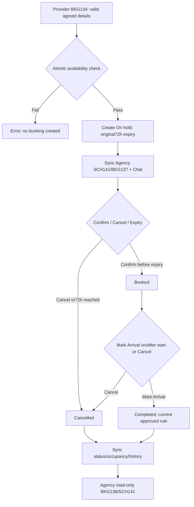

# Spec Document: Schedule/Booking

| **Field**                 | **Value**                                                                                                                                                                          |
|---------------------------|------------------------------------------------------------------------------------------------------------------------------------------------------------------------------------|
| Module ID                 | BKG                                                                                                                                                                                |
| Module name               | Schedule/Booking                                                                                                                                                                   |
| Spec version | v0.2 — consistency revision |
| Author (team member)      | Group G                                                                                                                                                                            |
| Date | 28/09/2026 |
| Status | Revised — pending human approval |
| Approved by (Client role) | Pending human approval |
| DBIZ2 source              | Function List rows **F-SCHED-01 .. F-SCHED-10**; Use Case **UC-BOOK-01 .. UC-BOOK-06**; Screens **BKG133, BKG134, BKG135, BKG144, BKG136, BKG137, BKG138, SCH139, SCH140, SCH141** |

Shared actor/state/field definitions: [Consistency Contract](../docs/consistency-contract.md). Exact current Function contracts are in §5/5.1. Technical choices and unresolved field-design questions are explicitly separated there.

**1. Purpose and scope (mandatory)**

> The Schedule / Booking Management module allows Local Providers to manage the complete lifecycle of their own bookings after agreement with a Tour Agency, and calculates/displays their resulting availability (operating hours are configured separately, on `F-PROFILE-04`). It also provides public Provider schedules and read-only private Agency schedules that stay synchronized with booking changes.

**In scope**

- Display Local Provider public schedule.

- Display Tour Agency private schedule containing only its own bookings.

- Calculate Provider availability (`F-SCHED-09`) from the Provider's operating hours — configured on `F-PROFILE-04` (Edit Local Provider Profile), outside this module — combined with active On hold/Booked Booking blocks. MVP does not include Provider-defined Unavailable or Blackout periods; only operating hours and Booking blocks feed the calculation.

- Local Provider creates a Booking after Agency–Provider negotiation.

- Every new Booking starts as **On hold**.

- On-hold period lasts **72 hours**.

- Local Provider updates Booking details.

- Local Provider changes permitted Booking status.

- Local Provider marks Group Arrival / completion.

- Display full Booking Detail according to actor and lifecycle state.

- Synchronize Booking changes to the Agency Private Schedule.

- Synchronize blocked Provider time to public schedule.

- Notify Agency through Chat auto-message when defined Booking changes occur.

**Out of scope**

- Tour Agency creating, confirming, updating or cancelling a Booking.

- HDT/UBND controlling Booking lifecycle.

- Guest access to private Booking Detail.

- Payment processing.

- Contract/e-contract management.

- Quote negotiation itself; this occurs through Chat before Booking creation.

- Manual editing of On hold/Booked schedule blocks independently of Booking records.

- Configuring operating hours (owned by `F-PROFILE-04` / Edit Local Provider Profile, PRF module) and any manual Provider "Manage Availability" editor screen — this module only calculates and displays the result.

- Provider-defined Unavailable/Blackout periods — not supported anywhere in MVP; the earlier `availability_type` design (Available/Unavailable/Blackout) is dropped.

- Admin override of Completed or Cancelled Booking states unless explicitly added later.

- Full notification-center functionality.

**Depends on**

| **Dependency**                                     | **Purpose**                                                                                          |
|----------------------------------------------------|------------------------------------------------------------------------------------------------------|
| **AUT – Authentication, Access & User Management** | Enforces booking ownership and role/data scope.                                                      |
| **PRF – Profile Management**                       | Supplies Experience, duration, capacity, pricing defaults, booking conditions, and the Provider's operating hours via `F-PROFILE-04` (Edit Local Provider Profile) — the sole input to `F-SCHED-09`'s availability calculation besides active Bookings. |
| **CHAT – In-app Chat**                             | Supplies negotiation context before Booking creation and receives automatic Booking update messages. |
| **EXP / AIT**                                      | May originate Quote/Chat that later results in a Booking.                                            |
| **Background Worker / Scheduler**                  | Handles the 72-hour On hold expiry rule.                                                             |

**2. Actors (mandatory)**

| **Actor**             | **Role in this module**                                                                | **Where it comes from**                |
|-----------------------|----------------------------------------------------------------------------------------|----------------------------------------|
| **Local Provider**    | Primary owner of Booking lifecycle, views Provider availability, and manages its own Booking list | F-SCHED-01, 03–07, 10                  |
| **Tour Agency**       | Views Provider public schedule, own private schedule and own Booking details read-only | F-SCHED-01, F-SCHED-02, F-SCHED-07    |
| **System**            | Synchronizes schedules, calculates Provider availability, and performs automatic Booking-related updates | F-SCHED-08, F-SCHED-09                |
| **Background Worker** | Applies scheduled 72-hour On hold expiry                                               | System Configuration / F-SCHED-03 rule |
| **Chat module**       | Provides source negotiation context and receives booking-update messages               | F-SCHED-03, 04, 05, 08                 |

**3. User scenarios and acceptance criteria (mandatory)**

## **US-1 (P1): View Schedule — UC-BOOK-01**

**Journey.** As a Tour Agency or Local Provider, I want to view schedule information so that I can understand availability and my own booking commitments.

### **Acceptance scenarios**

1.  Given a Local Provider opens its Provider Schedule, when the schedule loads, then operating hours and time blocks with permitted status information are displayed.

2.  Given a Tour Agency opens a Provider's public schedule, then other Agencies' identity, agreed price, contact information and private Booking conditions are not exposed.

3.  Given a Tour Agency opens its private Agency Schedule, then only that Agency's own Bookings are shown.

4.  Given a Booking changes, then the Agency Private Schedule reflects the latest synchronized data.

5.  Given date/status filters are supplied on the private schedule, then only matching Agency-owned Bookings are returned.

UC-BOOK-01 maps to F-SCHED-01 and F-SCHED-02.

## **US-2 (P1): View Calculated Availability — UC-BOOK-02**

**Journey.** As a Local Provider, I want to see my calculated availability so that Agencies see realistic booking windows, without needing a separate manual editor in this module — operating hours are set once on my Profile.

### **Acceptance scenarios**

1.  Given a Local Provider has operating hours configured on `F-PROFILE-04`, when the Provider Schedule or public schedule loads, then `F-SCHED-09` derives and displays availability from those operating hours plus active (On hold/Booked) Booking blocks.

2.  Given an existing On hold or Booked Booking occupies a time range, then that range is shown as unavailable/occupied, and a new Booking cannot be created there.

3.  Given a Completed or Cancelled Booking, then its time range does not block future availability.

4.  Given a Provider has not yet configured operating hours on `F-PROFILE-04`, then `F-SCHED-09` has no basis for availability and the Provider Schedule shows no available periods until operating hours are set.

**Note:** MVP has no manual "Manage Availability" editor and no Unavailable/Blackout period concept — editing operating hours happens only on `F-PROFILE-04`, outside this module. Superseded acceptance criteria that assumed manual availability editing, conflict-on-save blocking, or Unavailable/Blackout periods within this module are removed; see Open Question #25 (Resolved).

UC-BOOK-02 maps to F-SCHED-09.

## **US-3 (P1): View Bookings — UC-BOOK-03**

**Journey.** As a Tour Agency or Local Provider, I want to view a Booking I am involved in so that I can see its current details and status.

### **Acceptance scenarios**

1.  Given a Local Provider opens one of its Bookings, then full Booking detail and status-appropriate action buttons are displayed.

2.  Given a Tour Agency opens one of its own Bookings, then full permitted details are displayed in read-only mode.

3.  Given an Agency attempts to open another Agency's Booking, access is denied.

4.  Given HDT, UBND or Guest attempts to access the operational Booking Detail screen, access is denied.

5.  Given status is terminal, action buttons are not available.

UC-BOOK-03 maps to F-SCHED-07.

## **US-4 (P1): Create Booking — UC-BOOK-04**

**Journey.** As a Local Provider, I want to create a Booking after reaching agreement with a Tour Agency so that the agreed time is reserved and visible to both parties.

### **Acceptance scenarios**

1.  Given Agency and Local Provider have agreed through Chat, when the Provider creates a Booking with valid details, then a new Booking is created with status **On hold**.

2.  The system sets hold_expires_at = created_at + 72 hours.

3.  The corresponding Provider schedule slot becomes blocked as **On hold** immediately.

4.  The Booking is synchronized to the Agency Private Schedule.

5.  Given the requested time conflicts with Provider availability or another On hold/Booked Booking, then creation must not silently create a conflicting Booking.

6.  Tour Agency cannot perform Create Booking.

F-SCHED-03 explicitly states that **every newly created Booking MUST have initial status On hold for 72 hours**.

## **US-5 (P1): Manage Booking — UC-BOOK-05**

**Journey.** As a Local Provider, I want to update and progress my Booking so that its state reflects the actual collaboration with the Tour Agency.

### **Acceptance scenarios**

1.  Given a Booking is On hold, when the Provider confirms it, then it advances to **Booked**.

2.  Given an On hold Booking cannot proceed, the Provider may cancel it.

3.  Given a Booked Booking changes in date/time/group size/agreed price/conditions, then details are updated and schedules are synchronized.

4.  Given a Booked Booking reaches the tour start time and the group arrives, when Provider selects Mark Group Arrival, then status becomes Completed.

5.  Given a Booking becomes Cancelled or Completed, then the Booking remains available as history but no longer exposes lifecycle action buttons.

6.  Every create/update/status/arrival event, including automatic 72-hour On hold expiry, triggers Agency private-schedule synchronization.

7.  Tour Agency sees updated Booking state but cannot change it.

UC-BOOK-05 maps to F-SCHED-04 through F-SCHED-08.

## **US-6 (P1): List Bookings — UC-BOOK-06**

**Journey.** As a Local Provider, I want to see all of my Bookings in one management list, ordered by scheduled start time and highlighting what needs my action, so that I can manage inbound allotments without opening each one individually.

### **Acceptance scenarios**

1.  Given a Local Provider opens Booking Management, when the list loads, then it shows all of that Provider's own Bookings, ordered by scheduled start time.

2.  Given the Provider applies a status filter or date range, then the list recomputes for that scope only.

3.  Given a Booking is an active On hold Booking awaiting confirmation, or a Booked Booking eligible for Mark Group Arrival, then the list highlights it as requiring Provider action.

4.  Given the Provider selects a Booking from the list, then its full detail opens through F-SCHED-07.

5.  Given a Tour Agency or any other actor attempts to call this function for a Provider it does not own, access is denied.

6.  Given the Provider has zero Bookings (or the filter matches none), then the list shows an explicit empty state, not an error.

UC-BOOK-06 maps to F-SCHED-10.

### **Edge cases**

- On hold reaches exactly 72 hours while Provider is confirming it.

- Provider attempts to modify a Completed/Cancelled Booking.

- Two Booking operations try to reserve the same time slot concurrently.

- Provider moves an existing Booking to a conflicting time.

- Agency is offline when Booking changes.

- Chat session referenced for synchronization no longer exists.

- Local Provider attempts Mark Group Arrival before scheduled start time — **must be rejected/disabled by F-SCHED-06 itself (see BR-010); the UI action button's enabled state must reflect this, not status alone (see F-SCHED-07).**


- A Booking expires automatically while the Booking Detail screen is open.

- A schedule sync succeeds for Provider but fails for Agency view.

### Consistency acceptance examples

| AC ID | Given / When | Expected result |
|---|---|---|
| AC-BKG-HOLD | Provider creates valid negotiated booking | On hold with original72h expiry; own Agency schedule includes hold immediately. |
| AC-BKG-RACE | Two valid requests try the same occupied interval | At most one permitted booking commits; failed request creates no block. |
| AC-BKG-EXPIRY | Confirm competes with worker at hold deadline | One conditional transition wins; expired hold is Cancelled; no duplicate event/message. |
| AC-BKG-HOURS | Provider has no configured operating hours and no bookings | No available periods, not fully available. |
| AC-BKG-COMPLETE | Provider selects status on BKG144 | No Completed option; F-SCHED-06 applies the existing arrival/time rule. |

**4. Flows (mandatory)**

**4.1 Usage flow**



**4.2 Sequence for the main flow**

```mermaid
sequenceDiagram
    actor Provider
    actor Agency
    participant UI as Frontend
    participant API as Backend
    participant DB as Database
    participant Worker
    Note over Provider,UI: UC-BOOK-02 SCH139; operating hours edited only on PRF128
    UI->>API: Calculate availability (F-SCHED-09)
    API->>DB: Read operating hours and On hold/Booked occupancy
    API-->>UI: Calculated slots; no operating hours means no available periods
    Note over Provider,UI: UC-BOOK-04 BKG134
    Provider->>UI: Select Agency ID, Experience, time, group and agreed total price
    UI->>API: createBooking (F-SCHED-03)
    API->>API: Validate ownership, Agency identity and input
    API->>DB: Atomically recheck availability and create On hold, expires_at=created_at+72h
    alt Conflict/validation/permission failure
        API-->>UI: Defined error; no Booking or schedule block committed
    else Commit succeeds
        API->>DB: Persist booking event and Agency schedule projection
        API->>API: Resolve Active pair Chat and send booking auto-message (F-SCHED-08)
        API-->>UI: BKG135 On hold
        API-->>Agency: BKG137/SCH141 includes own On hold
    end
    Note over Provider,Worker: UC-BOOK-05 BKG144; confirm vs72h expiry race
    par Provider action
        Provider->>API: Update fields or target_status Booked/Cancelled
        API->>DB: Lock/check current state and original deadline, then permitted atomic transition
    and Expiry worker
        Worker->>API: Expire due On hold booking
        API->>DB: Conditional On hold→Cancelled if deadline reached; record automatic expiry once
    end
    Note over API,DB: At expiry boundary confirmation fails; only one transition wins. Repeated worker does not duplicate events/messages.
    API->>DB: Synchronize resulting schedule and occupancy
    API->>API: Deliver linked chat update; retry without duplicating the committed booking event
    Note over Provider,UI: F-SCHED-06 BKG136; retain current arrival/completion requirement
    Provider->>UI: Mark Group Arrival
    UI->>API: markArrival(booking_id)
    API->>DB: Check owner, Booked status and now>=start_at; set Completed and arrived_at once
    API-->>UI: BKG135 result or defined invalid-state/time error
    Note over Agency,UI: UC-BOOK-01/03 SCH141/BKG137/BKG138; Agency read-only
    Agency->>API: Read own schedule/booking details
    API->>DB: Scope by own organization
    API-->>Agency: Canonical status and latest update; no other Agency details
    Note over Provider,UI: UC-BOOK-06 BKG133 uses F-SCHED-10, own bookings only
```

**5. Functional requirements (mandatory)**

| FR ID | Function List ID | Requirement — system MUST | Actor | Priority |
|---|---|---|---|---|
| FR-001 | F-SCHED-01 | Display a Local Provider's public availability schedule in calendar format for the Local Provider itself and permitted Tour Agencies. Shows: Available time slots (unrestricted), On-hold blocks (time + status badge only), Booked blocks (time + status badge only), operating hours. Does NOT show: Agency name, contact, agreed price, booking conditions, expiry of on-hold. Only shows time blocked + status label. Public Schedule shows duration blocks (Google Calendar style). LP monitors own availability from this view. <br><br>For the Local Provider view, selecting a Booking block or Booking entry on the Provider Schedule navigates to F-SCHED-07 Booking Detail. Booking status is not changed directly by F-SCHED-01.<br><br>Availability displayed by F-SCHED-01 is calculated through F-SCHED-09 from the Provider's configured operating hours and active On hold / Booked Booking blocks. F-SCHED-01 does not provide manual availability editing.<br><br>Unavailable periods represent times outside the Provider's configured operating hours or periods occupied by active Booking constraints. | Tour Agency / Local Provider | Must |
| FR-002 | F-SCHED-02 | Display Tour Agency's private schedule showing only own bookings with FULL details. Shows: Village name, Local Provider name, experience name, dates/times, group size, agreed price, booking conditions (notice period, cancellation policy), current status (On hold / Booked / Completed / Cancelled), last update timestamp. Can filter by: status, village, date range. Syncs real-time when LP updates booking (via F-SCHED-08). Does NOT show: Other agencies' bookings, LP's internal notes. | Tour Agency | Must |
| FR-003 | F-SCHED-03 | Local Provider creates a booking after negotiation with the Tour Agency. The system may pre-fill relevant information from Chat context, including Agency information, selected Experience, interested dates, group size, and estimated budget. Local Provider enters the final booking details, including exact date/time, duration, final group size, agreed price, and booking conditions. Every newly created booking MUST have the initial status "On hold" for 72 hours. The corresponding time slot is immediately blocked on the Provider Public Schedule as an On hold block and synchronized to the Agency Private Schedule. Immediately before committing the Booking, the system atomically re-checks the requested time range against Provider availability and all existing On hold / Booked Bookings.<br><br>If a conflicting block exists, Booking creation is rejected with Slot Unavailable and no Booking record is committed.<br><br>The 72-hour hold countdown starts only after successful Booking creation. <br><br>MVP constraint: Each Booking represents exactly one scheduled occurrence/time block defined by start_at + duration. Multi-slot Bookings are not supported. | Local Provider | Must |
| FR-004 | F-SCHED-04 | Local Provider updates booking details such as date, time, group size, agreed price, or booking conditions. This function updates booking detail fields only; status changes are handled separately by F-SCHED-05. Changes are synchronized immediately to the Agency Private Schedule and the affected Tour Agency is informed of the update. When date/time changes, the new slot is atomically checked against availability and existing On hold/Booked Bookings before the update is committed. | Local Provider | Must |
| FR-005 | F-SCHED-05 | Local Provider manages Booking status transitions according to the official Booking lifecycle:<br><br>On hold → Booked<br>On hold → Cancelled<br>Booked → Cancelled<br><br>Booked → Completed is handled separately through F-SCHED-06 Mark Group Arrival. When status changes, the Agency Private Schedule and Public Provider Schedule are synchronized accordingly. | Local Provider | Must |
| FR-006 | F-SCHED-06 | Local Provider marks group arrival on or after the scheduled tour start date. This action transitions the booking from "Booked" to "Completed". Once completed, the booking becomes historical and no longer blocks Public Schedule availability.<br><br>Before applying Booked → Completed, the server MUST validate:<br>(1) current booking status = Booked; and<br>(2) current server time >= booking.start_at.<br><br>If either condition fails, the transition is rejected and the Booking remains unchanged.<br><br>Mark Group Arrival applies to the Booking as a whole. The MVP does not support per-slot arrival tracking or partial completion. One successful Mark Group Arrival action transitions the entire Booking from Booked to Completed. | Local Provider | Must |
| FR-007 | F-SCHED-07 | Display full booking detail with all information: dates, group size, price, booking conditions (notice period, cancellation policy), status, LP profile link (for Agency), Agency contact (for LP). <br><br>DISPLAY CONTENT: Same for both parties (LP + Agency)<br>- Experience name, dates/times, group size, agreed price<br>- Booking conditions (notice period, cancellation policy)<br>- Current status (On hold / Booked / Completed / Cancelled)<br>- Last update timestamp, LP/Agency contact<br><br>ACTION BUTTONS (Local Provider only):<br><br>- Status "On hold":<br>  [Confirm/Book], [Update], [Cancel] ENABLED.<br><br>- Status "Booked" AND current server time < start_at:<br>  [Update], [Cancel] ENABLED;<br>  [Mark Group Arrival] DISABLED.<br><br>- Status "Booked" AND current server time >= start_at:<br>  [Update], [Cancel], [Mark Group Arrival] ENABLED.<br><br>- Status "Completed":<br>  All buttons DISABLED (View only).<br><br>- Status "Cancelled":<br>  All buttons DISABLED (View only).<br><br>Agency: No action buttons (View only)<br><br>ACCESS CONTROL: <br>- Local Provider: View own bookings + action buttons per status<br>- Tour Agency: View own bookings (Read-only, no buttons)<br>- UBND/HDT/Guest: Cannot access<br><br>Payment processing and payment-status tracking are outside the current MVP scope. agreed_price represents the commercial amount agreed for the Booking and must not be interpreted as proof of payment. | Local Provider / Tour Agency | Must |
| FR-008 | F-SCHED-08 | System event: When LP updates/creates booking via F-SCHED-03/04/05/06, automatically sync changes to Agency's Private Schedule. Triggered on: Create booking (F-SCHED-03), Update details (F-SCHED-04), Status change (F-SCHED-05), Mark arrival (F-SCHED-06), Automatic 72-hour On hold expiry. Sync includes: Update Private Schedule table row, send Chat auto-message to Agency with update summary, mark as "latest update" timestamp. Sync happens in real-time (within seconds) OR on next Agency session load (if Agency not actively viewing Private Schedule). No manual refresh needed by Agency.<br><br>For Booking update messages, the target Chat is resolved in this order:<br>1. use source_chat_session_id when the Booking originated from an Active Chat;<br>2. otherwise use the most recent Active Chat between the same Agency and Local Provider;<br>3. if no Active Chat exists, create a new Active Chat with source = Booking and link it to booking_id before sending the system-generated update message. | System | Must |
| FR-009 | F-SCHED-09 | Calculates the Local Provider's available and occupied time periods for use by the Provider Schedule and public schedule views. The function does not provide manual availability editing on SCH139. Availability is derived from the Provider's configured operating hours together with active Booking blocks. On hold and Booked Bookings occupy their corresponding time ranges and therefore make those periods unavailable for another Booking. Completed and Cancelled Bookings do not block future availability. The calculated result is consumed by F-SCHED-01 when rendering the Provider Schedule and is also used by F-SCHED-03/F-SCHED-04 when checking whether a requested Booking time is available. <br><br>Calculates the Local Provider's available and occupied time periods.<br><br>Baseline availability is derived from the recurring Provider operating_hours configured through F-PROFILE-04.<br><br>On hold and Booked Bookings block their corresponding time ranges.<br>Completed and Cancelled Bookings do not block availability.<br><br>The MVP does not support manually configured blackout dates or ad-hoc unavailable periods. F-SCHED-09 is a calculation function only and does not provide availability-editing controls. | System | Must |
| FR-010 | F-SCHED-10 | Displays the authenticated Local Provider's own Bookings in a management list. Bookings may be filtered by lifecycle status and date range and are ordered by scheduled start time. The list highlights Bookings requiring Provider action, including active On hold Bookings awaiting confirmation and Booked Bookings eligible for Mark Group Arrival. Selecting a Booking opens its full detail through F-SCHED-07. The Local Provider cannot access Bookings belonging to another Provider. | Local Provider | Must |

**5.1 Input / Output contract**

| FR ID | Input fields and validation | Required | Output fields | Notes |
|---|---|---|---|---|
| FR-001 | provider_id (ID; Required — own for Local Provider, selected Provider for Tour Agency)<br><br>date_from (Date; Optional — defaults to current date)<br><br>date_to (Date; Optional — defaults to date_from + 29 days) | As specified per field | calendar_blocks (Array<Object{<br>  start_at,<br>  end_at,<br>  status: Enum[Available, On hold, Booked, Unavailable]<br>}>; Required)<br><br>operating_hours (Object; Required — recurring profile/provider operating hours applicable to the displayed period) | Same contract as F-SCHED-01; optional fields are not required. |
| FR-002 | agency_id (ID; Required — from session)<br>status (Enum[On hold, Booked, Completed, Cancelled]; Optional)<br>village_id (ID; Optional)<br>date_from (Date; Optional)<br>date_to (Date; Optional) | As specified per field | bookings (Array<Object>; Required), each with:<br>- booking_id (ID; Required)<br>- village_name, provider_name, experience_name (String; Required)<br>- start_at, end_at (DateTime; Required)<br>- group_size (Integer; Required)<br>- agreed_price (Decimal; Required)<br>- notice_period, cancellation_policy (see F-PROFILE-06; Required)<br>- status (Enum[On hold, Booked, Completed, Cancelled]; Required)<br>- last_updated_at (DateTime; Required) | Same contract as F-SCHED-02; optional fields are not required. |
| FR-003 | experience_id (ID; Required)<br><br>agency_id (ID; Required)<br><br>start_at (DateTime; Required)<br><br>duration (see F-PROFILE-06; Required)<br><br>group_size (Integer > 0; Required — must be <= Experience max_participants)<br><br>agreed_price (Decimal > 0, VND; Required — total agreed price for the Booking, not per-person price)<br><br>booking_conditions (Object{notice_period, cancellation_policy}; Required — prefilled as a snapshot from the Experience and may be adjusted by the Local Provider before Booking creation)<br><br>source_chat_session_id (ID; Optional — for pre-fill) | As specified per field | booking_id (ID; Required)<br>status (Enum["On hold"]; Required)<br>created_at (DateTime; Required)<br>hold_expires_at (DateTime; Required — created_at + 72h)<br>public_schedule_block (Object{start_at, end_at, status}; Required)<br>private_schedule_synced (Boolean; Required) | Same contract as F-SCHED-03; optional fields are not required. |
| FR-004 | booking_id (ID; Required)<br>start_at (DateTime; Optional — changing date/time does NOT reset hold_expires_at; an On hold Booking retains its original 72-hour expiry)<br>duration (see F-PROFILE-06; Optional)<br>group_size (Integer > 0; Optional)<br>agreed_price (Decimal; Optional)<br>booking_conditions (Object; Optional)<br>(at least one field must be provided) | As specified per field | updated_booking (Object; Required)<br>private_schedule_synced (Boolean; Required)<br>public_schedule_updated (Boolean; Optional — when time/date changes)<br>agency_notification_message_id (ID; Required)<br>audit_log_id (ID; Required) | Same contract as F-SCHED-04; optional fields are not required. |
| FR-005 | booking_id (ID; Required)<br><br>target_status (Enum[Booked, Cancelled]; Required)<br><br>cancellation_reason (Text; Required when target_status = Cancelled; otherwise omitted) | As specified per field | booking_status (Enum; Required)<br>status_history_entry (Object{from_status, to_status, changed_by, changed_at, reason}; Required)<br>schedules_synced (Boolean; Required)<br>agency_notification_message_id (ID; Required) | Same contract as F-SCHED-05; optional fields are not required. |
| FR-006 | booking_id (ID; Required — status must be Booked and start date reached) | As specified per field | transition_applied (Boolean; Required)<br><br>booking_status (Enum[Booked, Completed]; Required — resulting Booking status; remains Booked when the transition is rejected)<br><br>arrived_at (DateTime; Optional — returned only when transition_applied = true)<br><br>status_history_entry (Object; Optional — created only when transition_applied = true)<br><br>private_schedule_synced (Boolean; Required — true only when a successful transition requires synchronization)<br><br>availability_released (Boolean; Required — true only after successful Booked → Completed)<br><br>validation_error (<br>  Enum[<br>    Booking Not Booked,<br>    Tour Start Time Not Reached<br>  ];<br>  Optional — returned when transition_applied = false<br>) | Same contract as F-SCHED-06; optional fields are not required. |
| FR-007 | booking_id (ID; Required)<br>requester_id (ID; Required — from session; must be the LP or Agency of the booking) | As specified per field | experience_name (String; Required)<br>start_at, end_at (DateTime; Required)<br>group_size (Integer; Required)<br>agreed_price (Decimal; Required)<br>notice_period, cancellation_policy (see F-PROFILE-06; Required)<br>status (Enum[On hold, Booked, Completed, Cancelled]; Required)<br>last_updated_at (DateTime; Required)<br>provider_profile_link (URL; Optional — Agency view)<br>agency_contact (Object; Optional — LP view) | Same contract as F-SCHED-07; optional fields are not required. |
| FR-008 | booking_event (Object{event_type: Enum[create, update, status_change, mark_arrival, auto_expiry], booking_id, changed_fields}; Required) | As specified per field | private_schedule_updated (Boolean; Required)<br><br>chat_auto_message_id (ID; Required)<br><br>latest_update_at (DateTime; Required)<br><br>recipient_read_status (Enum[Seen, Unseen]; Required — internal state for the booking system message; not a visible per-message read receipt) | Same contract as F-SCHED-08; optional fields are not required. |
| FR-009 | provider_id (ID; Required)<br><br>date_from (Date; Required)<br><br>date_to (Date; Optional — same as date_from when omitted)<br><br>operating_hours (<br>  Object;<br>  Required — recurring Provider operating hours from F-PROFILE-04<br>)<br><br>booking_blocks (<br>  Array<Object{<br>    booking_id,<br>    start_at,<br>    end_at,<br>    status: Enum[On hold, Booked, Completed, Cancelled]<br>  }>;<br>  Required<br>) | As specified per field | availability_calendar (Object; Required)<br>available_slots (Array<Object{start_at, end_at}>; Required)<br>occupied_slots (Array<Object{booking_id, start_at, end_at, status: Enum[On hold, Booked]}>; Required)<br>calculated_at (DateTime; Required) | Same contract as F-SCHED-09; optional fields are not required. |
| FR-010 | provider_id (ID; Required — own Provider from session)<br>status (Enum[On hold, Booked, Completed, Cancelled]; Optional)<br>date_from (Date; Optional)<br>date_to (Date; Optional)<br>page (Integer; Optional — default 1)<br>page_size (Integer; Optional — default 20) | As specified per field | bookings (Array<Object>; Required), each with:<br>- booking_id (ID; Required)<br>- experience_name (String; Required)<br>- agency_name (String; Required)<br>- start_at (DateTime; Required)<br>- end_at (DateTime; Required)<br>- group_size (Integer; Required)<br>- status (Enum[On hold, Booked, Completed, Cancelled]; Required)<br>- hold_expires_at (DateTime; Optional — On hold only)<br>- requires_action (Boolean; Required)<br>status_counts (Map<Enum[On hold, Booked, Completed, Cancelled], Integer>; Required)<br>total_count (Integer; Required) | Same contract as F-SCHED-10; optional fields are not required. |

**5.2 Business rules**

| **Rule ID** | **Rule**                                                                                                                       | **Why it exists**                                              |
|-------------|--------------------------------------------------------------------------------------------------------------------------------|----------------------------------------------------------------|
| **BR-001**  | Only Local Provider controls Booking lifecycle actions.                                                                        | Preserves the agreed business ownership model.                 |
| **BR-002**  | Tour Agency may view only its own Booking/schedule information and cannot perform lifecycle actions.                           | Protects ownership and prevents Agency-side manipulation.      |
| **BR-003**  | Every newly created Booking starts in On hold.                                                                                 | Provides a consistent Booking entry state.                     |
| **BR-004**  | Initial On hold duration is exactly **72 hours**.                                                                              | Gives the Provider a fixed commitment window.                  |
| **BR-005**  | Creating an On hold Booking immediately blocks the relevant Provider time slot.                                                | Prevents double allocation.                                    |
| **BR-006**  | On hold and Booked schedule blocks originate from Booking records and are not manually edited anywhere; the only other availability input, operating hours, is edited on `F-PROFILE-04` (PRF module), not within this module. | Keeps schedule state consistent with Bookings and avoids a duplicate editor.                 |
| **BR-007**  | Booking detail changes and Booking status changes are separate functions.                                                      | Prevents accidental lifecycle modification during field edits. |
| **BR-008**  | Agency Private Schedule is read-only and contains only that Agency's own Bookings.                                             | Protects other Agencies' data.                                 |
| **BR-009**  | Public Provider Schedule must not reveal Agency identity, contact, agreed price or private booking conditions.                 | Protects commercial/private information.                       |
| **BR-010**  | Mark Group Arrival is permitted only for a Booked Booking on or after tour start.                                              | Prevents premature completion.                                 |
| **BR-011**  | Completed and Cancelled are terminal/view-only states.                                                                         | Stabilizes Booking history.                                    |
| **BR-012**  | Every create/update/status/arrival event must synchronize Agency Private Schedule.                                             | Maintains cross-party consistency.                             |
| **BR-014**  | UBND/HDT/Guest cannot access the operational Booking Detail screen defined by F-SCHED-07.                                      | Separates monitoring from Booking operations.                  |
| **BR-015**  | Booking negotiation precedes Booking creation; Request Quote itself is not a Booking.                                          | Separates commercial discussion from committed reservation.    |
| **BR-016**  | MVP: one Booking has exactly one operating time slot. There is no multi-slot/multi-session Booking and no fractional arrival progress (e.g. "1/2 slots"); Mark Group Arrival (BR-010) sets Status directly to Completed. | Keeps the Booking data model and lifecycle unambiguous for MVP; screen specs describing partial arrival progress are out of date and must be revised. |
| **BR-017**  | An action button's enabled/visible state must reflect that action's own full gating rule, not status alone. In particular, Mark Group Arrival must stay disabled until both status = Booked **and** current time ≥ the Booking's scheduled start time (BR-010). | Prevents F-SCHED-07 (Booking Detail) from exposing an action before its precondition (BR-010) is actually met. |

**6. Key entities (mandatory)**

| **Entity**                        | **Attributes from Input/Output**                                                                                                                 | **Relationships**                                         |
|-----------------------------------|--------------------------------------------------------------------------------------------------------------------------------------------------|-----------------------------------------------------------|
| **Booking**                       | booking_id, experience_id, agency_id, provider_id, start_at, duration, group_size, agreed_price, conditions, status, created_at, hold_expires_at | belongs to one Agency, Provider and Experience            |
| **Booking Status History**        | from_status, to_status, changed_by, changed_at, reason                                                                                           | has many entries per Booking                              |
| **Public Schedule Block**         | start_at, end_at, status                                                                                                                         | derived from Provider availability/Booking                |
| **Agency Private Schedule Entry** | booking details, status, last_updated_at                                                                                                         | derived from one Booking                                  |
| **Provider Operating Hours**      | recurring weekly hours by weekday (owned by `F-PROFILE-04`, PRF module — referenced, not defined, by this module)                                | belongs to one Provider; consumed as input by F-SCHED-09  |
| **Booking Condition**             | notice_period, cancellation_policy                                                                                                               | copied/referenced from Experience or agreed Booking       |
| **Booking Event**                 | event_type, booking_id, changed_fields                                                                                                           | triggers synchronization                                  |
| **Group Arrival Record**          | booking_id, arrived_at                                                                                                                           | associated with Booking completion                        |
| **Chat Booking Update Message**   | chat_session/message ID, Booking update summary                                                                                                  | associated with Booking and Agency/Provider communication |

**7. Screens involved**

| Screen ID | Screen name | Functions in this module |
|---|---|---|
| BKG133 | Booking Management | F-SCHED-10 |
| BKG134 | Create Booking | F-SCHED-03 |
| BKG135 | Booking Detail | F-SCHED-07 |
| BKG136 | Confirm Group Arrival | F-SCHED-06 |
| BKG137 | Booking History | F-SCHED-02 |
| BKG138 | Booking Detail | F-SCHED-07 |
| BKG144 | Edit Booking Detail | F-SCHED-04, F-SCHED-05 |
| DSH018 | Local Provider Dashboard | F-SCHED-01, F-SCHED-10 |
| SCH139 | Provider Schedule | F-SCHED-01, F-SCHED-05, F-SCHED-06, F-SCHED-07, F-SCHED-09 |
| SCH140 | Provider Schedule – Agency View | F-SCHED-01, F-SCHED-09 |
| SCH141 | Agency Schedule | F-SCHED-02, F-SCHED-07 |

**8. Success criteria (mandatory)**

| **SC ID**  | **Criterion**                                                                             | **How it is measured**                                             |
|------------|-------------------------------------------------------------------------------------------|--------------------------------------------------------------------|
| **SC-001** | Every newly created Booking enters On hold rather than a later lifecycle state.           | Create Booking and inspect initial status.                         |
| **SC-002** | Every On hold Booking receives an expiry exactly 72 hours after creation.                 | Compare created_at and hold_expires_at.                            |
| **SC-003** | An On hold Booking immediately blocks the corresponding Provider time period.             | Compare Provider Schedule before/after Booking creation.           |
| **SC-004** | Agency Private Schedule reflects Booking changes without manual Agency edits.             | Create/update/status-change a Booking and inspect Agency Schedule. |
| **SC-005** | Tour Agency cannot update/cancel/confirm a Booking.                                       | Attempt each lifecycle mutation with Agency role.                  |
| **SC-006** | UBND/HDT cannot perform Booking lifecycle actions.                                        | Attempt Booking Detail/lifecycle access using Admin roles.         |
| **SC-007** | Provider cannot complete a Booking through Group Arrival before the scheduled start time; the action button itself is disabled, not just blocked server-side. | Attempt early Group Arrival, and inspect the button's enabled state before start time. |
| **SC-008** | Completed/Cancelled Bookings remain viewable as history but expose no lifecycle actions.  | Open terminal-state Booking Detail.                                |
| **SC-009** | F-SCHED-09 derives availability only from Provider operating hours and Booking blocks; no manual Unavailable/Blackout editing is exposed in this module. | Inspect calculated availability and verify no availability-edit action exists. |
| **SC-010** | Public schedules do not expose another Agency's identity or commercial Booking details.   | Inspect SCH140 using unrelated Agency accounts.                    |
| **SC-011** | Provider's Booking list (F-SCHED-10) shows only its own Bookings, ordered by scheduled start time, with On hold-awaiting-confirmation and arrival-eligible Bookings visibly highlighted. | Apply filters/date range on Booking Management; verify ordering, highlighting, and cross-Provider access denial. |

**9. Assumptions**

- F-SCHED-03 in the final Function List is authoritative over the older direct-Confirmed branch in Usage Flow and Sequence Diagram.

- Booking status and Provider availability are distinct concepts.

- Provider availability can exist without a Booking; On hold and Booked blocks are generated by Booking state.

- Chat negotiation occurs before Booking creation.

- F-SCHED-08 synchronization applies even when the Agency is not actively online; the latest data is visible on next session load.

- Automatic 72-hour expiry requires a scheduled/background process even though the current F-SCHED rows do not define a separate expiry function.

- Schedule and Booking timestamps should use a consistent system time representation; exact storage timezone is not defined in the provided source.


**10. Open questions**

| **\#** | **Question**                                                                                                                                                                     | **Blocking?** | **Owner**   | **Status** | **Answer / Decision**                                                                                                                                                                                                                                                                       |
|--------|----------------------------------------------------------------------------------------------------------------------------------------------------------------------------------|---------------|-------------|------------|---------------------------------------------------------------------------------------------------------------------------------------------------------------------------------------------------------------------------------------------------------------------------------------------|
| 1 | What is the canonical status after On hold confirmation: **Booked** or **Confirmed**? F-SCHED-05 uses both terms across the module. | No | BA | **Closed** | **Booked** is the canonical lifecycle status. `Confirmed` is legacy wording and must not be used as a separate or preferred Booking status. |
| 2 | Should F-SCHED-05 be rewritten as On hold → Booked, rather than On hold → Confirmed? | No | BA | **Closed** | **Yes.** F-SCHED-05 uses **On hold → Booked**. |
| 3 | Is Completed reachable only through F-SCHED-06 Mark Group Arrival, or can F-SCHED-05 directly set Completed? | No | BA | **Closed** | **Completed is only reached through F-SCHED-06 Mark Group Arrival.** F-SCHED-05 must not directly set a Booking to Completed. |
| 4 | When 72 hours expires without confirmation, is the Booking automatically changed to Cancelled, or is a separate Expired status required? | No | BA | **Closed** | The Booking is automatically changed to **Cancelled**. No separate Expired status is required for MVP. |
| 5 | Should automatic 72-hour expiry trigger F-SCHED-08 schedule/chat synchronization? | No | BA / Tech | **Closed** | **Yes.** Automatic cancellation after 72 hours should trigger the same **schedule and chat synchronization** as a normal Booking cancellation. |
| 6 | Does changing an On hold Booking's date/time reset its 72-hour hold expiry? | No | Client / BA | **Closed** | **No.** Changing date/time does **not** reset `hold_expires_at`; an On hold Booking retains the original 72-hour expiry established at successful creation. |
| 7 | Must group_size \<= Experience.max_participants at Booking creation/update? | No | BA | **Closed** | **Yes.** group_size must not exceed Experience.max_participants at both Booking creation and update. |
| 8 | Is agreed_price total Booking price or per-person price, and what is the currency? | No | Client / BA | **Closed** | agreed_price is the **total Booking price for the entire group**, in **VND**. |
| 9 | Are Booking conditions mandatory fields at Booking creation, or automatically copied from the Experience unless negotiated otherwise? | No | BA | **Closed** | Booking conditions are **automatically copied from the selected Experience** at creation. They can be adjusted if both parties negotiate different conditions. |
| 10 | Is cancellation reason mandatory whenever a Booking is cancelled? | No | Client | **Closed** | **Yes.** `cancellation_reason` is required when `target_status = Cancelled`; otherwise it is omitted. |
| 11 | Should actual arrived_at time be persisted when Mark Group Arrival is used? | No | BA | **Closed** | **Yes.** The system persists the actual **arrived_at timestamp** when Mark Group Arrival is completed. |
| 12 | Are payment_notes in F-SCHED-07 part of MVP, given payment processing is not otherwise defined? | No | BA | **Closed** | **No.** `payment_notes` is not part of the current F-SCHED-07 Function List contract. Payment processing and payment-status tracking remain outside MVP scope. |
| 13 | Which Chat session receives F-SCHED-08 auto-messages, and what happens if no Chat exists? | No | BA / Tech | **Closed** | Resolve the target Chat in this order: **(1)** use `source_chat_session_id` when the Booking originated from an Active Chat; **(2)** otherwise use the most recent Active Chat between the same Agency and Local Provider; **(3)** if no Active Chat exists, create a new Active Chat with source = Booking, link it to `booking_id`, and post the system-generated update message there. |
| 14 | Should delivery status really be Seen/Unseen when the current Chat scope does not clearly define read receipts? | No | BA | Closed | recipient_read_status=Seen/Unseen is internal tracking for booking system messages; no visible per-message receipt is introduced. |
| 15 | What default date range is used when F-SCHED-01 public schedule receives no date filter? | No | UI/UX | **Closed** | `date_from` defaults to the **current date** and `date_to` defaults to **date_from + 29 days**. |
| 16 | Should Unavailable/Blackout periods from F-SCHED-09 appear on the Provider public schedule? | No | BA | **Superseded** | Originally **Yes** — Provider-defined Unavailable/Blackout periods were to be reflected on the public schedule. **Superseded by Open Question #25 (Resolved):** MVP does not support Unavailable/Blackout periods at all, on any screen, so this no longer applies. Kept for history; do not implement. |
| 17 | What is the difference between Unavailable and Blackout? | No | BA | **Superseded** | Originally: **Unavailable** = temporary capacity/operational constraint; **Blackout** = predefined non-operating period (holidays, planned closures). **Superseded by Open Question #25 (Resolved):** neither concept is built in MVP; `availability_type` is dropped from the data model. Kept for history; do not implement. |
| 18 | Is operating_hours recurring by weekday or configured per date? | No | BA | **Closed** | operating_hours is configured as **recurring weekly hours by weekday**, on `F-PROFILE-04` (Edit Local Provider Profile, PRF module) per Open Question #25 (Resolved). Per-date exceptions (Unavailable/Blackout) are not built in MVP, so there are no exceptions to the weekly pattern. |
| 19 | When an Availability change conflicts with an existing On hold/Booked Booking, should Save be blocked or only warn the Provider? | No | Client / BA | **Superseded** | This requirement is **not defined in the current Schedule/Booking Function List**. F-SCHED-09 is calculation-only and does not validate or save operating-hours edits. Any conflict-on-save rule for F-PROFILE-04 is outside this BKG specification unless separately added to the Profile Management source. |
| 20 | Current Sequence Diagram permits direct creation as Confirmed, conflicting with F-SCHED-03. Should Module 5 Sequence be updated? | No | BA | **Closed** | **Yes.** The final F-SCHED-03 is authoritative: every newly created Booking starts as **On hold**. Direct creation as Confirmed/Booked is not part of the current Function List. The Sequence Diagram must be updated accordingly. |
| 21 | Current Usage Flow contains decision Initial Booking Action: Hold or Confirm?, conflicting with F-SCHED-03. Should it be replaced by mandatory On hold creation? | No | BA | **Closed** | **Yes.** The Usage Flow must use mandatory **On hold** creation, followed later by the permitted **On hold → Booked** transition or cancellation. |
| 22 | Screen BKG144 says status can only move forward, while cancellation from Booked is also allowed. Should wording be changed to “only permitted predefined transitions”? | No | UI/UX / BA | **Closed** | **Yes.** Change the wording to **“only permitted predefined transitions”** to allow valid cancellation transitions. |
| 23 | Screen BKG137 uses statuses “pending, confirmed, completed, cancelled”, while Function List uses On hold / Booked / Completed / Cancelled. Should Screen terminology be updated? | No | UI/UX / BA | **Closed** | **Yes.** Use **On hold / Booked / Completed / Cancelled** as the canonical status terminology. |
| 24 | Should Public Provider Schedule F-SCHED-01 be viewable directly by Tour Agency as implied by SCH140, even though its Actor column currently says Local Provider only? | No | BA | **Closed** | **Yes.** F-SCHED-01 is a **public Provider Schedule** and should be viewable by **Tour Agency**. The Actor definition for SCH140 should be updated accordingly. |
| 25 | F-SCHED-09 has been redefined as a calculation-only function (derives availability from configured operating hours + active Bookings) and explicitly does **not** provide manual availability editing on `SCH139`. If operating hours / Unavailable / Blackout periods are no longer configured through `SCH139`, which screen (if any) provides that configuration in MVP? | No | BA | **Resolved** | **Operating hours are configured on `F-PROFILE-04` (Edit Local Provider Profile, PRF module)**, not on any BKG screen. **MVP does not support manually configured Unavailable/Blackout periods at all** — no screen, in this module or any other, provides that editing. `F-SCHED-09` therefore derives availability from exactly two inputs: the Provider's `F-PROFILE-04` operating hours and Booking blocks. This resolution **supersedes** Open Questions #16 and #17 and drops the earlier `availability_type` design from the BKG data model. Open Question #18 defines the recurring weekly pattern; Open Question #19 is superseded because conflict-on-save behavior for Profile operating-hours editing is not defined by the current Schedule/Booking Function List. |

**11. Traceability to DBIZ2**

| **Spec section**               | **DBIZ2 source**           | **Location**                                                                                                                                                                                                                              |
|--------------------------------|----------------------------|-------------------------------------------------------------------------------------------------------------------------------------------------------------------------------------------------------------------------------------------|
| **1. Purpose**                 | Schematic design 1.1 / 1.2 | **sheet Schematic1, sections 1.1 System Objectives and 1.2 System Main Functions – Schedule / Booking Management**                                                                                                                         |
| **4.1 Usage flow**             | Usage Flow figure          | **sheet Schematic2, Local Provider flow: “View Public Schedule” → “Receive Request Quote & Chat” → Booking lifecycle decisions → Auto-Sync → Booking History; Tour Agency flow: “Receive Booking Sync” → “View Private Booking Details”** |
| **4.2 Sequence**               | Sequence Diagram figure    | **sheet Schematic2, Module 5: Schedule / Booking Management – UC-BOOK-01, UC-BOOK-03, UC-BOOK-04, UC-BOOK-05**                                                                                                                            |
| **5. Functional requirements** | Function List              | **sheet FL&Cost1, F-SCHED-01 .. F-SCHED-10**                                                                                                                                                                                              |
| **7. Screens**                 | Screen List                | **sheet ST, BKG133, BKG134, BKG135, BKG144, BKG136, BKG137, BKG138, SCH139, SCH140, SCH141**                                                                                                                                              |
