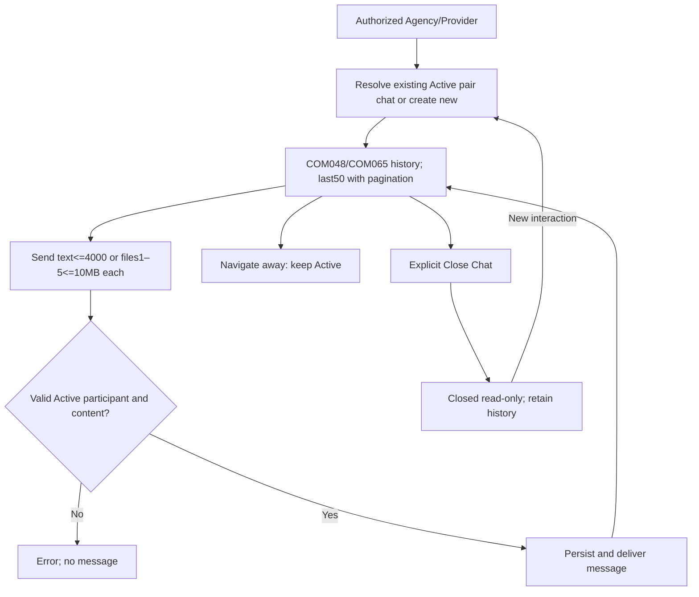
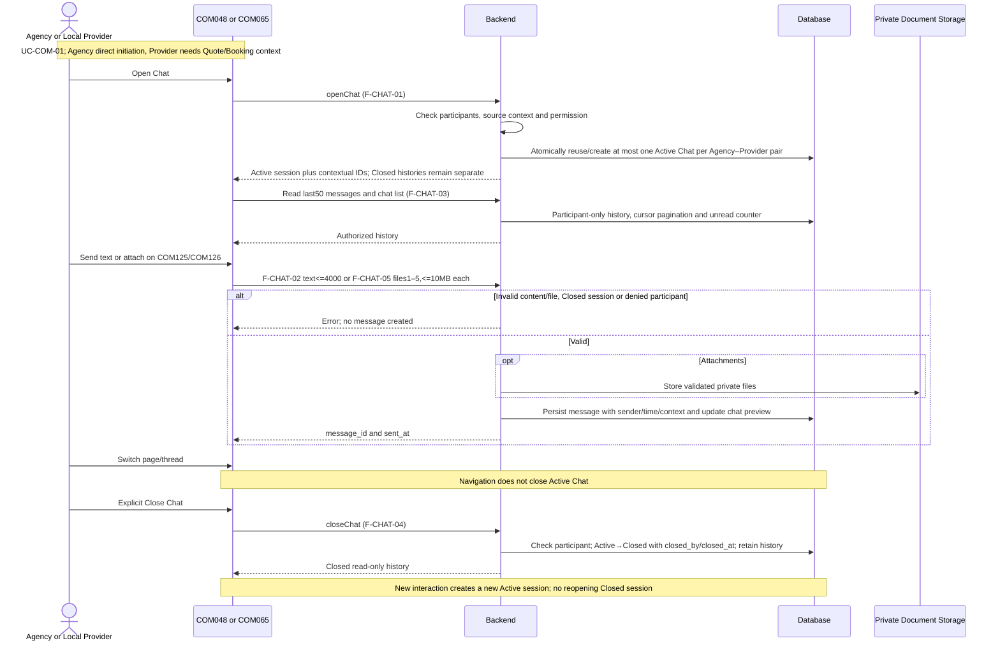

# Spec Document: In-app Chat

| **Field**                 | **Value**                                                                                                         |
|---------------------------|-------------------------------------------------------------------------------------------------------------------|
| Module ID                 | IAC                                                                                                               |
| Module name               | In-app Chat                                                                                                       |
| Spec version | v0.2 — consistency revision |
| Author (team member)      | Group G                                                                                                           |
| Date | 28/09/2026 |
| Status | Revised — pending human approval |
| Approved by (Client role) | Pending human approval |
| DBIZ2 source              | Function List rows **F-CHAT-01 .. F-CHAT-05**; Use Case **UC-COM-01**; Screens **COM048, COM065, COM125, COM126** |

Shared actor/state/field definitions: [Consistency Contract](../docs/consistency-contract.md). Exact current Function contracts are in §5/5.1. Technical choices and unresolved field-design questions are explicitly separated there.

**1. Purpose and scope (mandatory)**

> The In-app Chat module allows Tour Agencies and Local Providers to communicate directly within Artisan Bridge for clarification, negotiation and collaboration around Providers, Experiences and relevant Booking context. It maintains persistent conversation history and ensures only authorized conversation participants can view or send messages.

**In scope**

- Open an existing Chat session between a Tour Agency and Local Provider.

- Create a Chat session when no suitable conversation exists.

- Open Chat from AI Tour Matching.

- Open Chat from Explore.

- Open Chat from Provider context.

- Associate relevant Experience or Booking context with a conversation where applicable.

- Send text messages.

- Support plain text and basic markdown such as bold and italic.

- Upload one or more supported documents to an active Chat.

- Select files from the user's device and attach supported documents to an Active Chat.

- Attach documents to the current Chat conversation and relevant context.

- Display attached documents as part of persistent Chat history.

- Store message history.

- Display Chat list.

- Display latest message preview and timestamp.

- Display unread count.

- Display paginated Chat history.

- Enforce participant-only access.

- Reuse persistent Chat sessions across user sessions.

- Preserve the closed conversation history for later reference after the Chat session is closed.

**Out of scope**

- Message editing.

- Message deletion.

- Group Chat.

- Guest Chat access.

- HDT/UBND participation in Agency–Provider Chat.

- Audio/video calling.

- Booking creation by Chat itself.

- Permanent deletion of Chat sessions or Chat history.

- Read receipts beyond the currently defined unread-count behavior.

**Depends on**

| **Dependency**                                     | **Purpose**                                                                                           |
|----------------------------------------------------|-------------------------------------------------------------------------------------------------------|
| **AUT – Authentication, Access & User Management** | Verifies that the actor is authorized and is a participant in the Chat.                               |
| **AIT – AI Tour Matching**                         | May initiate Chat from matching results.                                                              |
| **EXP – Explore**                                  | May initiate Chat from an Experience.                                                                 |
| **PRF – Profile Management**                       | Provides Provider/Agency identity information displayed in Chat.                                      |
| **BKG – Schedule / Booking Management**            | May associate Booking context and may generate Booking-update messages into an existing conversation. |

F-CHAT-01 explicitly references permission validation through F-AUTH-16 and allows Chat to originate from AI Matching, Explore and Provider-profile contexts.

**2. Actors (mandatory)**

| **Actor**                      | **Role in this module**                                                                  | **Where it comes from** |
|--------------------------------|------------------------------------------------------------------------------------------|-------------------------|
| **Tour Agency**                | Opens conversations, sends messages and views its own Chat list/history                  | F-CHAT-01–05            |
| **Local Provider**             | Opens/participates in conversations, sends messages and views its own Chat list/history  | F-CHAT-01–05            |
| **System**                     | Creates/reuses Chat sessions, stores messages, loads history and enforces data isolation | F-CHAT-01–05            |
| **Authentication/RBAC**        | Verifies participant permission before protected Chat actions                            | F-AUTH-16               |
| **AI Tour Matching / Explore** | Upstream sources that may hand off into a Chat session                                   | F-CHAT-01               |

**3. User scenarios and acceptance criteria (mandatory)**

## Because the final Use Case contains only **one Chat use case**, all five F-CHAT functions are covered by one main user scenario.

## **US-1 (P1): Communicate via Chat — UC-COM-01**

## **Journey.** As a Tour Agency or Local Provider, I want to communicate with my collaboration partner through persistent Chat so that we can clarify requirements and negotiate before or during collaboration.

### **Acceptance scenarios**

## Given an authorized Tour Agency or Local Provider selects Chat with a permitted counterpart, when the system checks permission, then an existing eligible Chat session is opened or a new one is created.

## Given the actor is not a participant or does not have permission, when Chat access is attempted, then access is denied.

## Given Chat is opened from an Experience-related context, then the conversation may retain the related Experience context.

## Given Chat is initiated from AI Matching or Explore, then contextual information may be pre-populated into the conversation.

## Given a participant sends non-empty supported text, when Send is selected, then the message is stored with sender and timestamp and becomes part of Chat history.

## Given a participant uses supported basic markdown, then bold/italic formatting may be rendered.

## Given an authorized participant uploads or selects one or more supported documents, when the attachment action succeeds, then the documents are attached to the active Chat and become part of the persistent conversation history.

## Given the user opens the Chat list, then only conversations in which that user participates are displayed.

## Given a Chat is opened, then its message history is displayed chronologically.

## Given more than 50 messages exist, then the latest 50 are initially loaded and older messages can be retrieved through pagination/scroll.

## Given a Chat is opened by the recipient, then the conversation's unread count is reset according to the defined unread behavior.

## Given the user leaves the platform and returns later, the existing Chat conversation remains available.

1.  Given an active Chat session, when either authorized participant selects End Chat, then the system closes the active Chat session and records its closing state.

2.  Given a Chat session has been closed, when its history is viewed later, then previously stored messages remain available according to the user's access permission.

3.  Given a user who is not a participant attempts to close a Chat session, then the action is denied.

## The Function List defines persistent Chat sessions, participant-only access and paginated message history. 

### **Edge cases**

## The same pair attempts to open Chat simultaneously.

## A Chat already exists for the same participants.

## A user attempts to access a Chat by manually changing the Chat ID.

## Sender loses account access while Chat is open.

## Empty or whitespace-only message is submitted.

## Message is sent twice due to repeated user action/network retry.

## Conversation has no previous messages.

## Message history exceeds 50 records.

## AI Matching/Explore opens Chat without an Experience context.

## Booking context points to a record outside the participant scope; deny access.

## An uploaded file uses an unsupported format.

## An uploaded file exceeds the 10 MB per-file limit.

## A multi-file attachment contains one or more invalid files.

## File upload succeeds but attachment to the Chat fails.

### Consistency acceptance examples

| AC ID | Given / When | Expected result |
|---|---|---|
| AC-IAC-PAIR | Same pair opens Chat for two Experiences simultaneously | At most one Active Chat; both contexts attach to it. |
| AC-IAC-NAV | Participant changes page or selected thread | Chat stays Active; only explicit Close changes state. |
| AC-IAC-CLOSED | Participant starts new interaction after explicit Close | New Active session; Closed history immutable. |
| AC-IAC-FILE | Upload five valid10MB files versus six/oversize files | Valid batch permitted; invalid batch creates no attachment message. |

**4. Flows (mandatory)**

**4.1 Usage flow**

**4.2 Sequence for the main flow**

**5. Functional requirements (mandatory)**

| FR ID | Function List ID | Requirement — system MUST | Actor | Priority |
|---|---|---|---|---|
| FR-001 | F-CHAT-01 | Tour Agency may initiate Chat from AI Matching, Explore or Provider Profile.  Local Provider may initiate a Chat only when an existing Quote Request or Booking establishes a valid business context with the Agency.  A Closed Chat is immutable and is never reopened. If a new interaction is required after closure, F-CHAT-01 creates a new Active Chat while retaining the historical Closed Chat.  At most one Active Chat exists for an Agency–Local Provider pair at a time. Experience ID, Quote Request ID and Booking ID provide message/business context but do not define separate Chat threads. | Tour Agency / Local Provider | Must |
| FR-002 | F-CHAT-02 | Send text message in active chat. Actor: Tour Agency or Local Provider (permission verified by F-AUTH-16 - only participants can send). Message includes: text content, timestamp, sender_id. System stores message in chat history. Message delivered immediately (no queue). Update "last_message_timestamp" for chat list. Support: plain text + basic markdown (bold, italic) for MVP. F-CHAT-02 handles text/basic-markdown messages. Document attachments are handled separately by F-CHAT-05. | Tour Agency / Local Provider | Must |
| FR-003 | F-CHAT-03 | Display all chats for logged-in user with: (1) Chat List section showing: chat participants (name, organization), last message preview, last message timestamp, unread count. Sort by most recent first. (2) Chat History section (when chat opened) showing all messages in chronological order (oldest → newest). Display: message text, sender name, timestamp. Pagination: load last 50 messages, older on scroll. Tour Agency sees only chats with providers. Local Provider sees only chats with agencies. Permission verified by F-AUTH-16 - cannot view other users' chats. | Tour Agency / Local Provider | Must |
| FR-004 | F-CHAT-04 | Allows an authorized Tour Agency or Local Provider participant to close an active Chat session when the conversation or negotiation is considered finished. The system verifies that the requester is a participant of the Chat, changes the Chat session status from Active to Closed, records who closed the session and when it was closed, and retains all existing message history for later viewing. Closing a Chat does not delete the conversation or its messages. A later conversation between the same parties creates a new Active Chat through F-CHAT-01 and does not modify the Closed session. | Tour Agency / Local Provider | Should |
| FR-005 | F-CHAT-05 | Allows an authorized Tour Agency or Local Provider participant to attach and send a supported document within an Active Chat session. The system validates participant permission and file constraints before storing the attachment reference and associating it with the Chat message. | Tour Agency / Local Provider | Should |

**5.1 Input / Output contract**

| FR ID | Input fields and validation | Required | Output fields | Notes |
|---|---|---|---|---|
| FR-001 | initiator_id (ID; Required — from session)  recipient_id (ID; Required)  source (Enum[AI Matching, Explore, Provider Profile, Quote Request, Booking]; Required)  experience_id (ID; Optional)  quote_request_id (ID; Optional — required when source = Quote Request)  booking_id (ID; Optional — required when source = Booking)  permission_granted (Boolean; Required — from F-AUTH-16) | As specified per field | chat_session_id (ID; Required)  chat_status (Enum[Active]; Required)  is_new_session (Boolean; Required — false when an Active Chat already exists for the Agency–Local Provider pair; true when a new Active Chat is created) | Same contract as F-CHAT-01; optional fields are not required. |
| FR-002 | chat_session_id (ID; Required — Chat must be Active) message_text (Text, plain text + bold/italic markdown, max 4000 characters; Required) sender_id (ID; Required — from session) permission_granted (Boolean; Required — from F-AUTH-16) | As specified per field | message_id (ID; Required) sent_at (DateTime; Required) last_message_timestamp (DateTime; Required) | Same contract as F-CHAT-02; optional fields are not required. |
| FR-003 | user_id (ID; Required — from session) role (Enum[Tour Agency, Local Provider]; Required) chat_session_id (ID; Optional — when viewing history) before_cursor (String; Optional — loads older messages) permission_granted (Boolean; Required — from F-AUTH-16) | As specified per field | chat_list (Array<Object>; Required), each with: - chat_session_id (ID; Required) - chat_status (Enum[Active, Closed]; Required) - participant_name (String; Required) - organization (String; Required) - last_message_preview (String; Optional) - last_message_at (DateTime; Optional) - unread_count (Integer; Required)  message_history (Array<Object{   message_id,   text: Text Optional,   attachments: Array<Object{     attachment_id,     file_name,     file_type,     file_size   }> Optional,   sender_name,   sent_at,   experience_id: ID Optional (#28),   booking_id: ID Optional (#28) }>, 50 per page; Optional — returned when chat_session_id is provided)  has_more_messages (Boolean; Optional — returned when chat_session_id is provided)  closed_at (DateTime; Optional — Closed Chat, #34) closed_by_name (String; Optional — Closed Chat, #34) | Same contract as F-CHAT-03; optional fields are not required. |
| FR-004 | chat_session_id (ID; Required) closed_by (ID; Required — from authenticated session) close_reason (Text; Optional) permission_granted (Boolean; Required — verified by F-AUTH-16) | As specified per field | chat_session_id (ID; Required)  chat_status (Enum[Closed]; Required — Closed is terminal for that Chat session; the session cannot be reopened)  closed_at (DateTime; Required)  closed_by (ID; Required)  success_message (String; Required) | Same contract as F-CHAT-04; optional fields are not required. |
| FR-005 | chat_session_id (ID; Required — Chat must be Active)  sender_id (ID; Required — from authenticated session)  files (Array<File>, 1–5 files; Required — allowed formats PDF, DOC, DOCX, XLS, XLSX, JPG, JPEG, PNG; maximum 10MB per file)  permission_granted (Boolean; Required — verified by F-AUTH-16) | As specified per field | message_id (ID; Required)  attachments (Array<Object{   attachment_id,   file_name,   file_type,   file_size }>; Required)  sent_at (DateTime; Required) | Same contract as F-CHAT-05; optional fields are not required. |

**5.2 Business rules**

| **Rule ID** | **Rule** | **Why it exists** |
|-------------|----------|-------------------|
| **BR-001** | Chat is available only between Tour Agency and Local Provider actors. | Limits communication to intended collaboration participants. |
| **BR-002** | A user may access only Chat sessions in which they are a participant. | Prevents conversation data leakage. |
| **BR-003** | F-AUTH-16 permission must be satisfied before Chat access, messaging or document attachment. | Enforces authorization. |
| **BR-004** | If an appropriate Chat session already exists, the system reuses it instead of blindly creating another session. | Maintains conversation continuity. |
| **BR-005** | Active Chat sessions persist across user login sessions until an authorized participant closes the Chat. | Preserves long-running negotiation history. |
| **BR-006** | Messages are stored as immutable history in MVP; users cannot edit or delete them. | Maintains communication traceability. |
| **BR-007** | MVP Chat supports plain text plus basic bold/italic markdown. | Defines the supported text-messaging scope. |
| **BR-008** | Chat supports document attachments for authorized Tour Agency and Local Provider participants. | Supports B2B document exchange within collaboration. |
| **BR-009** | Only PDF, DOC, DOCX, XLS, XLSX, JPG, JPEG and PNG files up to10MB per file are supported. | Defines the MVP attachment boundary. |
| **BR-010** | One to five documents may be attached in a single attachment action. | Supports COM125/COM126 multi-select behavior. |
| **BR-011** | Attached documents become part of persistent Chat history and follow the same participant-access rules as the parent Chat session. | Maintains security and communication traceability. |
| **BR-012** | Chat/Experience/Booking context is an association to the conversation, not a document attachment. | Distinguishes contextual metadata from uploaded documents. |
| **BR-013** | Chat list is sorted by latest-message time, newest first. | Surfaces active conversations. |
| **BR-014** | Message history is shown oldest-to-newest within the opened conversation. | Maintains natural reading order. |
| **BR-015** | Initial history load is the latest 50 messages; older messages load progressively. | Controls history pagination. |
| **BR-016** | Tour Agency sees only conversations with Local Providers; Local Provider sees only conversations with Tour Agencies. | Enforces role-specific communication model. |
| **BR-017** | Unread count resets when the user opens the relevant Chat according to the current Function List rule. | Keeps Chat list state current. |
| **BR-018** | Chat does not itself create a Booking. | Booking remains Local Provider-controlled. |
| **BR-019** | Only a participant of the Chat may close that Chat session. | Prevents unauthorized lifecycle changes. |
| **BR-020** | Closing a Chat does not delete its messages, attachments or conversation history. | Preserves collaboration records. |
| **BR-021** | A Closed Chat never accepts new messages/attachments and is never reopened; a later interaction creates a new Active Chat. | Maintains clear Chat lifecycle state. |

**6. Key entities (mandatory)**

| **Entity**           | **Attributes from Input/Output**                                                                                          | **Relationships**                       |
|----------------------|---------------------------------------------------------------------------------------------------------------------------|-----------------------------------------|
| **Chat Session**     | chat_session_id, initiator_id, participants, start_time, **status, closed_at, closed_by**, source, last_message_timestamp | has two participants and many messages  |
| **Chat Participant** | user_id, role, organization                                                                                               | belongs to Chat Session                 |
| **Chat Message**     | message_id, chat_session_id, sender_id, text, sent_at                                                                     | belongs to one Chat Session and sender  |
| **Chat Context**     | experience_id, booking_id, source                                                                                         | optionally associated with Chat Session |
| **Chat List Entry**  | chat_session_id, participant_name, organization, last_message_preview, last_message_at, unread_count                      | derived per logged-in user              |
| **Unread State**     | user_id, chat_session_id, unread_count                                                                                    | belongs to one participant/chat pair    |
| **Message Cursor**   | before_cursor, has_more_messages                                                                                          | supports history pagination             |
| **Chat Attachment**  | attachment_id, chat_session_id, message_id, uploaded_by, source_type, file_name, file_type, file_size, active_reference_id, created_at | belongs to one Chat Session and one Chat Message |

**7. Screens involved**

| Screen ID | Screen name | Functions in this module |
|---|---|---|
| COM048 | Chat | F-CHAT-01, F-CHAT-02, F-CHAT-03, F-CHAT-04 |
| COM065 | Chat | F-CHAT-01, F-CHAT-02, F-CHAT-03, F-CHAT-04 |
| COM125 | Attach Document | F-CHAT-05 |
| COM126 | Attach Document | F-CHAT-05 |
| DSH018 | Local Provider Dashboard | F-CHAT-03 |

**8. Success criteria (mandatory)**

| **SC ID**  | **Criterion**                                                                                                 | **How it is measured**                                                       |
|------------|---------------------------------------------------------------------------------------------------------------|------------------------------------------------------------------------------|
| **SC-001** | Tour Agency and Local Provider can open/reuse an authorized conversation.                                     | Open the same participant conversation more than once and verify continuity. |
| **SC-002** | A non-participant cannot read or send messages in another user's Chat.                                        | Attempt Chat access using an unrelated account.                              |
| **SC-003** | A successfully sent message appears in stored Chat history with sender and timestamp.                         | Send a test message and reload the conversation.                             |
| **SC-004** | Chat history persists after logout and later login.                                                           | Send messages, logout, return and reopen Chat.                               |
| **SC-005** | An authorized Tour Agency or Local Provider can attach supported documents to an active Chat and the attachments remain visible in the persisted conversation history. | Attach valid documents, reload the Chat and verify that the attachments remain accessible. |
| **SC-006** | Chat list is ordered by the latest conversation activity.                                                     | Send messages in multiple conversations and inspect ordering.                |
| **SC-007** | Opening a Chat updates its unread state according to the defined rule.                                        | Create unread messages and open the conversation.                            |
| **SC-008** | Conversations with more than 50 messages initially show only the latest page and allow older history to load. | Use a seeded Chat with more than 50 messages.                                |
| **SC-009** | Agency accounts see Provider conversations only and Provider accounts see Agency conversations only.          | Inspect Chat list using each actor type.                                     |
| **SC-010** | Experience or Booking context can open the relevant conversation without creating or modifying a Booking automatically. | Trigger Chat from each supported context and inspect Chat and Booking records. |
| **SC-011** | An authorized participant can close an active Chat session.                                                   | Close a Chat using Agency and Provider accounts.                             |
| **SC-012** | A non-participant cannot close another user's Chat.                                                           | Attempt close using unrelated account.                                       |
| **SC-013** | Closing a Chat preserves all existing message history.                                                        | Close Chat, view read-only history and compare messages.                        |
| **SC-014** | A Closed Chat cannot accept new messages; opening history does not reopen the session.                            | Attempt to send into a Closed Chat.                                          |
| **SC-015** | Unsupported file formats or files larger than 10 MB are rejected before attachment. | Attempt to attach an invalid format and an oversized file. |

**9. Assumptions**

- A Chat is one-to-one between a Tour Agency and a Local Provider.

- Chat sessions persist across login sessions while active and remain stored after being closed.

- Closing a Chat changes its lifecycle state but does not delete the conversation or its messages.

- Leaving the Chat UI does not delete or permanently close the conversation.

- Context such as Experience or Booking IDs is metadata associated with Chat rather than a message attachment.

- COM048 and COM065 are the primary Chat screens.

- COM125 and COM126 are supporting MVP screens for document attachment.

- Attachments are stored as Chat-related records and follow the authorization rules of the parent Chat session.

- System-generated Booking update messages may appear in Chat, but their generation logic belongs to Schedule/Booking rather than F-CHAT.

- The 30-minute inactivity concept used by AI Matching's learning loop does not automatically mean that the persistent Chat conversation is deleted or closed.

## Clarifications

- 2026-11-05 #18: The AI Matching/Explore context message is a `User Text` message sent by the Agency user with `experience_id`; Request Quote keeps `Quote Request`.
- 2026-11-05 #19: `source` is AI Matching (+ `matching_session_id`), Explore (Experience card/detail), Provider Profile (Explore Provider page) or Booking (BKG).
- 2026-11-05 #20: Only `**bold**` and `*italic*` are rendered; all other markup is escaped and shown as text.
- 2026-11-05 #21: On reuse `source` / `matching_session_id` stay; the Chat's context ids follow the latest handoff; each context message carries its own ids.
- 2026-11-05 #22: `participant_name` = counterpart `full_name`; `organization` = Agency `company_name` or published Provider `business_name`.
- 2026-11-05 #23: Loading the first history page resets the reader's `unread_count` to 0 and `last_read_message_id` to the newest message.
- 2026-11-05 #24: Booking-source open adds no message; the Explore Provider page adds the #18 context message.
- 2026-11-05 #25: 4000 = Unicode code points of the trimmed text; the trimmed text is stored.
- 2026-11-05 #26: Each stored message adds 1 to the other participant's `unread_count`.
- 2026-11-05 #27: Unknown Chat, non-participant, Guest, UBND, HDT → 403 FORBIDDEN; nothing written.
- 2026-11-05 #28: `message_history` items also return optional `experience_id` and `booking_id`.
- 2026-11-05 #29: Either participant may close; non-participant, unknown Chat, Guest, UBND, HDT → 403; nothing written.
- 2026-11-05 #30: `close_reason` trimmed, optional, ≤ 500 code points; stored in one `audit_logs` row `chat.close`; not shown.
- 2026-11-05 #31: Closing a Closed Chat → 409 CHAT_CLOSED; nothing written.
- 2026-11-05 #32: `success_message` = "Đã đóng hội thoại. Lịch sử vẫn được lưu; lần trao đổi sau sẽ mở hội thoại mới."
- 2026-11-05 #33: Close is confirmed in a dialog with an optional reason; Cancel sends nothing.
- 2026-11-05 #34: History output adds optional `closed_at`, `closed_by_name`; Closed Chat screen is read-only.
- 2026-11-05 #35: New interaction only through the existing F-CHAT-01 entry points; no reopen/new button; Closed Chats stay listed.
- 2026-11-05 #36: BKG Booking Updates never use a Closed Chat; FR-008 step 3 creates a new Active Chat.
- 2026-11-05 #37: Closing adds no message, notification or unread change.
- 2026-11-05 #38: Close, Send, Open share one lock; Send/Open re-check inside it; F-MATCH-13 not built.
- 2026-11-05 #39: Attached files are stored as private files in the demo runtime (`.demo-data/chat-files/<file_id>`), uploaded as `multipart/form-data` field `files`; `demo:reset` clears them.
- 2026-11-05 #40: Participants download through `GET /api/iac/chats/{id}/attachments/{attachment_id}` (`Content-Disposition: attachment`); others → 403 as #27; Closed Chat files stay downloadable; seed files without content → 404.
- 2026-11-05 #41: Chat images store `width_px`/`height_px` NULL; no minimum resolution for Chat files.
- 2026-11-05 #42: The format is the file-name extension (case-insensitive); `file_type` is the MIME type derived from it; the browser MIME type is ignored; the content is not inspected.
- 2026-11-05 #43: 10 MB = 10,485,760 bytes; a 0-byte file is rejected.
- 2026-11-05 #44: One attachment action = one `Attachment` message with `text` NULL and 1–5 `chat_attachments` rows; no caption in MVP.
- 2026-11-05 #45: Any invalid file, 0 files or more than 5 → 400 VALIDATION with `file_errors[]` (file name + reason); nothing written; duplicate names allowed.
- 2026-11-05 #46: Validate first, write files, then write records under the lock; if the records fail, the written files are removed.
- 2026-11-05 #47: F-CHAT-02 rules apply: unread +1 (#26), `last_message_timestamp`, monotonic `sent_at`, shared lock with Active re-check (#38), Closed → 409 CHAT_CLOSED, 403 as #27; nothing written when refused.
- 2026-11-05 #48: `last_message_preview` of an attachment message = "Tệp đính kèm: " + the file names joined by ", ".
- 2026-11-05 #49: COM125/COM126 are one dialog opened by Attach on COM048/COM065; per-file checks in the browser; Send enabled only when all files are valid and no send is pending; Cancel sends nothing; no Attach on a Closed Chat; history shows name, type, size and a download link; no document tags.
- 2026-11-05 #50: The Chat Attachment entity fields `source_type`, `active_reference_id`, `chat_session_id` are not in `data/schema.sql` `chat_attachments`; data wins, the Chat comes through the message; §8 to be aligned by the spec owner.

**10. Open questions**

| **\#** | **Question**                                                                                                                                                                       | **Blocking?** | **Owner**   | **Status** | **Answer/Decision**                                                                                                                                            |
|--------|------------------------------------------------------------------------------------------------------------------------------------------------------------------------------------|---------------|-------------|------------|----------------------------------------------------------------------------------------------------------------------------------------------------------------|
| 1 | What is the maximum allowed message_text length? | No | BA / Tech | Closed | 4000 characters, as F-CHAT-02. |
| 2 | The Function List allows Local Provider as an actor but source only lists AI Matching, Explore and Provider Profile. What source value represents a Local Provider-initiated Chat? | No | BA | Closed | Use source=Quote Request or Booking for Provider initiation; Agency may also use AI Matching/Explore/Provider Profile. |
| 3 | Which exact UI entry point allows Local Provider to initiate a new Chat with an Agency? | No | UI/UX / BA | Closed | Agency may initiate directly; Provider requires an existing Quote Request or Booking context. |
| 4 | When deciding whether an existing Chat should be reused, is uniqueness based only on Agency + Provider, or Agency + Provider + Experience/context? | No | BA / Tech | Closed | At most one Active Chat per Agency–Provider pair; Experience/Quote/Booking IDs are context, not separate threads. |
| 5 | If the same Agency and Provider discuss multiple Experiences, should they share one conversation or separate Experience-specific chats? | No | Client / BA | Closed | Reuse the existing Active Chat for the pair regardless of context. Closed Chat is terminal. |
| 6 | F-CHAT-01 includes optional booking_id, but no current entry point opens Chat from a Booking. Should Booking be added as a source or should booking_id be removed? | No | BA | Closed | **Add Booking as a source.** Post-booking communication is a critical real-world workflow. |
| 7 | What exact context message is auto-populated when Chat is opened from AI Matching or Explore? | No | BA / UI | Closed | A system-generated message block containing the Experience Name, link, and a standard greeting (e.g., "I am interested in this experience"). |
| 10 | Is unread count tracked per message or maintained as a conversation-level counter? | No | Tech | Closed | Maintained as a conversation-level counter. |
| 11 | Does opening a conversation immediately mark all loaded messages as read? | No | BA / Tech | Closed | Yes. Opening the conversation immediately resets the counter to 0. |
| 12 | Is a separate “read receipt” (Seen) required per message? Current F-CHAT functions do not define one. | No | BA | Closed | No visible per-message read receipt. unread_count is conversation-level; booking messages retain internal recipient_read_status for F-SCHED-08. |
| 13 | Should Chat support explicit archived conversations, or are all persistent Chats permanently visible in the list? | No | Product | Closed | Permanently visible in the list (sorted by most recent). Archiving is out of scope for MVP. |
| 14 | After a Chat is Closed, can either participant reopen the same session, or must a new Chat session be created? | No | BA / Client | Closed | Closed is immutable. Navigating away does not close the Chat; explicit Close Chat creates a terminal Closed session. |
| 15 | If the same Agency and Provider start Chat again after a previous session was Closed, should the old history remain in the same thread or a new thread? | No | BA / Client | Closed | Create a new Active Chat after closure; retain the historical Closed session. |
| 16 | Is a close reason required or optional? | No | BA | Closed | Optional. |
| 17 | Does 30-minute inactivity in F-MATCH-13 only end the AI learning window, or can it ever automatically close F-CHAT-04? | No | BA / AI | Closed | It **only** ends the learning analysis window. It does NOT automatically close the Chat session. |
| 18 | #7 calls the pre-populated context block "system-generated", but the data model allows a message without a sender only for `message_kind` Booking Update. Who sends the context message of a Chat opened from AI Matching or Explore, and with which `message_kind`? | Yes (F-CHAT-01) | BA / Data | Closed | The context message is a `User Text` message sent by the Agency user who opened the Chat, with the Experience's `experience_id` on the message. Its content is the one in #7. A Request Quote handoff keeps `message_kind` Quote Request. Decided by Vũ Khánh Linh (linhkhanh-vu), 2026-11-05. |
| 19 | Which FR-001 `source` value does each entry point record? | Yes (F-CHAT-01) | BA | Closed | AI Tour Matching → `AI Matching` with the `matching_session_id`; Explore Experience card or detail page → `Explore`; Explore Provider page → `Provider Profile`; Booking (BKG) → `Booking`. Decided by Vũ Khánh Linh (linhkhanh-vu), 2026-11-05. |
| 20 | Which markdown does BR-007 "basic bold/italic markdown" accept, and what happens to other markup? | No | BA / Tech | Closed | Only `**bold**` and `*italic*` are rendered. Everything else, including HTML and other markdown, is escaped and shown as literal text. Decided by Vũ Khánh Linh (linhkhanh-vu), 2026-11-05. |
| 21 | When an Active Chat is reused (FR-001), which Chat fields change, and where is the new context kept? | Yes (F-CHAT-01) | BA / Data | Closed | `source` and `matching_session_id` keep the values written when the Chat was created. The Chat's `experience_id`, `quote_request_id` and `booking_id` are set to the context of the latest handoff. Every context message also carries its own `experience_id` / `quote_request_id` / `booking_id`. Decided by Vũ Khánh Linh (linhkhanh-vu), 2026-11-05. |
| 22 | FR-003 lists `participant_name` and `organization`. Which data are they? | No | BA / Data | Closed | `participant_name` is the counterpart user's `full_name`; `organization` is the counterpart Agency's `company_name` or the counterpart Provider's published `business_name`. Decided by Vũ Khánh Linh (linhkhanh-vu), 2026-11-05. |
| 23 | BR-017 resets the unread count "when the user opens the relevant Chat". What counts as opening? | No | BA / Tech | Closed | Loading the first (latest) history page of the Chat by that participant sets their `unread_count` to 0 and `last_read_message_id` to the newest message. Loading older pages does not change it. Decided by Vũ Khánh Linh (linhkhanh-vu), 2026-11-05. |
| 24 | Does opening a Chat from a Booking (source Booking) or from the Explore Provider page add a context message? | No | BA | Closed | A Booking-source open adds no message; it only opens or reuses the pair's Active Chat with the `booking_id` as context. The Explore Provider page adds the #18 context message for the Experience it passes. Decided by Vũ Khánh Linh (linhkhanh-vu), 2026-11-05. |
| 25 | How is the 4000-character limit of `message_text` counted? | No | Tech | Closed | Leading and trailing white space is removed first; the remaining text may have at most 4000 Unicode code points, and that trimmed text is stored. Decided by Vũ Khánh Linh (linhkhanh-vu), 2026-11-05. |
| 26 | When does the conversation-level unread count (#10) increase? | No | BA / Tech | Closed | Every stored message, including a context message, adds 1 to the `unread_count` of the other participant; the sender's count does not change. Decided by Vũ Khánh Linh (linhkhanh-vu), 2026-11-05. |
| 27 | What does the API answer when a user opens a Chat ID that does not exist or that they do not participate in (edge case "manually changing the Chat ID")? | No | BA / Tech | Closed | 403 FORBIDDEN in both cases, so the response does not reveal whether the Chat exists; Guest, UBND and HDT also get 403 FORBIDDEN (as spec-BKG #67). Nothing is written. Decided by Vũ Khánh Linh (linhkhanh-vu), 2026-11-05. |
| 28 | COM048/COM065 show "contextual references", but the FR-003 `message_history` items have no context fields. Which context is returned? | No | BA / UI | Closed | Each `message_history` item also returns `experience_id` (Optional) and `booking_id` (Optional) of that message; no other field changes. Decided by Vũ Khánh Linh (linhkhanh-vu), 2026-11-05. |
| 29 | Who may close a Chat (F-CHAT-04), and what do others get? | Yes (F-CHAT-04) | BA | Closed | Either participant of that Chat: the Agency user or the Provider user. A non-participant, an unknown Chat ID, Guest, UBND and HDT get 403 FORBIDDEN (as #27) and nothing is written. No permission other than `use_chat` is needed. Decided by Vũ Khánh Linh (linhkhanh-vu), 2026-11-05. |
| 30 | `close_reason` is an optional FR-004 input, but the data model has no column for it. Where is it kept, and how long may it be? | No | BA / Data | Closed | The reason is trimmed; empty means no reason; at most 500 Unicode code points (longer → 400). Each close writes one `audit_logs` row: `action` `chat.close`, `target_type` `chat_session`, `target_id` = `chat_session_id`, `change_or_result` = `{from: Active, to: Closed, close_reason?}` (the data CRUD matrix gives F-CHAT-04 Create on audit logs). The reason is not returned and not shown in the Chat. Decided by Vũ Khánh Linh (linhkhanh-vu), 2026-11-05. |
| 31 | What happens when a participant closes a Chat that is already Closed? | No | BA | Closed | 409 CHAT_CLOSED; `closed_at` and `closed_by` keep their values and nothing is written (BR-021). Decided by Vũ Khánh Linh (linhkhanh-vu), 2026-11-05. |
| 32 | What is the FR-004 `success_message`? | No | BA / UI | Closed | "Đã đóng hội thoại. Lịch sử vẫn được lưu; lần trao đổi sau sẽ mở hội thoại mới." Decided by Vũ Khánh Linh (linhkhanh-vu), 2026-11-05. |
| 33 | Is the close confirmed before it is sent? | No | UI/UX | Closed | Yes. Close Chat opens a confirmation with an optional reason field; Cancel sends nothing. Decided by Vũ Khánh Linh (linhkhanh-vu), 2026-11-05. |
| 34 | What does the read-only history of a Closed Chat show? | No | BA / UI | Closed | The F-CHAT-03 history output also returns `closed_at` (DateTime; Optional) and `closed_by_name` (String; Optional, the closing user's `full_name`) for a Closed Chat; no other field changes. COM048/COM065 hide the composer and Close Chat and show "Đã đóng bởi {name} lúc {time} — chỉ xem". Decided by Vũ Khánh Linh (linhkhanh-vu), 2026-11-05. |
| 35 | How does a new interaction start after a Chat was Closed? | No | BA / UI | Closed | Through the existing F-CHAT-01 entry points only (Agency: Explore, AI Tour Matching, Explore Provider page, BKG138; Provider: BKG135), which create a new Active Chat. The Closed Chat screen has no reopen or new-Chat button, only this hint. Closed Chats stay in the Chat list, ordered by latest activity (#13). Decided by Vũ Khánh Linh (linhkhanh-vu), 2026-11-05. |
| 36 | What happens to BKG Booking Update messages (F-SCHED-08) after the pair's Chat was Closed? | No | BA | Closed | Unchanged spec-BKG FR-008 order: a Closed Chat is never used (#13, #56); without an Active Chat a new Active Chat with source Booking and the `booking_id` is created and receives the message. The Closed Chat stays unchanged. Decided by Vũ Khánh Linh (linhkhanh-vu), 2026-11-05. |
| 37 | Does closing notify the other participant or change unread counts? | No | BA | Closed | No. Closing adds no message, no notification and no unread change; the other participant sees the Closed status in the Chat list and history. Decided by Vũ Khánh Linh (linhkhanh-vu), 2026-11-05. |
| 38 | How do Close, Send and Open interact when they happen at the same time, and does Close feed AI Matching F-MATCH-13? | No | BA / Tech | Closed | Close runs under the same write lock as Send and Open; Send and Open re-check the status inside the lock, so a message is either stored before `closed_at` or refused with 409, and an Open after the Close creates a new Active Chat. F-MATCH-13 (spec-AIT FR-013, Should) is not built; F-CHAT-04 returns `closed_at` for it later. Decided by Vũ Khánh Linh (linhkhanh-vu), 2026-11-05. |
| 39 | Are attached files stored, and how are they sent to the API (sequence diagram "Private Document Storage"; checklist §3 #42 says there is no binary storage)? | Yes (F-CHAT-05) | BA / Tech | Closed | The file content is stored as a private file of the demo runtime under `.demo-data/chat-files/<file_id>` (git-ignored); the `stored_files.storage_key` is `chat-files/<file_id>`. The client sends `multipart/form-data` with one `files` field per file. `npm run demo:reset` removes the stored chat files. No new dependency. Decided by Vũ Khánh Linh (linhkhanh-vu), 2026-11-05. |
| 40 | How do participants open an attached document after reload (SC-005), and who may? | Yes (F-CHAT-05) | BA / Tech | Closed | `GET /api/iac/chats/{chat_session_id}/attachments/{attachment_id}` returns the file with `Content-Disposition: attachment` and the stored `file_type`. Only a participant of that Chat may download it (BR-011); a non-participant, unknown Chat or attachment, Guest, UBND and HDT get 403 FORBIDDEN as #27. Files of a Closed Chat stay downloadable (BR-020). Seed attachments have metadata but no content: 404 with "Tệp mẫu không có nội dung." Decided by Vũ Khánh Linh (linhkhanh-vu), 2026-11-05. |
| 41 | `stored_files` requires every `image/%` file to be at least 1280×720 (Experience BR-008). Does that apply to Chat images? | No | BA / Data | Closed | No. BR-009 limits Chat files to format and size only. Chat images are stored with `width_px` and `height_px` NULL, which the schema check allows; `data/` is unchanged. Decided by Vũ Khánh Linh (linhkhanh-vu), 2026-11-05. |
| 42 | How is the file format checked? | No | Tech | Closed | By the file-name extension, case-insensitive: pdf, doc, docx, xls, xlsx, jpg, jpeg, png. `file_type` is the MIME type derived from the extension (pdf `application/pdf`, doc `application/msword`, docx `application/vnd.openxmlformats-officedocument.wordprocessingml.document`, xls `application/vnd.ms-excel`, xlsx `application/vnd.openxmlformats-officedocument.spreadsheetml.sheet`, jpg/jpeg `image/jpeg`, png `image/png`). The MIME type sent by the browser is ignored; the content is not inspected. Decided by Vũ Khánh Linh (linhkhanh-vu), 2026-11-05. |
| 43 | What exactly is "10 MB", and is an empty file valid? | No | Tech | Closed | 10 MB = 10,485,760 bytes (as `stored_files.file_size_bytes`); a file of exactly that size is valid. A 0-byte file is rejected. Decided by Vũ Khánh Linh (linhkhanh-vu), 2026-11-05. |
| 44 | How many messages does one attachment action create, and can it carry text? | No | BA | Closed | One `chat_messages` row with `message_kind` `Attachment` and `text` NULL, plus one `stored_files` and one `chat_attachments` row per file (1–5). FR-005 has no text input, so there is no caption in MVP; text already stored on seed attachment messages is shown as it is. Decided by Vũ Khánh Linh (linhkhanh-vu), 2026-11-05. |
| 45 | What does the API answer when a batch has invalid files (AC-IAC-FILE)? | No | BA / Tech | Closed | 400 VALIDATION with `file_errors` (Array<Object{file_name, reason}>), one entry per invalid file; reasons: unsupported format, larger than 10 MB, empty file. 0 files or more than 5 files is also 400. Nothing is stored. Two files with the same name in one batch are allowed. Decided by Vũ Khánh Linh (linhkhanh-vu), 2026-11-05. |
| 46 | What happens when the file upload succeeds but attaching to the Chat fails? | No | Tech | Closed | Order: authorize, validate every file, write the files, then write the message and attachment records under the Chat write lock. If writing the records fails (including a Chat closed in the meantime), the files written for that action are removed and no message exists. Decided by Vũ Khánh Linh (linhkhanh-vu), 2026-11-05. |
| 47 | Which F-CHAT-02 rules also apply to an attachment message? | No | BA / Tech | Closed | All of them: the other participant's `unread_count` +1 (#26); `last_message_timestamp` is updated; `sent_at` is at least 1 ms after the Chat's latest message; the action runs under the shared Chat/Booking write lock and re-checks Active inside it (#38); a Closed Chat → 409 CHAT_CLOSED; unknown Chat, non-participant, Guest, UBND, HDT → 403 (#27). A refused action writes nothing. Decided by Vũ Khánh Linh (linhkhanh-vu), 2026-11-05. |
| 48 | What is the chat-list `last_message_preview` of an attachment message? | No | UI | Closed | "Tệp đính kèm: " followed by the file names joined by ", " (for example "Tệp đính kèm: bao-gia.pdf, lich-trinh.xlsx"). Decided by Vũ Khánh Linh (linhkhanh-vu), 2026-11-05. |
| 49 | How do COM125/COM126 work on screen, and do the mockup tags ("GUEST MANIFEST", "ACTIVE QUOTE", "Attach Quote / Invoice") apply? | No | UI/UX | Closed | COM125 (Agency) and COM126 (Provider) are the same dialog opened by Attach on COM048/COM065. It lists the chosen files with name, type and size and shows each file's error in the browser; Send is enabled only when 1–5 files are all valid and no send is pending; Cancel closes it without sending. A Closed Chat has no Attach. The history shows each attachment's name, type, size and a download link. The mockup tags are legacy decoration: the contract has no document type or tag field, so none is built. Decided by Vũ Khánh Linh (linhkhanh-vu), 2026-11-05. |
| 50 | §8 lists Chat Attachment fields `source_type`, `active_reference_id` and `chat_session_id`, which `data/schema.sql` `chat_attachments` does not have. Which wins? | No | BA / Data | Closed | `data/` wins; no column is added. The Chat is reached through `message_id`. The §8 entity row is left for the spec owner to align. Decided by Vũ Khánh Linh (linhkhanh-vu), 2026-11-05. |

**11. Traceability to DBIZ2**

| **Spec section**               | **DBIZ2 source**           | **Location**                                                                                                                                                 |
|--------------------------------|----------------------------|--------------------------------------------------------------------------------------------------------------------------------------------------------------|
| **1. Purpose**                 | Schematic design 1.1 / 1.2 | **sheet Schematic1, sections 1.1 System Objectives and 1.2 System Main Functions – In-app Chat**                                                              |
| **4.1 Usage flow**             | Usage Flow figure          | **sheet Schematic2, Tour Agency flow: “Choose Interaction” → “Input Message” → “Communicate via Chat”; Local Provider Chat flow** |
| **4.2 Sequence**               | Sequence Diagram figure    | **sheet Schematic2, Module 7: In-app Chat – UC-COM-01 Chat**                                                                                                 |
| **5. Functional requirements** | Function List              | **sheet FL&Cost1, F-CHAT-01 .. F-CHAT-05**                                                                                                                   |
| **7. Screens**                 | Screen List                | **sheet ST, COM048, COM065, COM125, COM126**                                                                                                                                 |
