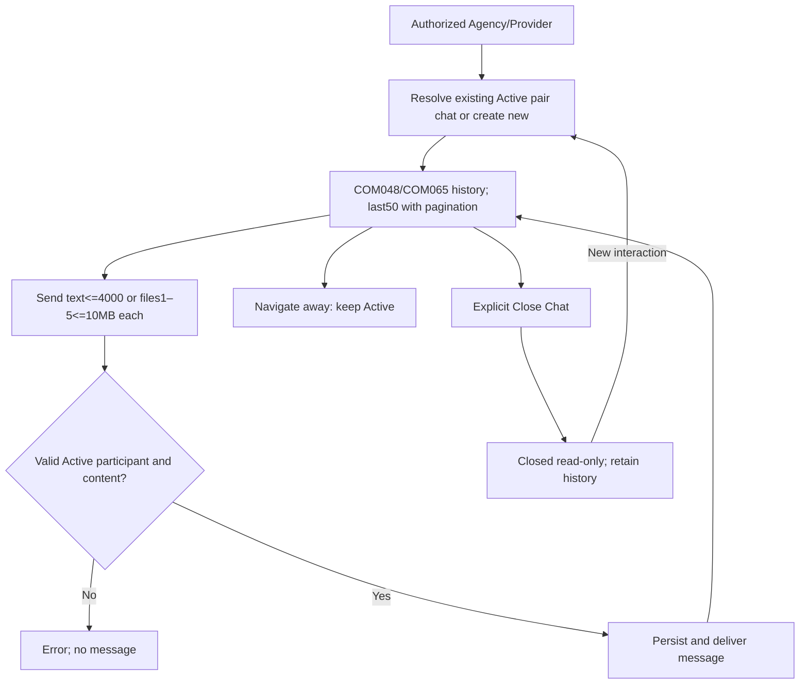
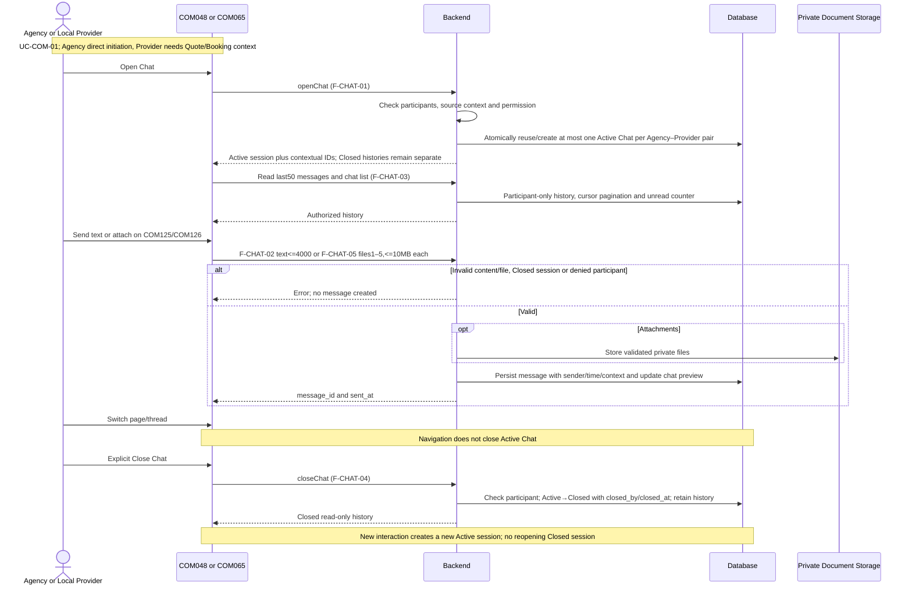

# Spec Document: In-app Chat

| **Field**                 | **Value**                                                                                                         |
|---------------------------|-------------------------------------------------------------------------------------------------------------------|
| Module ID                 | IAC                                                                                                               |
| Module name               | In-app Chat                                                                                                       |
| Spec version | v0.2 — consistency revision |
| Author (team member)      | Group G                                                                                                           |
| Date | 28/09/2026 |
| Status | Revised — pending human approval |
| Approved by (Client role) | Pending human approval |
| DBIZ2 source              | Function List rows **F-CHAT-01 .. F-CHAT-05**; Use Case **UC-COM-01**; Screens **COM048, COM065, COM125, COM126** |

Shared actor/state/field definitions: [Consistency Contract](../docs/consistency-contract.md). Exact current Function contracts are in §5/5.1. Technical choices and unresolved field-design questions are explicitly separated there.

**1. Purpose and scope (mandatory)**

> The In-app Chat module allows Tour Agencies and Local Providers to communicate directly within Artisan Bridge for clarification, negotiation and collaboration around Providers, Experiences and relevant Booking context. It maintains persistent conversation history and ensures only authorized conversation participants can view or send messages.

**In scope**

- Open an existing Chat session between a Tour Agency and Local Provider.

- Create a Chat session when no suitable conversation exists.

- Open Chat from AI Tour Matching.

- Open Chat from Explore.

- Open Chat from Provider context.

- Associate relevant Experience or Booking context with a conversation where applicable.

- Send text messages.

- Support plain text and basic markdown such as bold and italic.

- Upload one or more supported documents to an active Chat.

- Select files from the user's device and attach supported documents to an Active Chat.

- Attach documents to the current Chat conversation and relevant context.

- Display attached documents as part of persistent Chat history.

- Store message history.

- Display Chat list.

- Display latest message preview and timestamp.

- Display unread count.

- Display paginated Chat history.

- Enforce participant-only access.

- Reuse persistent Chat sessions across user sessions.

- Preserve the closed conversation history for later reference after the Chat session is closed.

**Out of scope**

- Message editing.

- Message deletion.

- Group Chat.

- Guest Chat access.

- HDT/UBND participation in Agency–Provider Chat.

- Audio/video calling.

- Booking creation by Chat itself.

- Permanent deletion of Chat sessions or Chat history.

- Read receipts beyond the currently defined unread-count behavior.

**Depends on**

| **Dependency**                                     | **Purpose**                                                                                           |
|----------------------------------------------------|-------------------------------------------------------------------------------------------------------|
| **AUT – Authentication, Access & User Management** | Verifies that the actor is authorized and is a participant in the Chat.                               |
| **AIT – AI Tour Matching**                         | May initiate Chat from matching results.                                                              |
| **EXP – Explore**                                  | May initiate Chat from an Experience.                                                                 |
| **PRF – Profile Management**                       | Provides Provider/Agency identity information displayed in Chat.                                      |
| **BKG – Schedule / Booking Management**            | May associate Booking context and may generate Booking-update messages into an existing conversation. |

F-CHAT-01 explicitly references permission validation through F-AUTH-16 and allows Chat to originate from AI Matching, Explore and Provider-profile contexts.

**2. Actors (mandatory)**

| **Actor**                      | **Role in this module**                                                                  | **Where it comes from** |
|--------------------------------|------------------------------------------------------------------------------------------|-------------------------|
| **Tour Agency**                | Opens conversations, sends messages and views its own Chat list/history                  | F-CHAT-01–05            |
| **Local Provider**             | Opens/participates in conversations, sends messages and views its own Chat list/history  | F-CHAT-01–05            |
| **System**                     | Creates/reuses Chat sessions, stores messages, loads history and enforces data isolation | F-CHAT-01–05            |
| **Authentication/RBAC**        | Verifies participant permission before protected Chat actions                            | F-AUTH-16               |
| **AI Tour Matching / Explore** | Upstream sources that may hand off into a Chat session                                   | F-CHAT-01               |

**3. User scenarios and acceptance criteria (mandatory)**

## Because the final Use Case contains only **one Chat use case**, all five F-CHAT functions are covered by one main user scenario.

## **US-1 (P1): Communicate via Chat — UC-COM-01**

## **Journey.** As a Tour Agency or Local Provider, I want to communicate with my collaboration partner through persistent Chat so that we can clarify requirements and negotiate before or during collaboration.

### **Acceptance scenarios**

## Given an authorized Tour Agency or Local Provider selects Chat with a permitted counterpart, when the system checks permission, then an existing eligible Chat session is opened or a new one is created.

## Given the actor is not a participant or does not have permission, when Chat access is attempted, then access is denied.

## Given Chat is opened from an Experience-related context, then the conversation may retain the related Experience context.

## Given Chat is initiated from AI Matching or Explore, then contextual information may be pre-populated into the conversation.

## Given a participant sends non-empty supported text, when Send is selected, then the message is stored with sender and timestamp and becomes part of Chat history.

## Given a participant uses supported basic markdown, then bold/italic formatting may be rendered.

## Given an authorized participant uploads or selects one or more supported documents, when the attachment action succeeds, then the documents are attached to the active Chat and become part of the persistent conversation history.

## Given the user opens the Chat list, then only conversations in which that user participates are displayed.

## Given a Chat is opened, then its message history is displayed chronologically.

## Given more than 50 messages exist, then the latest 50 are initially loaded and older messages can be retrieved through pagination/scroll.

## Given a Chat is opened by the recipient, then the conversation's unread count is reset according to the defined unread behavior.

## Given the user leaves the platform and returns later, the existing Chat conversation remains available.

1.  Given an active Chat session, when either authorized participant selects End Chat, then the system closes the active Chat session and records its closing state.

2.  Given a Chat session has been closed, when its history is viewed later, then previously stored messages remain available according to the user's access permission.

3.  Given a user who is not a participant attempts to close a Chat session, then the action is denied.

## The Function List defines persistent Chat sessions, participant-only access and paginated message history. 

### **Edge cases**

## The same pair attempts to open Chat simultaneously.

## A Chat already exists for the same participants.

## A user attempts to access a Chat by manually changing the Chat ID.

## Sender loses account access while Chat is open.

## Empty or whitespace-only message is submitted.

## Message is sent twice due to repeated user action/network retry.

## Conversation has no previous messages.

## Message history exceeds 50 records.

## AI Matching/Explore opens Chat without an Experience context.

## Booking context points to a record outside the participant scope; deny access.

## An uploaded file uses an unsupported format.

## An uploaded file exceeds the 10 MB per-file limit.

## A multi-file attachment contains one or more invalid files.

## File upload succeeds but attachment to the Chat fails.

### Consistency acceptance examples

| AC ID | Given / When | Expected result |
|---|---|---|
| AC-IAC-PAIR | Same pair opens Chat for two Experiences simultaneously | At most one Active Chat; both contexts attach to it. |
| AC-IAC-NAV | Participant changes page or selected thread | Chat stays Active; only explicit Close changes state. |
| AC-IAC-CLOSED | Participant starts new interaction after explicit Close | New Active session; Closed history immutable. |
| AC-IAC-FILE | Upload five valid10MB files versus six/oversize files | Valid batch permitted; invalid batch creates no attachment message. |

**4. Flows (mandatory)**

**4.1 Usage flow**

**4.2 Sequence for the main flow**

**5. Functional requirements (mandatory)**

| FR ID | Function List ID | Requirement — system MUST | Actor | Priority |
|---|---|---|---|---|
| FR-001 | F-CHAT-01 | Tour Agency may initiate Chat from AI Matching, Explore or Provider Profile.  Local Provider may initiate a Chat only when an existing Quote Request or Booking establishes a valid business context with the Agency.  A Closed Chat is immutable and is never reopened. If a new interaction is required after closure, F-CHAT-01 creates a new Active Chat while retaining the historical Closed Chat.  At most one Active Chat exists for an Agency–Local Provider pair at a time. Experience ID, Quote Request ID and Booking ID provide message/business context but do not define separate Chat threads. | Tour Agency / Local Provider | Must |
| FR-002 | F-CHAT-02 | Send text message in active chat. Actor: Tour Agency or Local Provider (permission verified by F-AUTH-16 - only participants can send). Message includes: text content, timestamp, sender_id. System stores message in chat history. Message delivered immediately (no queue). Update "last_message_timestamp" for chat list. Support: plain text + basic markdown (bold, italic) for MVP. F-CHAT-02 handles text/basic-markdown messages. Document attachments are handled separately by F-CHAT-05. | Tour Agency / Local Provider | Must |
| FR-003 | F-CHAT-03 | Display all chats for logged-in user with: (1) Chat List section showing: chat participants (name, organization), last message preview, last message timestamp, unread count. Sort by most recent first. (2) Chat History section (when chat opened) showing all messages in chronological order (oldest → newest). Display: message text, sender name, timestamp. Pagination: load last 50 messages, older on scroll. Tour Agency sees only chats with providers. Local Provider sees only chats with agencies. Permission verified by F-AUTH-16 - cannot view other users' chats. | Tour Agency / Local Provider | Must |
| FR-004 | F-CHAT-04 | Allows an authorized Tour Agency or Local Provider participant to close an active Chat session when the conversation or negotiation is considered finished. The system verifies that the requester is a participant of the Chat, changes the Chat session status from Active to Closed, records who closed the session and when it was closed, and retains all existing message history for later viewing. Closing a Chat does not delete the conversation or its messages. A later conversation between the same parties creates a new Active Chat through F-CHAT-01 and does not modify the Closed session. | Tour Agency / Local Provider | Should |
| FR-005 | F-CHAT-05 | Allows an authorized Tour Agency or Local Provider participant to attach and send a supported document within an Active Chat session. The system validates participant permission and file constraints before storing the attachment reference and associating it with the Chat message. | Tour Agency / Local Provider | Should |

**5.1 Input / Output contract**

| FR ID | Input fields and validation | Required | Output fields | Notes |
|---|---|---|---|---|
| FR-001 | initiator_id (ID; Required — from session)  recipient_id (ID; Required)  source (Enum[AI Matching, Explore, Provider Profile, Quote Request, Booking]; Required)  experience_id (ID; Optional)  quote_request_id (ID; Optional — required when source = Quote Request)  booking_id (ID; Optional — required when source = Booking)  permission_granted (Boolean; Required — from F-AUTH-16) | As specified per field | chat_session_id (ID; Required)  chat_status (Enum[Active]; Required)  is_new_session (Boolean; Required — false when an Active Chat already exists for the Agency–Local Provider pair; true when a new Active Chat is created) | Same contract as F-CHAT-01; optional fields are not required. |
| FR-002 | chat_session_id (ID; Required — Chat must be Active) message_text (Text, plain text + bold/italic markdown, max 4000 characters; Required) sender_id (ID; Required — from session) permission_granted (Boolean; Required — from F-AUTH-16) | As specified per field | message_id (ID; Required) sent_at (DateTime; Required) last_message_timestamp (DateTime; Required) | Same contract as F-CHAT-02; optional fields are not required. |
| FR-003 | user_id (ID; Required — from session) role (Enum[Tour Agency, Local Provider]; Required) chat_session_id (ID; Optional — when viewing history) before_cursor (String; Optional — loads older messages) permission_granted (Boolean; Required — from F-AUTH-16) | As specified per field | chat_list (Array<Object>; Required), each with: - chat_session_id (ID; Required) - chat_status (Enum[Active, Closed]; Required) - participant_name (String; Required) - organization (String; Required) - last_message_preview (String; Optional) - last_message_at (DateTime; Optional) - unread_count (Integer; Required)  message_history (Array<Object{   message_id,   text: Text Optional,   attachments: Array<Object{     attachment_id,     file_name,     file_type,     file_size   }> Optional,   sender_name,   sent_at }>, 50 per page; Optional — returned when chat_session_id is provided)  has_more_messages (Boolean; Optional — returned when chat_session_id is provided) | Same contract as F-CHAT-03; optional fields are not required. |
| FR-004 | chat_session_id (ID; Required) closed_by (ID; Required — from authenticated session) close_reason (Text; Optional) permission_granted (Boolean; Required — verified by F-AUTH-16) | As specified per field | chat_session_id (ID; Required)  chat_status (Enum[Closed]; Required — Closed is terminal for that Chat session; the session cannot be reopened)  closed_at (DateTime; Required)  closed_by (ID; Required)  success_message (String; Required) | Same contract as F-CHAT-04; optional fields are not required. |
| FR-005 | chat_session_id (ID; Required — Chat must be Active)  sender_id (ID; Required — from authenticated session)  files (Array<File>, 1–5 files; Required — allowed formats PDF, DOC, DOCX, XLS, XLSX, JPG, JPEG, PNG; maximum 10MB per file)  permission_granted (Boolean; Required — verified by F-AUTH-16) | As specified per field | message_id (ID; Required)  attachments (Array<Object{   attachment_id,   file_name,   file_type,   file_size }>; Required)  sent_at (DateTime; Required) | Same contract as F-CHAT-05; optional fields are not required. |

**5.2 Business rules**

| **Rule ID** | **Rule** | **Why it exists** |
|-------------|----------|-------------------|
| **BR-001** | Chat is available only between Tour Agency and Local Provider actors. | Limits communication to intended collaboration participants. |
| **BR-002** | A user may access only Chat sessions in which they are a participant. | Prevents conversation data leakage. |
| **BR-003** | F-AUTH-16 permission must be satisfied before Chat access, messaging or document attachment. | Enforces authorization. |
| **BR-004** | If an appropriate Chat session already exists, the system reuses it instead of blindly creating another session. | Maintains conversation continuity. |
| **BR-005** | Active Chat sessions persist across user login sessions until an authorized participant closes the Chat. | Preserves long-running negotiation history. |
| **BR-006** | Messages are stored as immutable history in MVP; users cannot edit or delete them. | Maintains communication traceability. |
| **BR-007** | MVP Chat supports plain text plus basic bold/italic markdown. | Defines the supported text-messaging scope. |
| **BR-008** | Chat supports document attachments for authorized Tour Agency and Local Provider participants. | Supports B2B document exchange within collaboration. |
| **BR-009** | Only PDF, DOC, DOCX, XLS, XLSX, JPG, JPEG and PNG files up to10MB per file are supported. | Defines the MVP attachment boundary. |
| **BR-010** | One to five documents may be attached in a single attachment action. | Supports COM125/COM126 multi-select behavior. |
| **BR-011** | Attached documents become part of persistent Chat history and follow the same participant-access rules as the parent Chat session. | Maintains security and communication traceability. |
| **BR-012** | Chat/Experience/Booking context is an association to the conversation, not a document attachment. | Distinguishes contextual metadata from uploaded documents. |
| **BR-013** | Chat list is sorted by latest-message time, newest first. | Surfaces active conversations. |
| **BR-014** | Message history is shown oldest-to-newest within the opened conversation. | Maintains natural reading order. |
| **BR-015** | Initial history load is the latest 50 messages; older messages load progressively. | Controls history pagination. |
| **BR-016** | Tour Agency sees only conversations with Local Providers; Local Provider sees only conversations with Tour Agencies. | Enforces role-specific communication model. |
| **BR-017** | Unread count resets when the user opens the relevant Chat according to the current Function List rule. | Keeps Chat list state current. |
| **BR-018** | Chat does not itself create a Booking. | Booking remains Local Provider-controlled. |
| **BR-019** | Only a participant of the Chat may close that Chat session. | Prevents unauthorized lifecycle changes. |
| **BR-020** | Closing a Chat does not delete its messages, attachments or conversation history. | Preserves collaboration records. |
| **BR-021** | A Closed Chat never accepts new messages/attachments and is never reopened; a later interaction creates a new Active Chat. | Maintains clear Chat lifecycle state. |

**6. Key entities (mandatory)**

| **Entity**           | **Attributes from Input/Output**                                                                                          | **Relationships**                       |
|----------------------|---------------------------------------------------------------------------------------------------------------------------|-----------------------------------------|
| **Chat Session**     | chat_session_id, initiator_id, participants, start_time, **status, closed_at, closed_by**, source, last_message_timestamp | has two participants and many messages  |
| **Chat Participant** | user_id, role, organization                                                                                               | belongs to Chat Session                 |
| **Chat Message**     | message_id, chat_session_id, sender_id, text, sent_at                                                                     | belongs to one Chat Session and sender  |
| **Chat Context**     | experience_id, booking_id, source                                                                                         | optionally associated with Chat Session |
| **Chat List Entry**  | chat_session_id, participant_name, organization, last_message_preview, last_message_at, unread_count                      | derived per logged-in user              |
| **Unread State**     | user_id, chat_session_id, unread_count                                                                                    | belongs to one participant/chat pair    |
| **Message Cursor**   | before_cursor, has_more_messages                                                                                          | supports history pagination             |
| **Chat Attachment**  | attachment_id, chat_session_id, message_id, uploaded_by, source_type, file_name, file_type, file_size, active_reference_id, created_at | belongs to one Chat Session and one Chat Message |

**7. Screens involved**

| Screen ID | Screen name | Functions in this module |
|---|---|---|
| COM048 | Chat | F-CHAT-01, F-CHAT-02, F-CHAT-03, F-CHAT-04 |
| COM065 | Chat | F-CHAT-01, F-CHAT-02, F-CHAT-03, F-CHAT-04 |
| COM125 | Attach Document | F-CHAT-05 |
| COM126 | Attach Document | F-CHAT-05 |
| DSH018 | Local Provider Dashboard | F-CHAT-03 |

**8. Success criteria (mandatory)**

| **SC ID**  | **Criterion**                                                                                                 | **How it is measured**                                                       |
|------------|---------------------------------------------------------------------------------------------------------------|------------------------------------------------------------------------------|
| **SC-001** | Tour Agency and Local Provider can open/reuse an authorized conversation.                                     | Open the same participant conversation more than once and verify continuity. |
| **SC-002** | A non-participant cannot read or send messages in another user's Chat.                                        | Attempt Chat access using an unrelated account.                              |
| **SC-003** | A successfully sent message appears in stored Chat history with sender and timestamp.                         | Send a test message and reload the conversation.                             |
| **SC-004** | Chat history persists after logout and later login.                                                           | Send messages, logout, return and reopen Chat.                               |
| **SC-005** | An authorized Tour Agency or Local Provider can attach supported documents to an active Chat and the attachments remain visible in the persisted conversation history. | Attach valid documents, reload the Chat and verify that the attachments remain accessible. |
| **SC-006** | Chat list is ordered by the latest conversation activity.                                                     | Send messages in multiple conversations and inspect ordering.                |
| **SC-007** | Opening a Chat updates its unread state according to the defined rule.                                        | Create unread messages and open the conversation.                            |
| **SC-008** | Conversations with more than 50 messages initially show only the latest page and allow older history to load. | Use a seeded Chat with more than 50 messages.                                |
| **SC-009** | Agency accounts see Provider conversations only and Provider accounts see Agency conversations only.          | Inspect Chat list using each actor type.                                     |
| **SC-010** | Experience or Booking context can open the relevant conversation without creating or modifying a Booking automatically. | Trigger Chat from each supported context and inspect Chat and Booking records. |
| **SC-011** | An authorized participant can close an active Chat session.                                                   | Close a Chat using Agency and Provider accounts.                             |
| **SC-012** | A non-participant cannot close another user's Chat.                                                           | Attempt close using unrelated account.                                       |
| **SC-013** | Closing a Chat preserves all existing message history.                                                        | Close Chat, view read-only history and compare messages.                        |
| **SC-014** | A Closed Chat cannot accept new messages; opening history does not reopen the session.                            | Attempt to send into a Closed Chat.                                          |
| **SC-015** | Unsupported file formats or files larger than 10 MB are rejected before attachment. | Attempt to attach an invalid format and an oversized file. |

**9. Assumptions**

- A Chat is one-to-one between a Tour Agency and a Local Provider.

- Chat sessions persist across login sessions while active and remain stored after being closed.

- Closing a Chat changes its lifecycle state but does not delete the conversation or its messages.

- Leaving the Chat UI does not delete or permanently close the conversation.

- Context such as Experience or Booking IDs is metadata associated with Chat rather than a message attachment.

- COM048 and COM065 are the primary Chat screens.

- COM125 and COM126 are supporting MVP screens for document attachment.

- Attachments are stored as Chat-related records and follow the authorization rules of the parent Chat session.

- System-generated Booking update messages may appear in Chat, but their generation logic belongs to Schedule/Booking rather than F-CHAT.

- The 30-minute inactivity concept used by AI Matching's learning loop does not automatically mean that the persistent Chat conversation is deleted or closed.

**10. Open questions**

| **\#** | **Question**                                                                                                                                                                       | **Blocking?** | **Owner**   | **Status** | **Answer/Decision**                                                                                                                                            |
|--------|------------------------------------------------------------------------------------------------------------------------------------------------------------------------------------|---------------|-------------|------------|----------------------------------------------------------------------------------------------------------------------------------------------------------------|
| 1 | What is the maximum allowed message_text length? | No | BA / Tech | Closed | 4000 characters, as F-CHAT-02. |
| 2 | The Function List allows Local Provider as an actor but source only lists AI Matching, Explore and Provider Profile. What source value represents a Local Provider-initiated Chat? | No | BA | Closed | Use source=Quote Request or Booking for Provider initiation; Agency may also use AI Matching/Explore/Provider Profile. |
| 3 | Which exact UI entry point allows Local Provider to initiate a new Chat with an Agency? | No | UI/UX / BA | Closed | Agency may initiate directly; Provider requires an existing Quote Request or Booking context. |
| 4 | When deciding whether an existing Chat should be reused, is uniqueness based only on Agency + Provider, or Agency + Provider + Experience/context? | No | BA / Tech | Closed | At most one Active Chat per Agency–Provider pair; Experience/Quote/Booking IDs are context, not separate threads. |
| 5 | If the same Agency and Provider discuss multiple Experiences, should they share one conversation or separate Experience-specific chats? | No | Client / BA | Closed | Reuse the existing Active Chat for the pair regardless of context. Closed Chat is terminal. |
| 6 | F-CHAT-01 includes optional booking_id, but no current entry point opens Chat from a Booking. Should Booking be added as a source or should booking_id be removed? | No | BA | Closed | **Add Booking as a source.** Post-booking communication is a critical real-world workflow. |
| 7 | What exact context message is auto-populated when Chat is opened from AI Matching or Explore? | No | BA / UI | Closed | A system-generated message block containing the Experience Name, link, and a standard greeting (e.g., "I am interested in this experience"). |
| 10 | Is unread count tracked per message or maintained as a conversation-level counter? | No | Tech | Closed | Maintained as a conversation-level counter. |
| 11 | Does opening a conversation immediately mark all loaded messages as read? | No | BA / Tech | Closed | Yes. Opening the conversation immediately resets the counter to 0. |
| 12 | Is a separate “read receipt” (Seen) required per message? Current F-CHAT functions do not define one. | No | BA | Closed | No visible per-message read receipt. unread_count is conversation-level; booking messages retain internal recipient_read_status for F-SCHED-08. |
| 13 | Should Chat support explicit archived conversations, or are all persistent Chats permanently visible in the list? | No | Product | Closed | Permanently visible in the list (sorted by most recent). Archiving is out of scope for MVP. |
| 14 | After a Chat is Closed, can either participant reopen the same session, or must a new Chat session be created? | No | BA / Client | Closed | Closed is immutable. Navigating away does not close the Chat; explicit Close Chat creates a terminal Closed session. |
| 15 | If the same Agency and Provider start Chat again after a previous session was Closed, should the old history remain in the same thread or a new thread? | No | BA / Client | Closed | Create a new Active Chat after closure; retain the historical Closed session. |
| 16 | Is a close reason required or optional? | No | BA | Closed | Optional. |
| 17 | Does 30-minute inactivity in F-MATCH-13 only end the AI learning window, or can it ever automatically close F-CHAT-04? | No | BA / AI | Closed | It **only** ends the learning analysis window. It does NOT automatically close the Chat session. |

**11. Traceability to DBIZ2**

| **Spec section**               | **DBIZ2 source**           | **Location**                                                                                                                                                 |
|--------------------------------|----------------------------|--------------------------------------------------------------------------------------------------------------------------------------------------------------|
| **1. Purpose**                 | Schematic design 1.1 / 1.2 | **sheet Schematic1, sections 1.1 System Objectives and 1.2 System Main Functions – In-app Chat**                                                              |
| **4.1 Usage flow**             | Usage Flow figure          | **sheet Schematic2, Tour Agency flow: “Choose Interaction” → “Input Message” → “Communicate via Chat”; Local Provider Chat flow** |
| **4.2 Sequence**               | Sequence Diagram figure    | **sheet Schematic2, Module 7: In-app Chat – UC-COM-01 Chat**                                                                                                 |
| **5. Functional requirements** | Function List              | **sheet FL&Cost1, F-CHAT-01 .. F-CHAT-05**                                                                                                                   |
| **7. Screens**                 | Screen List                | **sheet ST, COM048, COM065, COM125, COM126**                                                                                                                                 |
