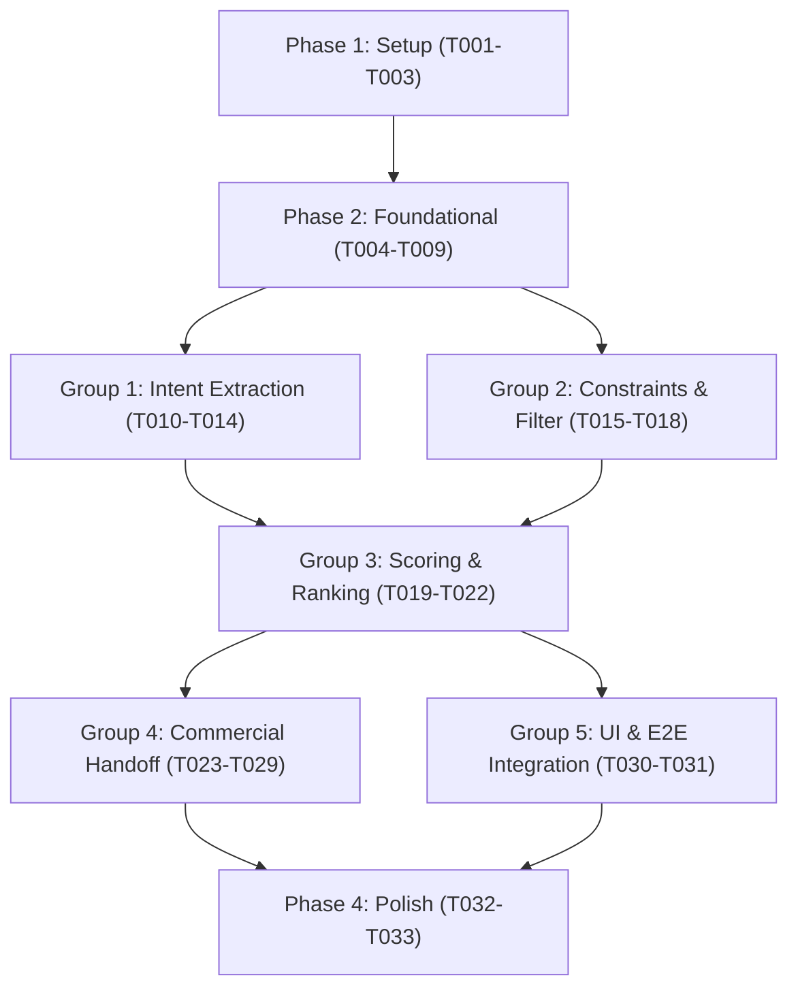

# Tasks: 001-ait-core (AI Tour Matching)

**Feature**: AI Tour Matching (Slice `001-ait-core`)  
**Input**: [spec.md](spec.md), [plan.md](plan.md), [data-model.md](data-model.md), [contracts/matching-api.md](contracts/matching-api.md), [quickstart.md](quickstart.md)  
**Governance**: Constitution Principle II (Test-First Non-Negotiable) — every test task comes before the code task it checks.

---

## Phase 1: Setup (Shared Infrastructure)

**Purpose**: Project initialization and basic dependencies

- [X] T001 Initialize project structure with TypeScript and Vitest configuration in package.json, tsconfig.json, and vitest.config.ts
- [X] T002 [P] Configure environment template in .env.example
- [X] T003 [P] Setup database client abstraction for PostgreSQL and SQLite in src/lib/db/client.ts

---

## Phase 2: Foundational (Blocking Prerequisites)

**Purpose**: Core data layer, seed loading, and validation schemas that must complete before user story implementation

- [X] T004 Test: Seed data loader verification in tests/unit/seed-data.test.ts (loads data/seed/ and validates 4 Hanoi craft villages and experience pricing fixtures)
- [X] T005 Implement Seed data loader and catalog accessor in src/lib/db/seed-loader.ts (satisfies T004)
- [X] T006 [P] Test: Domain types and validation schemas in tests/unit/schema-validation.test.ts
- [X] T007 [P] Implement Zod validation schemas and TypeScript types in src/lib/matching/types.ts (satisfies T006)
- [X] T008 [P] Test: Authentication & access control guard in tests/unit/auth-guard.test.ts (verifies BR-001, BR-002, BR-016)
- [X] T009 [P] Implement authentication & session helper in src/lib/auth/session.ts (satisfies T008)

---

## Phase 3: User Story 1 - AI Tour Matching (Priority: P1) 🎯 MVP

**Goal**: As a Tour Agency, describe tour needs conversationally and receive relevant, ranked Local Experience recommendations with pre-negotiation Quote/Chat handoff (UC-DIS-05).  
**Independent Test**: Run `npx vitest run tests/integration/ait-flow.test.ts` to verify full conversational matching, candidate filtering, ranking, and handoff without external dependencies.

### Group 1: Clarification & Natural Language Intent Extraction
*Covers: FR-001, FR-002, FR-003, FR-004, BR-004, BR-016, BR-017, AC-AIT-ORDER, AC-AIT-FAIL, AC-AIT-CLARIFY*

- [X] T010 [P] [US1] Test: Matching session creation and message history in tests/contract/sessions-api.test.ts (checks FR-001, FR-002, BR-016)
- [X] T011 [P] [US1] Test: Intent extraction, incomplete fields detection, and clarification questions in tests/unit/clarification.test.ts (checks FR-003, FR-004, BR-004, BR-017)
- [X] T012 [P] [US1] Implement OpenAI structured output intent extraction in src/lib/ai/extractor.ts (satisfies T011)
- [X] T013 [US1] Implement session API route in src/app/api/ait/sessions/route.ts (satisfies T010)
- [X] T014 [US1] Implement messages API route in src/app/api/ait/sessions/[id]/messages/route.ts (satisfies T010, T011)

### Group 2: Route, Hard Constraints & Candidate Filtering
*Covers: FR-005, FR-006, BR-003, BR-005*

- [X] T015 [P] [US1] Test: Verified Local Provider candidate retrieval and unpublished exclusion in tests/unit/candidate-filter.test.ts (checks FR-005, BR-003)
- [X] T016 [P] [US1] Test: Hard constraints (capacity, budget, date) and route feasibility filter in tests/unit/hard-constraints.test.ts (checks FR-006, BR-005)
- [X] T017 [P] [US1] Implement candidate repository reading seed catalog in src/lib/matching/candidate-repo.ts (satisfies T015)
- [X] T018 [US1] Implement route distance service and hard-constraint filter in src/lib/matching/constraint-engine.ts (satisfies T016)

### Group 3: Multi-Factor Scoring, Ranking & Explanations
*Covers: FR-007, FR-008, FR-009, FR-012, BR-006, BR-007, BR-008, BR-020*

- [X] T019 [P] [US1] Test: Multi-factor scoring algorithm (0-100) and normalization in tests/unit/scoring-engine.test.ts (checks FR-007, BR-006)
- [X] T020 [P] [US1] Test: Top-5 recommendation formatting, match explanations, and criteria relaxation suggestions in tests/unit/recommendations.test.ts (checks FR-008, FR-012, BR-007, BR-020)
- [X] T021 [US1] Implement multi-factor scoring engine in src/lib/matching/scoring-engine.ts (satisfies T019)
- [X] T022 [US1] Implement recommendation builder and relaxation suggestions in src/lib/matching/recommendation-service.ts (satisfies T020)

### Group 4: Commercial Handoff & Interaction Learning Loop
*Covers: FR-010, FR-011, FR-013, FR-014, FR-015, FR-016, BR-009, BR-010, BR-013, BR-014, BR-015, BR-018, BR-019, BR-021, BR-022*

- [X] T023 [P] [US1] Test: Request Quote uniqueness, chat session reuse, and zero booking creation in tests/contract/quote-chat-api.test.ts (checks FR-011, BR-009, BR-010, BR-018, BR-019)
- [X] T024 [P] [US1] Test: Exponential 30-day half-life time-decay calculation in tests/unit/time-decay.test.ts (checks FR-015, BR-013, BR-021)
- [X] T025 [P] [US1] Test: Agency preference profile saving and personalized Explore re-ranking in tests/unit/preference-profile.test.ts (checks FR-010, FR-014, FR-016, BR-014, BR-015, BR-022)
- [X] T026 [US1] Implement Request Quote API endpoint in src/app/api/ait/sessions/[id]/quote/route.ts (satisfies T023)
- [X] T027 [US1] Implement Chat handoff API endpoint in src/app/api/ait/sessions/[id]/chat/route.ts (satisfies T023)
- [X] T028 [US1] Implement time-decay calculation service in src/lib/decay/time-decay.ts (satisfies T024)
- [X] T029 [US1] Implement Agency preference profile API endpoint in src/app/api/ait/preferences/[agencyId]/route.ts (satisfies T025)

### Group 5: Screen AIT121 UI & End-to-End Flow
*Covers: UI Presentation Tier & Full User Journey*

- [X] T030 [P] [US1] Test: End-to-end conversational matching journey integration test in tests/integration/ait-flow.test.ts
- [X] T031 [US1] Implement interactive conversational matching UI (Screen AIT121) in src/app/ai-matching/page.tsx (satisfies T030)

---

## Phase 4: Polish & Cross-Cutting Concerns

- [X] T032 [P] Validate runnable scenarios against quickstart.md in specs/001-ait-core/quickstart.md
- [X] T033 Code cleanup, formatting, and linting checks in package.json

---

## Dependencies & Execution Order

---

## Parallel Opportunities

- Within Phase 1: `T002` and `T003` can run in parallel after `T001`.
- Within Phase 2: `T006`, `T007`, `T008`, `T009` can run in parallel.
- Within User Story 1:
  - All test tasks (`T010`, `T011`, `T015`, `T016`, `T019`, `T020`, `T023`, `T024`, `T025`) can be written in parallel.
  - Candidate repo (`T017`) and Intent extractor (`T012`) can be implemented in parallel.
  - Endpoints (`T026`, `T027`, `T028`, `T029`) can be implemented in parallel.
