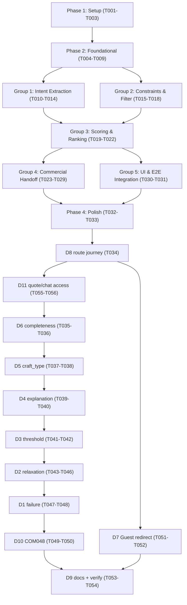

# Tasks: 001-ait-core (AI Tour Matching)

**Feature**: AI Tour Matching (Slice `001-ait-core`)  
**Input**: [spec.md](spec.md), [plan.md](plan.md), [data-model.md](data-model.md), [contracts/matching-api.md](contracts/matching-api.md), [quickstart.md](quickstart.md)  
**Governance**: Constitution Principle II (Test-First Non-Negotiable) — every test task comes before the code task it checks.

---

## Phase 1: Setup (Shared Infrastructure)

**Purpose**: Project initialization and basic dependencies

- [X] T001 Initialize project structure with TypeScript and Vitest configuration in package.json, tsconfig.json, and vitest.config.ts
- [X] T002 [P] Configure environment template in .env.example
- [X] T003 [P] Setup database client abstraction for PostgreSQL and SQLite in src/lib/db/client.ts

---

## Phase 2: Foundational (Blocking Prerequisites)

**Purpose**: Core data layer, seed loading, and validation schemas that must complete before user story implementation

- [X] T004 Test: Seed data loader verification in tests/unit/seed-data.test.ts (loads data/seed/ and validates 4 Hanoi craft villages and experience pricing fixtures)
- [X] T005 Implement Seed data loader and catalog accessor in src/lib/db/seed-loader.ts (satisfies T004)
- [X] T006 [P] Test: Domain types and validation schemas in tests/unit/schema-validation.test.ts
- [X] T007 [P] Implement Zod validation schemas and TypeScript types in src/lib/matching/types.ts (satisfies T006)
- [X] T008 [P] Test: Authentication & access control guard in tests/unit/auth-guard.test.ts (verifies BR-001, BR-002, BR-016)
- [X] T009 [P] Implement authentication & session helper in src/lib/auth/session.ts (satisfies T008)

---

## Phase 3: User Story 1 - AI Tour Matching (Priority: P1) 🎯 MVP

**Goal**: As a Tour Agency, describe tour needs conversationally and receive relevant, ranked Local Experience recommendations with pre-negotiation Quote/Chat handoff (UC-DIS-05).  
**Independent Test**: Run `npx vitest run tests/integration/ait-flow.test.ts` to verify full conversational matching, candidate filtering, ranking, and handoff without external dependencies.

### Group 1: Clarification & Natural Language Intent Extraction
*Covers: FR-001, FR-002, FR-003, FR-004, BR-004, BR-016, BR-017, AC-AIT-ORDER, AC-AIT-FAIL, AC-AIT-CLARIFY*

- [X] T010 [P] [US1] Test: Matching session creation and message history in tests/contract/sessions-api.test.ts (checks FR-001, FR-002, BR-016)
- [X] T011 [P] [US1] Test: Intent extraction, incomplete fields detection, and clarification questions in tests/unit/clarification.test.ts (checks FR-003, FR-004, BR-004, BR-017)
- [X] T012 [P] [US1] Implement OpenAI structured output intent extraction in src/lib/ai/extractor.ts (satisfies T011)
- [X] T013 [US1] Implement session API route in src/app/api/ait/sessions/route.ts (satisfies T010)
- [X] T014 [US1] Implement messages API route in src/app/api/ait/sessions/[id]/messages/route.ts (satisfies T010, T011)

### Group 2: Route, Hard Constraints & Candidate Filtering
*Covers: FR-005, FR-006, BR-003, BR-005*

- [X] T015 [P] [US1] Test: Verified Local Provider candidate retrieval and unpublished exclusion in tests/unit/candidate-filter.test.ts (checks FR-005, BR-003)
- [X] T016 [P] [US1] Test: Hard constraints (capacity, budget, date) and route feasibility filter in tests/unit/hard-constraints.test.ts (checks FR-006, BR-005)
- [X] T017 [P] [US1] Implement candidate repository reading seed catalog in src/lib/matching/candidate-repo.ts (satisfies T015)
- [X] T018 [US1] Implement route distance service and hard-constraint filter in src/lib/matching/constraint-engine.ts (satisfies T016)

### Group 3: Multi-Factor Scoring, Ranking & Explanations
*Covers: FR-007, FR-008, FR-009, FR-012, BR-006, BR-007, BR-008, BR-020*

- [X] T019 [P] [US1] Test: Multi-factor scoring algorithm (0-100) and normalization in tests/unit/scoring-engine.test.ts (checks FR-007, BR-006)
- [X] T020 [P] [US1] Test: Top-5 recommendation formatting, match explanations, and criteria relaxation suggestions in tests/unit/recommendations.test.ts (checks FR-008, FR-012, BR-007, BR-020)
- [X] T021 [US1] Implement multi-factor scoring engine in src/lib/matching/scoring-engine.ts (satisfies T019)
- [X] T022 [US1] Implement recommendation builder and relaxation suggestions in src/lib/matching/recommendation-service.ts (satisfies T020)

### Group 4: Commercial Handoff & Interaction Learning Loop
*Covers: FR-010, FR-011, FR-013, FR-014, FR-015, FR-016, BR-009, BR-010, BR-013, BR-014, BR-015, BR-018, BR-019, BR-021, BR-022*

- [X] T023 [P] [US1] Test: Request Quote uniqueness, chat session reuse, and zero booking creation in tests/contract/quote-chat-api.test.ts (checks FR-011, BR-009, BR-010, BR-018, BR-019)
- [X] T024 [P] [US1] Test: Exponential 30-day half-life time-decay calculation in tests/unit/time-decay.test.ts (checks FR-015, BR-013, BR-021)
- [X] T025 [P] [US1] Test: Agency preference profile saving and personalized Explore re-ranking in tests/unit/preference-profile.test.ts (checks FR-010, FR-014, FR-016, BR-014, BR-015, BR-022)
- [X] T026 [US1] Implement Request Quote API endpoint in src/app/api/ait/sessions/[id]/quote/route.ts (satisfies T023)
- [X] T027 [US1] Implement Chat handoff API endpoint in src/app/api/ait/sessions/[id]/chat/route.ts (satisfies T023)
- [X] T028 [US1] Implement time-decay calculation service in src/lib/decay/time-decay.ts (satisfies T024)
- [X] T029 [US1] Implement Agency preference profile API endpoint in src/app/api/ait/preferences/[agencyId]/route.ts (satisfies T025)

### Group 5: Screen AIT121 UI & End-to-End Flow
*Covers: UI Presentation Tier & Full User Journey*

- [X] T030 [P] [US1] Test: End-to-end conversational matching journey integration test in tests/integration/ait-flow.test.ts
- [X] T031 [US1] Implement interactive conversational matching UI (Screen AIT121) in src/app/ai-matching/page.tsx (satisfies T030)

---

## Phase 4: Polish & Cross-Cutting Concerns

- [X] T032 [P] Validate runnable scenarios against quickstart.md in specs/001-ait-core/quickstart.md
- [X] T033 Code cleanup, formatting, and linting checks in package.json

---

## Phase 5: Round 3 fixes (review of `main` `fc29cbc`, 2026-10-30)

**Purpose**: Fix defects D1–D10 found in the round 3 verify of `main` `fc29cbc` (B1 and B3 confirmed fixed; B2, B4 partly). Decisions: spec §10 #23–#34 (Clarifications 2026-10-30).
**Rule**: every test task is written, run and seen failing for the right reason before its code task (Constitution II). A test whose code already exists (T034) must instead be seen failing under a mutation of that code (the code is changed temporarily, the test goes red, the change is reverted), recorded in the build log (lesson #13).
**Runtime**: tests call route handlers with `new Request(..., { headers: { cookie: 'hab_demo_account=<key>' } })` and `demoRepository().reset()` in `beforeEach`, as in `tests/integration/bkg-create-api.test.ts`. The AI failure path is forced with `vi.mock('@/lib/ai/extractor')`; no production test seam.
**Demo sentences** (#29, all OQ #4 critical fields): "Silk weaving, 10 pax on 2026-11-20 from Hoàn Kiếm" → "Change to 15 pax" → "Change to 13 pax" → "Change to 200 pax" → "Change to 10 pax, budget 20,000 VND per person".

### D8 — Multi-turn through the API route (test gap)
*Covers: FR-009, BR-008, AS-8, BR-005, BR-009, BR-010, BR-018, BR-019*

- [ ] T034 [D8] Test: route-level journey in tests/integration/ait-matching-api.test.ts — one session via `POST /api/ait/sessions`, then the demo sentences through `POST /api/ait/sessions/[id]/messages` + `POST /api/ait/matching`: 10 pax → 5 cards, Vạn Phúc #1; 15 → only Quất Động, Chuông; 13 → no Bát Tràng (4 cards); 200 → no match; fresh session with 15 pax gives the same list as turn 3. Request Quote ×2 and Chat ×2 through `quote/route.ts` and `chat/route.ts` keep their IDs; Quote and Chat on the same Provider share one chat; `bookings` count unchanged. Guest → 401 and provider → 403 on `sessions`, `messages` and `matching` (quote/chat access: T055). Assertions owned by D2–D6 live in their own tasks. Mutation check (H5): (a) make the extractor keep the first group size it sees → the 15 / 13 pax turns go red; (b) make `createQuoteHandoff` always insert a new Quote Request → the Quote ×2 assertion goes red; (c) make `createChatHandoff` ignore the existing Active chat → the Chat ×2 assertion goes red; revert each. Any other failure is a new defect → stop and report.

### D11 — Quote / Chat: authorize before validate (H1)
*Covers: BR-001, BR-002, FR-011, BR-018, BR-019; lesson #15 (authorize → validate → write)*

- [ ] T055 [D11] Test: in tests/integration/ait-matching-api.test.ts — `POST /api/ait/sessions/[id]/quote` and `/chat`: Guest → 401, also with an empty or invalid body; provider, ubnd, hdt → 403; an Agency on another Agency's matching session → 403; a missing `experience_id` from the owning Agency → 400; every denied or invalid request leaves `quote_requests`, `chat_sessions`, `chat_messages` and `bookings` unchanged (deep equal before/after). Must fail on current code (Guest gets 403; the body is validated before access).
- [ ] T056 [D11] In src/app/api/ait/sessions/[id]/quote/route.ts and chat/route.ts: check `authenticated` (401), role `TourAgency` (403) and session ownership (403) before reading or validating the body (satisfies T055).

### D6 — Completeness per OQ #4, nothing invented
*Covers: FR-003, BR-004, AC-AIT-ORDER, AC-AIT-CLARIFY, OQ #4, #29, #34*

- [ ] T035 [P] [D6] Test: in tests/unit/clarification.test.ts and tests/integration/ait-matching-api.test.ts — message without origin → `is_complete=false` with an origin follow-up; without any Experience preference → `is_complete=false` with a preference follow-up; "pottery workshop, 10 pax on 2026-11-20 from Hoàn Kiếm" and "workshop, 10 pax on 2026-11-20 from Hoàn Kiếm" are both complete (#34: a stated Experience type counts); `tour_context` never contains a default `origin_or_route` or `experience_types` the Agency did not state; the messages route returns `tour_preference_profile: null` until all four fields are present. Must fail on current code (extractor defaults origin and experience_types).
- [ ] T036 [D6] Fix `extractTourContext` in src/lib/ai/extractor.ts — remove the default origin and default `experience_types`; read a stated origin ("from <place>") and Experience type (#34 keywords → `category` enum); follow-ups for every missing OQ #4 field (satisfies T035).

### D5 — Craft match by Provider `craft_type`
*Covers: FR-007, BR-006, AS-7, #26, #32*

- [ ] T037 [P] [D5] Test: in tests/unit/scoring-engine.test.ts — every #32 keyword maps to its `craft_type`; with a silk preference, Quất Động (published `craft_type` Silk/Textile) and Vạn Phúc get the same craft-fit score; a fixture Experience whose name and village contain no craft keyword but whose Provider `craft_type` is Silk/Textile still matches; a hat preference and a bamboo preference each give Chuông and Phú Vinh (both Other) the same craft-fit score (#32 limitation); with no craft preference no candidate gets a craft-match bonus. Route-level (ait-matching-api.test.ts): Silk demo keeps Vạn Phúc #1. Must fail on current code (match by hard-coded names).
- [ ] T038 [D5] Expose the published `craft_type` on candidates (`loadExperiences` in src/lib/db/seed-loader.ts, src/lib/matching/candidate-repo.ts) and replace the name/village craft matching in `scoreCandidate` (src/lib/matching/scoring-engine.ts) with the #32 mapping (satisfies T037). The mocked distance stays (checklist limitation, FR-006).

### D4 — Explanation from evaluated profile factors
*Covers: FR-008, BR-007, AS-7, #25*

- [ ] T039 [D4] Test: in tests/unit/recommendations.test.ts and ait-matching-api.test.ts — explanation names the craft preference only when the profile has one (no "silk" for a request without a craft); states capacity against group size; states price against budget when a budget is given; marks distance as estimated. Must fail on current code (template from the Experience name).
- [ ] T040 [D4] Pass the Tour Preference Profile into `buildRecommendations` and build the explanation from evaluated factors in src/lib/matching/recommendation-service.ts; update the call in src/app/api/ait/matching/route.ts (satisfies T039).

### D3 — Apply the 60/100 threshold
*Covers: BR-020, FR-012, OQ #15, #30*

- [ ] T041 [D3] Test: in tests/unit/recommendations.test.ts — ranked fixture with scores 72, 59.9, 40 → only 72 is returned; all below 60 → no-match result with relaxation suggestions; route-level: no `match_score` < 60 in any response of T034. Must fail on current code (no threshold filter).
- [ ] T042 [D3] Filter candidates below 60 after ranking in src/app/api/ait/matching/route.ts (and the recommendation builder) and fall back to the no-match response when none remain (satisfies T041).

### D2 — Useful relaxation suggestions
*Covers: BR-011, FR-012, AS-9, #23, #24*

- [ ] T043 [D2] Test: in tests/unit/recommendations.test.ts and ait-matching-api.test.ts — 10 pax with budget 20,000 → Budget suggestion = 150000 (lowest price among candidates that pass every non-budget constraint **and** score ≥ 60 for this profile, #23 + #30); resending with that budget returns ≥ 1 match; a unit fixture whose cheapest non-budget-feasible candidate scores < 60 suggests the cheapest one scoring ≥ 60, or no Budget suggestion if none does; 200 pax → no Budget suggestion and `conversation_prompt` names capacity with 16 (largest accepted group in the seed); no fixed 600000. Must fail on current code (budget × 1.3, fixed 600000).
- [ ] T044 [D2] Rewrite `buildRelaxationSuggestions` in src/lib/matching/recommendation-service.ts to take the ranked candidates that passed every non-budget constraint and reuse the T042 threshold filter; pass them from the no-match branch of src/app/api/ait/matching/route.ts instead of `[]` (satisfies T043).
- [ ] T045 [P] [D2] Test: in tests/unit/ai-matching-view.test.ts — `noMatchView(response)` returns the prompt and one line per suggestion (criterion + value). Must fail (module does not exist).
- [ ] T046 [D2] Create src/app/ai-matching/matching-view.ts with `noMatchView`; render the suggestions in src/app/ai-matching/page.tsx (the `relaxationSuggestions` field is stored by `fetchMatchingResults` but never rendered) (satisfies T045).

### D1 — No fabricated results on failure
*Covers: FR-003, BR-017, AC-AIT-FAIL, AIT121 Error state, SR-003, #27, #33*

- [ ] T047 [D1] Test: in tests/unit/ai-matching-view.test.ts — `messageOutcome` maps network error, non-2xx (including 503), and incomplete-without-follow-ups to a failure with exactly "Temporary AI Failure — we couldn't process your request right now. Your conversation is saved." and a Retry action of kind `reanalyze` (not a resend), never to cards; `handoffOutcome` maps network error / non-2xx to "Could not complete the request. Nothing was created." with Retry. In ait-matching-api.test.ts with `vi.mock('@/lib/ai/extractor')` forcing a failure: `POST …/messages` returns **503** `{ error_code: 'AI_SERVICE_UNAVAILABLE', message, retry_available: true }` (contract §2), no profile, and the Agency message is kept in the session; then `POST …/messages` with `{ "retry": true }` and a working extractor returns the analysis of the stored conversation and the number of `matching_messages` for the session is unchanged (#33). Must fail on current code.
- [ ] T048 [D1] Add `messageOutcome` / `handoffOutcome` to src/app/ai-matching/matching-view.ts. In src/app/api/ait/sessions/[id]/messages/route.ts return 503 on `processing_status = 'Temporary AI Failure'` and accept `{ retry: true }` (re-analyze, add no message). In src/app/ai-matching/page.tsx remove `simulateMatchingFlow` and the fake success messages in the `catch` blocks of `handleRequestQuote` / `handleChat`; handle every non-2xx and failure with the #27 panel; Retry calls the messages route with `{ retry: true }` (satisfies T047).

### D10 — Quote and Chat open COM048
*Covers: FR-011, AS-10, AS-11, AIT121 element 8, #31*

- [ ] T049 [D10] Test: in tests/unit/ai-matching-view.test.ts — `handoffOutcome` for a successful Quote or Chat response returns `navigateTo = /messages?chat_session_id=<encoded id>`; for a failure returns no `navigateTo`. Must fail (no navigation today).
- [ ] T050 [D10] In `handleRequestQuote` / `handleChat` of src/app/ai-matching/page.tsx navigate with `router.push(outcome.navigateTo)` only after success, as src/app/explore/ExperienceActions.tsx:21 does (satisfies T049).

### D7 — Guest redirected to Login
*Covers: BR-001, BR-002, AS-1, AS-2, #28*

- [ ] T051 [P] [D7] Test: in tests/unit/ai-matching-access.test.ts — `aiMatchingAccess(DEMO_IDENTITIES[key])`: guest → `redirect-login`; agency → `allow`; provider, ubnd, hdt → `restricted`; the restricted copy does not mention Guests. In ait-matching-api.test.ts (L1, #28): provider, ubnd, hdt → `POST /api/ait/sessions` 403 and `matching_sessions` unchanged. Must fail (module does not exist).
- [ ] T052 [D7] Create src/app/ai-matching/ai-matching-access.ts; add a server src/app/ai-matching/layout.tsx that reads the `hab_demo_account` cookie and calls `redirect('/login')` for a Guest (pattern: src/app/explore/providers/[id]/schedule/page.tsx); update the restricted view (`if (role === 'Guest')` branch) in src/app/ai-matching/page.tsx; the in-page "Guest (Blocked)" role button sends the Guest to Login (satisfies T051).

### D9 — Quickstart and status docs

- [X] T053 [D9] Update specs/001-ait-core/quickstart.md (done 2026-10-30 with the tasks; §2 is marked as the behaviour after Phase 5 and is re-checked in T054): run from `main` (not the stale `001-ait-core` branch), `npm ci`, `npm run demo:seed` / `demo:reset` before `npm run dev`, 47 CSVs, drop the SQLite `DATABASE_URL`, replace the `GET /api/ait/sessions` health check (405) with the demo path, demo sentences with origin + craft; update the round 3 checklist sentences in docs/build/claude-context/03-module-status.md the same way.
- [ ] T054 Verify: `npm test` (paste last line), `npm run lint`; mutation checks for D1 (restore the fake offline fallback → T047 red) and D2 (restore budget × 1.3 → T043 red), reverted; `npm run demo:reset`, then run the 03-module-status round 3 checklist in the browser (clicked) and with curl, labelled per step; build-log entry in docs/build/build-log.md; remove row 9 ("Request Quote / Chat are stubs … Chat opens no screen") from the AIT draft of checklist §3 in docs/build/claude-context/03-module-status.md; move the AIT draft rows that are still true into docs/build/mvp-alpha-checklist.md §3 as new rows (its row 9 is BKG and stays), adding (M6) "Date availability is not checked in matching; the Budget suggestion (#23) considers capacity only" (AIT FR-006, #23) and (#32) "Providers with `craft_type` Other match hat/bamboo preferences equally"; update the AIT row of 03-module-status.md.

---

## Dependencies & Execution Order

Round 3 order: T034 first (shared test file and demo sentences), then T055/T056 (same test file). Contract (contracts/matching-api.md) was updated with these tasks and describes the behaviour after Phase 5. D4, D3 and D2 edit the same files (recommendation-service.ts, recommendations.test.ts, matching/route.ts), so they run in sequence; D1 and D10 both edit page.tsx and matching-view.ts. D7 touches only access files and the page header, and can run in parallel after T034.

---

## Parallel Opportunities

- Within Phase 1: `T002` and `T003` can run in parallel after `T001`.
- Within Phase 2: `T006`, `T007`, `T008`, `T009` can run in parallel.
- Within User Story 1:
  - All test tasks (`T010`, `T011`, `T015`, `T016`, `T019`, `T020`, `T023`, `T024`, `T025`) can be written in parallel.
  - Candidate repo (`T017`) and Intent extractor (`T012`) can be implemented in parallel.
  - Endpoints (`T026`, `T027`, `T028`, `T029`) can be implemented in parallel.
