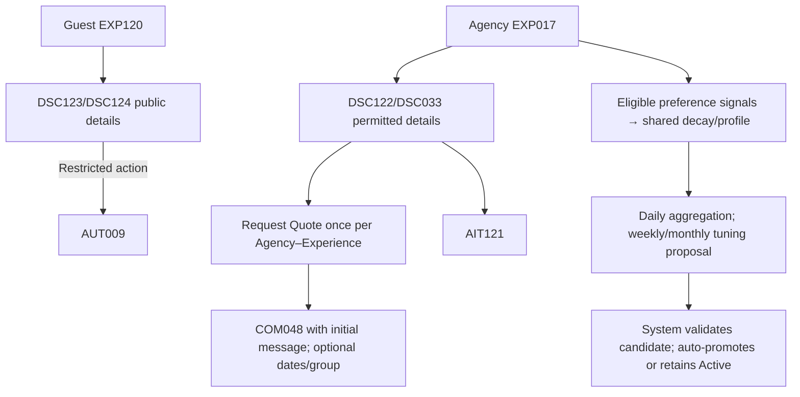
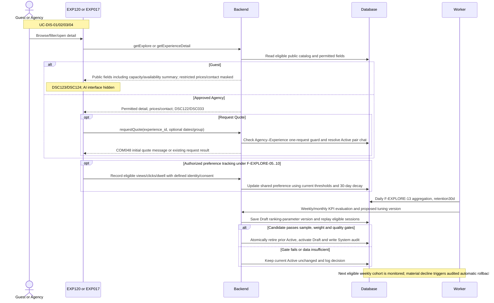

<!-- DBIZ3-SNAPSHOT source=docs/spec/specs/spec-EXP.md sha256=7cc2aca4f1f176f8e224fb8e7bb758ed2ec3fcde2b91318e2836b8b3c762c265 taken=2026-10-13T04:28Z -->
<!-- Read-only copy for Spec Kit. Do not edit here. Edit docs/spec/specs/spec-EXP.md, then run:
     uv run tools/start_feature.py --refresh -->

# Spec Document: Explore

| **Field**                 | **Value**                                                                                                                                                    |
|---------------------------|--------------------------------------------------------------------------------------------------------------------------------------------------------------|
| Module ID                 | EXP                                                                                                                                                          |
| Module name               | Explore                                                                                                                                                      |
| Spec version | v0.2 — consistency revision |
| Author (team member)      | Group G                                                                                                                                                      |
| Date | 28/09/2026 |
| Status | Revised — pending human approval |
| Approved by (Client role) | Pending human approval |
| DBIZ2 source              | Function List rows **F-EXPLORE-01 .. F-EXPLORE-17**; Use Case **UC-DIS-01 .. UC-DIS-04**; Screens **EXP017, EXP120, DSC122, DSC123, DSC033, DSC124, COM048** |

Shared actor/state/field definitions: [Consistency Contract](../docs/consistency-contract.md). Exact current Function contracts are in §5/5.1. Technical choices and unresolved field-design questions are explicitly separated there.

**1. Purpose and scope (mandatory)**

> The Explore module allows Guests and Tour Agencies to discover verified Local Providers and Experiences through browsable cards and detail views. For Tour Agencies, the module additionally learns from browsing behavior to personalize Experience ranking and evaluates aggregate ranking performance for future optimization.

**In scope**

- Display public and authenticated Explore pages.

- Display Experience/Activity cards and quick previews.

- Display Provider and Experience detail information according to user role.

- Display related Experiences and alternative Provider suggestions.

- Record Tour Agency browsing and interaction behavior.

- Track detail-page engagement.

- Record strong interest signals such as Request Quote and Chat.

- Analyze session behavior.

- Update Agency Experience Preference weights.

- Re-rank Experiences within the current Agency session.

- Initiate Request Quote and Chat from Explore.

- Aggregate Explore usage metrics.

- Evaluate ranking quality.

- Define ranking optimization scenarios and KPIs.

- Measure ranking performance.

- Tune ranking parameters based on KPI feedback.

**Out of scope**

- Creating or editing Local Provider or Experience content.

- Provider profile verification.

- AI Tour Matching conversation logic.

- Booking creation or lifecycle management.

- Chat message lifecycle itself.

- User authentication/account management.

- Guest use of Request Quote or Chat.

- Agency creation of bookings directly from Explore.

**Depends on**

| **Dependency**                                     | **Purpose**                                                                                       |
|----------------------------------------------------|---------------------------------------------------------------------------------------------------|
| **AUT – Authentication, Access & User Management** | Checks permission for protected actions and redirects Guests to Login.                            |
| **PRF – Profile Management**                       | Supplies verified Provider/Experience content, pricing, images, capacity and booking information. |
| **AIT – AI Tour Matching**                         | May provide Agency Preference Profile and updated preference signals used for personalization.    |
| **CHAT – In-app Chat**                             | Receives Chat and Request Quote handoff from Explore.                                             |
| **Schedule / Booking**                             | Supplies public availability information displayed on Experience detail.                          |

**2. Actors (mandatory)**

| **Actor**                  | **Role in this module**                                                                                                     | **Where it comes from** |
|----------------------------|-----------------------------------------------------------------------------------------------------------------------------|-------------------------|
| **Tour Agency**            | Main authenticated Explore user; browses full content and uses protected actions                                            | F-EXPLORE-01–04         |
| **Guest**                  | Browses publicly permitted Explore and detail information without Quote/Chat actions                                        | F-EXPLORE-01–04         |
| **System**                 | Records activity, analyzes behavior, updates preference weights, re-ranks content and evaluates algorithm performance       | F-EXPLORE-05–17         |
| **Local Provider**         | Appears as the Provider whose profile/Experience is being viewed; final Use Case also lists LP as an actor for detail views | UC-DIS-03/04            |
| **HDT Admin / UBND Admin** | May view Provider/Experience information according to Use Case scope                                                        | UC-DIS-03/04            |
| **Chat module**            | Receives the conversation handoff from Chat/Request Quote actions                                                           | F-EXPLORE-11/12         |

**3. User scenarios and acceptance criteria (mandatory)**

## **US-1 (P1): Browse Explore — UC-DIS-01**

**Journey.** As a Guest or Tour Agency, I want to browse verified Experiences so that I can discover suitable craft and cultural activities.

### **Acceptance scenarios**

1.  Given the user opens Explore, when content loads, then verified Experience cards are displayed with pagination.

2.  Given a Tour Agency is authenticated, then full permitted actions are available.

3.  Given a Guest browses Explore, then public content is visible but protected actions such as Request Quote and Chat require Login.

4.  Given an Agency Preference Profile exists, it may be used when ordering initial Explore results.

5.  Given no Experience is available, the Explore page displays a valid empty state rather than failing.

UC-DIS-01 maps to F-EXPLORE-01 and F-EXPLORE-02.

## **US-2 (P2): Explore Experiences with Personalization — UC-DIS-02**

**Journey.** As a Tour Agency, I want Explore to learn from my browsing behavior so that relevant Experiences appear higher during my session.

### **Acceptance scenarios**

1.  Given an Agency browses Experience cards, when it clicks, expands previews, views details, filters or scrolls, then those interactions are logged.

2.  Given an Agency visits an Experience detail page, then visit duration and defined engagement signals are recorded.

3.  Given an Agency selects Quote or Chat, then the action is stored as a stronger preference signal.

4.  Given sufficient session signals exist, when session behavior is analyzed, then a session preference pattern is produced.

5.  Given the Agency preference changes, then current Explore results are re-ranked using the updated preference weights.

6.  The personalized re-ranking affects that Agency's results and does not automatically change another Agency's preference profile.

7.  Aggregate metrics are periodically evaluated to assess and improve Explore ranking performance.

UC-DIS-02 maps to F-EXPLORE-05–10 and F-EXPLORE-13–17.

## **US-3 (P1): View Provider — UC-DIS-03**

**Journey.** As a Tour Agency, I want to view information about a Local Provider so that I can evaluate the Provider behind an Experience.

### **Acceptance scenarios**

1.  Given an Agency selects a Provider, when the Provider information loads, then permitted Provider information and related Experiences are displayed.

2.  Given a Guest views Provider information, then restricted commercial/contact information is not exposed.

3.  Given an authenticated actor has broader visibility rights, then its permitted information is displayed according to access scope.

4.  Viewing Provider information must not grant editing permission.

The final Use Case maps UC-DIS-03 to F-EXPLORE-03.

## **US-4 (P1): View Experience — UC-DIS-04**

**Journey.** As a Tour Agency, I want to view Experience details and related options so that I can decide whether to continue with the Provider.

### **Acceptance scenarios**

1.  Given a Tour Agency opens an Experience detail page, then full permitted Experience information, pricing, operational information and Provider contact information are displayed.

2.  Given a Guest opens public Experience detail, then public Experience information is displayed while protected commercial/contact information remains hidden.

3.  Related Experiences may be displayed from the same Provider, similar activity type or nearby locations.

4.  Given a Tour Agency chooses Chat, permission is checked before the Provider conversation opens.

5.  Given a Guest attempts Chat or another protected action, then Login is required.

UC-DIS-04 maps to F-EXPLORE-03, F-EXPLORE-04 and F-EXPLORE-12.

### **Edge cases**

- No Experiences are available.

- Experience referenced by a card has been deleted or unpublished.

- Agency Preference Profile does not yet exist.

- User exits detail page before engagement timer completes.

- Duplicate events are sent for the same interaction.

- Chat service is unavailable.

- Request Quote has already been created for the same Experience.

- Ranking algorithm receives insufficient behavior data.

- KPI calculations run before enough sessions exist.

- New ranking parameters reduce performance compared with the previous version.

### Consistency acceptance examples

| AC ID | Given / When | Expected result |
|---|---|---|
| AC-EXP-GUEST | Guest opens public Experience detail | Capacity/anonymous availability visible; price/contact hidden; AI nav absent. |
| AC-EXP-QUOTE | Agency requests the same Experience on two different dates | Reuse the one Agency–Experience Quote Request; no second request identity. |
| AC-EXP-CONSENT | Guest refuses analytics consent | No non-essential analytics/personalization; browsing still works. |
| AC-EXP-VERSION | System proposes tuned algorithm parameters | Save a Draft; promote it automatically only after the sample, bounded-change and offline-replay gates pass. Otherwise the current Active version remains unchanged. |

**4. Flows (mandatory)**

**4.1 Usage flow**

**4.2 Sequence for the main flow**

**5. Functional requirements (mandatory)**

| FR ID | Function List ID | Requirement — system MUST | Actor | Priority |
|---|---|---|---|---|
| FR-001 | F-EXPLORE-01 | Load and display initial Explore page with experience/activity catalog in card format.  VISIBILITY BY ROLE: - Tour Agency: Full access, all verified experiences, all action buttons enabled - Guest: Public Explore browse ALLOWED. Guest can view Experience cards, quick previews and Public Experience Detail. Request Quote and Chat remain disabled and display "Login required". Attempting a protected action redirects to Login. | Tour Agency / Guest | Must |
| FR-002 | F-EXPLORE-02 | Display an individual Experience card with activity photo, activity name, craft/activity type, Village name, short description, Local Provider name, duration, capacity and price when permitted. Capacity is derived from the stored max_participants field and displayed as 1 to max_participants. For Tour Agency, View Details, Request Quote and Chat are enabled. For Guest, View Details opens the Public Experience Detail; Request Quote and Chat require login. | Tour Agency / Guest | Must |
| FR-003 | F-EXPLORE-03 | Display full experience detail page: activity name, Local Provider name/location, all images gallery, full activity description, duration, participant capacity, included items (materials, equipment, instruction), excluded items (meals not included, etc.), pricing breakdown, operational info (class hours, booking lead time, cancellation policy), Local Provider bio + contact info, availability calendar (booked/available slots only), related experiences from same or other providers, recommendation of other craft types.  Display full experience detail page: - VISIBLE TO ALL (Tour Agency + Guest): Activity name, craft type, duration, participant capacity, image gallery, full public description, included/excluded items, Local Provider name and public bio, related Experiences, other craft suggestions and public availability information.  - VISIBLE TO TOUR AGENCY ONLY: Full pricing breakdown, detailed operational/booking information and Local Provider private contact information.  -ACTION BUTTONS: Tour Agency — Request Quote / Chat enabled. Guest — Request Quote / Chat disabled and redirects to Login. | Tour Agency / Guest | Must |
| FR-004 | F-EXPLORE-04 | Display related experiences: other activities from same Local Provider, similar activities from other providers in same craft type, or activities in nearby villages. Shows: activity name, provider, duration, capacity, price (if available), photos. Linked from experience detail page or from experience card quick preview. Helps Tour Agency discover alternatives. | Tour Agency / Guest | Should |
| FR-005 | F-EXPLORE-05 | Log every user interaction with experience/activity cards: when clicks experience card, when expands quick preview, when clicks "View Details", when filters applied, when scrolls through results. Captures: user_id, session_id, action_type (click_card / expand_preview / view_detail / apply_filter / scroll), experience_id, provider_id, timestamp, duration_on_previous_screen. Authenticated Agency interactions may be linked to the Agency for personalization.  Guest interactions must not be linked to a user identity. Non-essential Guest analytics are logged only when analytics_consent = true and use an anonymous session identifier. When consent is not given, only strictly necessary technical events are retained and are not used for personalization. | System | Should |
| FR-006 | F-EXPLORE-06 | When Tour Agency visits experience detail page: start timer. Record: how long spent on page, which sections viewed (scroll depth %), did they view gallery fully, did they expand activity requirements/materials, did they view provider info/contact, time until next action (chat, request quote). On page exit: log total duration and sections viewed. | System | Should |
| FR-007 | F-EXPLORE-07 | When Tour Agency takes a strong-interest action from an Explore Experience card/detail page, record the action. Supported MVP action types are Request Quote and Chat. Log action_type, experience_id, provider_id, timestamp and source context. | System | Should |
| FR-008 | F-EXPLORE-08 | Analyze behavior logs from F-EXPLORE-05, F-EXPLORE-06 and F-EXPLORE-07 in the current Explore session: which experience types viewed most, which providers attractive, time spent per experience, patterns (e.g., "all pottery workshops", "all <500k price range", "all full-day activities", "all with English guide"). Detect explicit preferences (user filtered by activity_type=pottery_workshop) and implicit preferences (user clicked 5 pottery activities out of 10 views, spent long time on English-guide activities). Build session experience preference profile.  Preference detection rules: - An explicit filter choice immediately creates an explicit preference signal. - Request Quote or Chat immediately creates a strong positive signal for the related Experience attributes. - An implicit positive preference is created when the same attribute appears in at least 3 interacted Experiences and represents at least 50% of Experience clicks/views in the current session. - Detail-page dwell time of at least 60 seconds on at least 2 Experiences sharing the same attribute may also create an implicit positive signal. - A single click or view alone does not create a persistent implicit preference. | System | Should |
| FR-009 | F-EXPLORE-09 | Update the Agency Preference Profile in real time using the session behavior pattern generated by F-EXPLORE-08. Adjust relevant Experience/activity preference weights based on current-session browsing and strong-action signals. Store the updated Agency-specific preference weights for use by F-EXPLORE-10. F-EXPLORE-09 applies current-session behavior only. Historical time decay is handled exclusively by F-MATCH-15. | System | Should |
| FR-010 | F-EXPLORE-10 | After F-EXPLORE-09 updates the Agency Preference Profile, re-rank using the version pinned from Active when that Explore session starts. Store the version ID and each displayed Experience list with timestamp/positions in tracked Explore sessions for F-EXPLORE-14/16/17 attribution and replay. Store no ranking history when non-essential tracking is disabled. Show refreshed results with a subtle indicator. | System | Should |
| FR-011 | F-EXPLORE-11 | When a Tour Agency clicks "Request Quote" from an Experience card or detail page, the system calls F-AUTH-16 to verify permission. If granted, the system creates or reuses the Quote Request for the selected Experience and opens the related Chat with the Local Provider through F-CHAT-01. The chat thread is scoped per (Agency, Local Provider) pair and is reused across all Experiences of that provider. The "Request Quote" action is one-time per (Agency, Experience) pair: once used for a given Experience, the button is hidden for that Agency on that Experience only, while it remains available for other Experiences from the same Local Provider — each such request appends a new quote-request message to the existing chat thread rather than creating a new one. The Quote Request is not a Booking. The action is logged through F-EXPLORE-07. | System | Should |
| FR-012 | F-EXPLORE-12 | When Tour Agency clicks "Chat" from experience card or detail page: calls F-AUTH-16 to verify permission. If granted → opens chat session with Local Provider of that experience. Auto-sends an initial message containing Agency information, the selected Experience and source context. Group size and interested dates are included only when these values are already available from an Agency Preference Profile or related AI Matching context; Explore does not require the Agency to enter them before opening Chat. The Chat action is recorded through F-EXPLORE-07 as a strong Explore preference signal. | System | Should |
| FR-013 | F-EXPLORE-13 | System tracks aggregate metrics: experiences viewed, experiences clicked, activity types viewed  (by type distribution), actions taken (quote requests, chats), user retention, time spent per session,  top experiences. Data feeds into: Experience ranking optimization (F-EXPLORE-14/15/16/17), Agency Preference Profile updates, versioned ranking-parameter evaluation under F-EXPLORE-14..17; no standalone model-retraining pipeline in MVP. | System | Should |
| FR-014 | F-EXPLORE-14 | Compare ranked experience positions vs actual user clicks/conversions. Did user click top-ranked experience card? Did top-5 ranked experiences get clicked? Did user take action (quote/chat) on highly-ranked experiences? If top-ranked activities got clicked/converted → ranking quality GOOD. If user ignored ranked activities, scrolled past, or searched instead → ranking quality POOR. Measure ranking quality score (0-100). Data used to close learning loop and determine if algorithm working.  ranking_quality_score = 0.50 × rank_relevance_score + 0.30 × click_engagement_score + 0.20 × strong_action_score.  rank_relevance_score: - selected rank 1 = 100 - ranks 2–3 = 80 - ranks 4–5 = 60 - ranks 6–10 = 30 - no ranked Experience selected = 0  click_engagement_score = 100 when at least one ranked Experience is clicked; otherwise 0.  strong_action_score = 100 when Request Quote or Chat occurs for a ranked Experience; otherwise 0.  assessment = Good when ranking_quality_score >= 60; otherwise Poor. | System | Should |
| FR-015 | F-EXPLORE-15 | Define explicit scenarios: Scenario A (user clicks top-ranked experience card within 10sec, takes action) = good ranking → improve this direction. Scenario B (user scrolls past ranked experiences + searches instead of clicking ranked results) = bad ranking → optimize away. Scenario C (user clicks experience ranked #5-10, skips #1-4) = ranking partially relevant → adjust weights. Define KPIs to measure: CTR (click-through rate on ranked experiences), conversion rate (explore→quote request on ranked experiences), avg rank position of selected experience, time-to-action, activity type distribution of selections. This function defines versioned optimization rules/KPIs and is executed when a ranking-algorithm version is created or revised, not as part of every Explore session. | System | Should |
| FR-016 | F-EXPLORE-16 | Calculate weekly/monthly KPIs: CTR (% of ranked experience cards clicked), conversion rate (% of Explore sessions where ranked experience led to quote request / chat / booking), rank position of selected experience (avg rank of experience user actually selected/acted on), user engagement time on ranked experiences, bounce rate (users leave Explore without interacting). Compare before/after algorithm changes to measure improvement. Store metrics in time series with algorithm version tracking. KPIs are calculated weekly by default. Monthly values are roll-ups of the weekly metrics. No separate daily KPI cycle is used for MVP. | System | Should |
| FR-017 | F-EXPLORE-17 | Weekly, System evaluates F-EXPLORE-16 KPIs and F-EXPLORE-15 scenario outcomes, saves a bounded candidate Draft, replays eligible sessions and promotes it automatically only if BR-015 gates pass. Promotion atomically retires the previous Active version and writes a System audit. The next eligible weekly cohort is monitored; a material live quality decline causes audited automatic rollback to the prior parameter map. Failure, invalid candidate or insufficient data leaves Active unchanged. F-EXPLORE-10 uses only Active. | System | Should |

**5.1 Input / Output contract**

| FR ID | Input fields and validation | Required | Output fields | Notes |
|---|---|---|---|---|
| FR-001 | agency_id (ID; Optional — absent for Guest) agency_preference_profile (Object; Optional — if one exists) page (Integer; Optional — default 1)  page_size (Integer; Optional — default 12, maximum 50) | As specified per field | experience_cards (Array<ExperienceCard>; Required — see F-EXPLORE-02) pagination (Object{page, page_size, total_count}; Required) | Same contract as F-EXPLORE-01; optional fields are not required. |
| FR-002 | experience (Object; Required), with: - id (ID; Required) - name (String; Required) - type (Enum; Required) - location (Object{village_name}; Required) - provider_name (String; Required) - images (Array<Image>; Required) - description (String, 1–2 sentences; Required) - duration (see F-PROFILE-06; Required) - capacity (Object{min_pax: Integer = 1, max_pax: Integer = max_participants}; Required) - price (Decimal, VND; Optional — visible to authenticated Tour Agency only; hidden from Guest) | As specified per field | card_view (UI Component; Required) quick_preview (UI Component; Optional — on click) | Same contract as F-EXPLORE-02; optional fields are not required. |
| FR-003 | experience_id (ID; Required for Experience detail; omitted for Provider-only detail) provider_id (ID; Required for Provider-only detail; derived from Experience otherwise) agency_id (ID; Optional — absent for Guest) | As specified per field | Visible to all: - activity_name (String; Required) - craft_type (Enum; Required) - duration, participant_capacity (see F-EXPLORE-02; Required) - images (Array<Image>; Required) - public_description (Text; Required) - included_items, excluded_items (Array<String>; Optional) - provider_name (String; Required) - provider_public_bio (Text; Optional) - related_experiences (Array<Object>; Optional) - other_craft_suggestions (Array<Object>; Optional) - availability_summary (Object{   operating_hours,   available_slots,   blocked_slots: Array<Object{start_at, end_at, status}> }; Required — contains public schedule information only; blocked slots expose only time and status, never Agency identity, agreed price or booking conditions)  Tour Agency only: - pricing_breakdown (Object{price_per_person, group_discounts}; Required) - operational_booking_info (Object{class_hours, booking_lead_time, cancellation_policy}; Required) - provider_private_contact (Object{phone, email}; Required) action_buttons (Array<Enum[Request Quote, Chat]> with enabled flag; Required) | Same contract as F-EXPLORE-03; optional fields are not required. |
| FR-004 | experience_id (ID; Required) relation_types (Array<Enum[Same Provider, Same Craft Type, Nearby]>; Optional — default uses all three)  nearby_radius_km (Decimal; Optional — default 20 km when Nearby is used) | As specified per field | related_experiences (Array<Object{experience_id, name, provider_name, duration, capacity, price (Optional), photos}>; Required — may be empty) | Same contract as F-EXPLORE-04; optional fields are not required. |
| FR-005 | user_id (ID; Optional — authenticated Agency only; null for Guest)  session_id (String; Required)  tracking_scope (Enum[Personalized, Anonymous Analytics, No Non-essential Tracking]; Required)  analytics_consent (Boolean; Required for Guest non-essential analytics)  action_type (Enum[click_card, expand_preview, view_detail, apply_filter, scroll]; Required)  experience_id (ID; Optional — not required for apply_filter/scroll)  provider_id (ID; Optional)  timestamp (DateTime; Required)  duration_on_previous_screen (Integer, seconds; Optional)  filter_values (Object; Optional — populated for apply_filter events) | As specified per field | logged (Boolean; Required)  interaction_log_id (ID; Optional — returned only when an interaction event is actually stored) | Same contract as F-EXPLORE-05; optional fields are not required. |
| FR-006 | agency_id (ID; Required) experience_id (ID; Required) entered_at (DateTime; Required) exited_at (DateTime; Required) scroll_depth_pct (Integer 0–100; Required) sections_viewed (Array<Enum[   Gallery,   Description,   Included/Excluded Items,   Provider Bio,   Availability,   Pricing,   Booking Conditions,   Provider Contact,   Related Experiences ]>; Required — Pricing, Booking Conditions and Provider Contact are tracked only when visible to the authenticated Agency) next_action (Enum[Chat, Request Quote]; Optional) time_to_next_action (Integer, seconds; Optional) | As specified per field | detail_visit_log_id (ID; Required) duration_seconds (Integer; Required) | Same contract as F-EXPLORE-06; optional fields are not required. |
| FR-007 | agency_id (ID; Required)  action_type (Enum[Request Quote, Chat]; Required)  experience_id (ID; Required)  provider_id (ID; Required)  timestamp (DateTime; Required)  source_context (Enum[Card, Detail Page]; Required) | As specified per field | action_signal_log_id (ID; Required) | Same contract as F-EXPLORE-07; optional fields are not required. |
| FR-008 | session_id (String; Required) session_logs (Array<InteractionLog>; Required) | As specified per field | session_behavior_pattern (Object; Required), with: - clicked_experience_types (Map<Enum, Integer>; Required) - provider_patterns (Array<Object>; Optional) - time_patterns (Object; Optional) - filter_choices (Array<Object>; Optional) - implicit_preferences (Array<Object>; Optional) | Same contract as F-EXPLORE-08; optional fields are not required. |
| FR-009 | session_behavior_pattern (Object; Required)  agency_preference_profile (Object; Optional — absent for a new Agency) | As specified per field | updated_preference_weights (Map<String, Decimal>; Required) updated_at (DateTime; Required) | Same contract as F-EXPLORE-09; optional fields are not required. |
| FR-010 | updated_preference_profile (Object; Required) current_experience_list (Array<ID>; Required) session_id (ID; Required) | As specified per field | reranked_experience_list (Array<Object{experience_id, rank, score}>; Required) ranking_version_id (ID; Required for tracked sessions) results_refreshed_indicator (Boolean; Required) | Persist the displayed list and Active version only when tracking is permitted; F-EXPLORE-14/16 use this exposure record. |
| FR-011 | experience_id (ID; Required)  agency_id (ID; Required — from session)  activity_details (Object{   duration: Integer Optional }; Optional — prefilled from the selected Experience; Request Quote does not require the Agency to complete a separate form) | As specified per field | quote_request_id (ID; Required)  is_new_request (Boolean; Required — true only for the first Quote Request for the Agency–Experience pair)  chat_session_id (ID; Required) | Same contract as F-EXPLORE-11; optional fields are not required. |
| FR-012 | experience_id (ID; Required)  provider_id (ID; Required)  agency_id (ID; Required — from session)  action_context (Object{   source: Enum[Card, Detail Page],   known_group_size: Integer Optional,   known_dates: Object Optional }; Optional) | As specified per field | chat_session_id (ID; Required) initial_message_id (ID; Required) | Same contract as F-EXPLORE-12; optional fields are not required. |
| FR-013 | interaction_logs (Array<Object>; Required) aggregation_period (Enum[Daily, Weekly, Monthly]; Required) | As specified per field | aggregated_metrics (Object; Required), with: - experience_views (Integer; Required) - unique_experiences_viewed (Integer; Required) - experience_clicks (Integer; Required) - click_rate (Decimal, %; Required) - filter_usage (Map<String, Integer>; Required) - quote_request_count (Integer; Required) - chat_action_count (Integer; Required) - action_rate (Decimal, %; Required) - avg_session_duration (Integer, seconds; Required) - bounce_rate (Decimal, %; Required) - top_experiences (Array<ID>; Required) - user_retention_30d (Decimal, %; Optional — percentage of authenticated Agencies in a cohort that return to Explore within 30 days of their first Explore session) | Same contract as F-EXPLORE-13; optional fields are not required. |
| FR-014 | ranked_experience_list (Array<Object>; Required) user_action_logs (Array<Object>; Required) session_outcomes (Array<Object>; Required) | As specified per field | ranking_quality_score (Integer 0–100; Required)  assessment (Enum[Good, Poor]; Required — Good when ranking_quality_score >= 60) | Same contract as F-EXPLORE-14; optional fields are not required. |
| FR-015 | behavior_patterns (Array<Object>; Required) ranking_outcomes (Array<Object>; Required) success_criteria (Object; Required — versioned configuration maintained by the project/system team; not recalculated separately for each user session) | As specified per field | scenario_rules (Array<Object{scenario: Enum[A, B, C], condition, action}>; Required) kpi_definitions (Array<Object{kpi, formula, target}>; Required) | Same contract as F-EXPLORE-15; optional fields are not required. |
| FR-016 | interaction_logs (Array<Object>; Required) explore_session_data (Array<Object>; Required) algorithm_version (String; Required) | As specified per field | ctr (Decimal, %; Required) conversion_rate (Decimal, %; Required) avg_rank_selected (Decimal; Required) engagement_time (Integer, seconds; Required) bounce_rate (Decimal, %; Required) improvement_vs_previous (Decimal, %; Optional — none for the first version) algorithm_version (String; Required) period_granularity (Enum[Weekly, Monthly]; Required — default Weekly) period (Date range; Required) | Same contract as F-EXPLORE-16; optional fields are not required. |
| FR-017 | kpi_results (Object; Required) scenario_analysis (Object; Required) current_parameters (Map<String, Decimal>; Required) tuning_rules (Object; Required) eligible_session_count (Integer; Required) replay_quality_delta (Decimal, points; Optional until replay) | As specified per field | optimized_parameters (Map<String, Decimal>; Optional when no candidate) tuning_decision_log (Object; Required) new_algorithm_version (ID; Optional when unchanged) version_status (Enum[Draft, Active, Retired]; Optional when unchanged) audit_log_id (ID; Optional when activation/rollback occurs) | Reject invalid weights, insufficient cohort or replay gain below 5 points. Keep Active on failure. Roll back after a later eligible weekly cohort declines by at least 5 live quality points. |

**5.2 Business rules**

| **Rule ID** | **Rule**                                                                                                                                   | **Why it exists**                                                 |
|-------------|--------------------------------------------------------------------------------------------------------------------------------------------|-------------------------------------------------------------------|
| **BR-001**  | Explore may display only Experiences/Providers eligible for discovery according to verification rules.                                     | Prevents unverified content from being promoted.                  |
| **BR-002**  | Guests may browse public Explore content but cannot use protected Quote/Chat actions without Login.                                        | Separates public discovery from member collaboration.             |
| **BR-003**  | Sensitive pricing, operational and Provider contact fields must follow the visibility rules defined for Guest versus Tour Agency.          | Protects competitive/business information.                        |
| **BR-004**  | Agency browsing behavior may be recorded as preference signals for personalization.                                                        | Enables the Explore learning loop.                                |
| **BR-005**  | Simple browsing signals and strong actions must remain distinguishable; Request Quote/Chat are stronger intent signals than passive views. | Improves preference interpretation.                               |
| **BR-006**  | Session behavior analysis uses F-EXPLORE-05, 06 and 07 as its input sources.                                                               | Maintains traceable learning flow.                                |
| **BR-007**  | F-EXPLORE-09 updates Agency-specific preference weights.                                                                                   | Keeps preferences specific to each Agency.                        |
| **BR-008**  | F-EXPLORE-10 re-ranks the current Experience list for the relevant Agency only.                                                            | Prevents one Agency's behavior affecting another Agency directly. |
| **BR-009**  | Request Quote and Chat require F-AUTH-16 permission before handoff.                                                                        | Enforces authentication and authorization.                        |
| **BR-010**  | Request Quote is not a Booking.                                                                                                            | Booking remains under Schedule/Booking and Provider control.      |
| **BR-011**  | Aggregate Explore metrics must not be treated as individual Agency-specific personalization results.                                       | Separates personal learning from system-wide optimization.        |
| **BR-012**  | F-EXPLORE-13–17 form the system-level ranking optimization loop.                                                                           | Separates global ranking improvement from session re-ranking.     |
| **BR-013**  | Ranking-quality/KPI evaluation must compare actual user behavior against ranked positions.                                                 | Provides measurable algorithm feedback.                           |
| **BR-014**  | Every proposed change to ranking parameter values creates a Draft version and tuning decision log. System promotion changes status, not parameter values, and writes `audit_logs` with a NULL human actor and both version IDs. Rollback copies the previous parameter map into a new version rather than reactivating a Retired version. | Supports auditability and comparison across versions. |
| **BR-015** | F-EXPLORE-17 runs weekly. At least 30 eligible, consented or otherwise authorized tracked Explore sessions in the preceding seven days are required. Each weight may change by no more than 10 percentage points and weights remain valid/normalized. Offline replay must improve mean ranking-quality proxy by at least 5 points on the 0–100 scale, with eligibility constraints unchanged. Replay re-ranks the historical displayed catalog, locates the Experience actually clicked/acted on, and recomputes the F-EXPLORE-14 rank-relevance component while keeping observed click/strong-action facts fixed; sessions with no action still count. This is a proxy and does not establish better live conversion. Passing candidates promote Draft → Active and prior Active → Retired in one transaction. After a new eligible seven-day cohort of at least 30 sessions, a live mean quality decline of at least 5 points versus the pre-promotion baseline triggers an audited automatic rollback. Any failed gate or transaction leaves the current Active version unchanged; there is no Admin edit/approval path. | MVP working thresholds make automatic tuning measurable, bounded and reversible; calibrate them with real traffic before production. |

**6. Key entities (mandatory)**

| **Entity**                               | **Attributes (from Input/Output fields)**                                        | **Relationships**                             |
|------------------------------------------|----------------------------------------------------------------------------------|-----------------------------------------------|
| **Explore Session**                      | session_id, agency_id/guest context, ranking_version_id and displayed ranked results when tracked, timestamps | has many interaction logs; optionally references one Ranking Parameter Version |
| **Experience Card**                      | experience_id, name, type, location, Provider, images, duration, capacity, price | references one Experience                     |
| **Experience Detail**                    | Experience data, Provider data, availability, pricing/operational fields         | belongs to one Experience                     |
| **Interaction Log**                      | user_id, session_id, action_type, experience_id, provider_id, timestamp          | belongs to Explore Session                    |
| **Detail Visit Log**                     | experience_id, duration, scroll depth, sections viewed, next action              | belongs to Agency session                     |
| **Action Signal**                        | action_type, experience_id, provider_id, context, timestamp                      | belongs to Agency preference learning         |
| **Session Behavior Pattern**             | clicked activity types, Provider patterns, filters, implicit preferences         | derived from Interaction Logs                 |
| **Agency Experience Preference Profile** | Agency ID, preference weights, updated_at                                        | belongs to one Agency                         |
| **Ranked Experience**                    | experience_id, rank, score                                                       | generated from Experience + Agency preference |
| **Related Experience Set**               | origin Experience, related Experience IDs, relation type                         | derived from catalog relationships            |
| **Quote Request**                        | quote_request_id, Agency, Experience, context                                    | may open one Chat session                     |
| **Explore Aggregate Metrics**            | views, click rate, action rate, session duration, top Experiences                | aggregated across sessions                    |
| **Ranking Quality Assessment**           | score, assessment, ranking/session outcomes                                      | evaluates a ranking result/version            |
| **Optimization Scenario**                | scenario rule, condition, action, KPI definition                                 | used for global optimization                  |
| **Algorithm Performance Record**         | algorithm version, period, CTR, conversion, rank, engagement, bounce rate        | belongs to one ranking version                |
| **Ranking Parameter Version**            | parameter map, version, tuning log                                               | produces later Explore rankings               |

**7. Screens involved**

| Screen ID | Screen name | Functions in this module |
|---|---|---|
| DSC033 | Experience Detail | F-EXPLORE-03, F-EXPLORE-11, F-EXPLORE-12 |
| DSC122 | Provider Profile | F-EXPLORE-03 |
| DSC123 | Public Provider Profile | F-EXPLORE-03 |
| DSC124 | Public Experience Detail | F-EXPLORE-03 |
| EXP017 | Explore | F-EXPLORE-01, F-EXPLORE-02, F-EXPLORE-03, F-EXPLORE-04, F-EXPLORE-05, F-EXPLORE-06, F-EXPLORE-07, F-EXPLORE-08, F-EXPLORE-09, F-EXPLORE-10, F-EXPLORE-11, F-EXPLORE-12, F-EXPLORE-13, F-EXPLORE-14, F-EXPLORE-15, F-EXPLORE-16, F-EXPLORE-17 |
| EXP120 | Public Explore | F-EXPLORE-01, F-EXPLORE-02, F-EXPLORE-03, F-EXPLORE-04, F-EXPLORE-05 |
| SCH140 | Provider Schedule – Agency View | F-EXPLORE-11 |
| VIL030 | Village Profile | F-EXPLORE-02 |

**8. Success criteria (mandatory)**

| **SC ID**  | **Criterion**                                                                                  | **How it is measured**                                                         |
|------------|------------------------------------------------------------------------------------------------|--------------------------------------------------------------------------------|
| **SC-001** | Guest can browse public Explore without gaining access to restricted Quote/Chat actions.       | Test public Explore and attempt restricted actions.                            |
| **SC-002** | Tour Agency sees the permitted full Experience information and protected actions.              | Compare authenticated and Guest rendering of the same Experience.              |
| **SC-003** | Explore records the defined Agency browsing and strong-action signals.                         | Perform each tracked interaction and inspect generated log records.            |
| **SC-004** | Meaningful Agency behavior can change the ordering of Explore results within the same session. | Generate a clear preference pattern and compare ranking before/after.          |
| **SC-005** | Agency A's browsing does not directly alter Agency B's personal preference ranking.            | Run independent behavior sessions for two Agencies.                            |
| **SC-006** | Request Quote/Chat can be initiated only after permission succeeds.                            | Test authorized and unauthorized requests.                                     |
| **SC-007** | Aggregate ranking KPIs can be calculated for a defined algorithm version and period.           | Run metric calculation against a known test period.                            |
| **SC-008** | Ranking-quality assessment reflects whether highly ranked Experiences receive clicks/actions.  | Use controlled ranking/action test data.                                       |
| **SC-009** | Every optimization produces traceable parameter/version output.                                | Review optimized parameters, version and tuning log after an optimization run. |
| **SC-010** | Guest-sensitive fields remain hidden across public Explore, Provider and Experience screens.   | Field-by-field visibility comparison.                                          |
| **SC-011** | HDT_Admin can activate a Draft and only one version becomes Active; UBND_Admin is denied and a failed activation preserves the previous Active version. | Attempt HDT/UBND activation, concurrent activation and rollback; inspect audit_logs and active version. |

**9. Assumptions**

- Explore consumes Experience and Provider information managed elsewhere; it does not own the business content.

- Guest public detail screens remain supported because both the current Function List and Screen List include public Provider/Experience detail visibility.

- Agency-specific preference updates and global ranking optimization are treated as two separate learning loops.

- F-MATCH and F-EXPLORE use the same shared Agency Preference Profile; signals and decay are applied once to that shared entity.

- Ratings/reviews listed in Explore outputs are treated as display data only; the current Function List contains no function that creates ratings or reviews.

- Request Quote remains a supporting Explore action even though the final Use Case document no longer contains the earlier UC-DIS-06.

- Search is not treated as a standalone Explore function because no Search function currently exists in the Function List.

**10. Open questions**

| **\#**                                                                            | **Question**                                                                                                                                                                          | **Blocking?** | **Owner**         | **Status**                                                                                                                                                                                                                           | **Anwers/ Decision**                                                                                                                                                                                                                                                                                                                                                                                                                                                                                                                                                                                                                              |
|-----------------------------------------------------------------------------------|---------------------------------------------------------------------------------------------------------------------------------------------------------------------------------------|---------------|-------------------|--------------------------------------------------------------------------------------------------------------------------------------------------------------------------------------------------------------------------------------|---------------------------------------------------------------------------------------------------------------------------------------------------------------------------------------------------------------------------------------------------------------------------------------------------------------------------------------------------------------------------------------------------------------------------------------------------------------------------------------------------------------------------------------------------------------------------------------------------------------------------------------------------|
| 1 | What is the default Explore page size? | No | UI/UX / Tech | Closed | page_size default12,max50, as F-EXPLORE-01. |
| 2 | Is price shown on Guest Experience cards? | No | Client / BA | Closed | Guest price is hidden; authenticated Agency may see it. |
| 3 | Where do Provider ratings and review counts come from, given no Review function exists? | No | BA | Closed | No defined Review function/source: omit missing rating/review fields; no fabricated rating. |
| 4 | Is card capacity a single maximum value or min–max range such as 1–8 pax? | No | BA | Closed | Display 1..max_participants; no separate recommended group-size field is defined in MVP. |
| 5 | What relation types are officially supported by F-EXPLORE-04? | No | BA | Closed | Same Provider, Same Craft Type and Nearby, as F-EXPLORE-04. |
| 6 | What distance/radius qualifies as a “nearby village”? | No | BA / Tech | Closed | nearby_radius_km defaults20km. |
| 7 | Are Guest browsing interactions recorded by F-EXPLORE-05? | No | Product / Privacy | Closed | Agency personalized events; Guest non-essential analytics only with consent and anonymous session ID. No Guest personalization. |
| 8 | What is the schema of filter_values? | No | BA | Closed | Optional filter_values stores current applied filter data; no additional required filter schema or search function is introduced. |
| 9 | What sections are tracked by sections_viewed in F-EXPLORE-06? | No | UI/UX | Closed | Use the sections_viewed enum in F-EXPLORE-06; Pricing/Booking Conditions/Provider Contact only when visible. |
| 10 | Should references to Add to Tour, Bookmark/Save and direct Booking actions be removed completely from older Explore wording? | No | BA | Closed | Add to Tour, Bookmark/Save and direct Agency Booking are outside MVP. |
| 11 | context = Search result exists in F-EXPLORE-07, but no Explore Search function exists. Should this context be removed? | No | BA | Closed | Use source_context Card or Detail Page; Search result is not an enum value. |
| 12 | What behavior threshold converts clicks/time spent into an implicit preference? | No | AI / BA | Closed | Use F-EXPLORE-08: at least 3 Experiences with at least 50% viewed, or at least 2 Experiences with dwell >=60s. |
| 13 | Is F-EXPLORE-09's Agency Experience Preference Profile the same entity as the Agency Preference Profile from F-MATCH-10? | No | BA / AI | Closed | AIT and Explore use the shared Agency Preference Profile. |
| 14 | How should F-EXPLORE-09 time decay interact with F-MATCH-15 time decay? | No | AI / BA | Closed | Apply one shared30-day decay; do not decay the same signal twice. |
| 15 | Does F-EXPLORE-11 open a separate Quote Request form or directly open Chat? | No | BA / UI | Closed | Request Quote opens Chat with a prefilled initial message, not a separate form. |
| 16 | Which Quote Request fields are pre-filled, required and editable? | No | BA | Closed | Request Quote is an action opening Chat with an initial message; group_size and preferred dates are optional, not a separate mandatory form. |
| 17 | Where do group_size and dates used by F-EXPLORE-12's initial Chat context come from? | No | BA | Closed | Use optional current context/filter values; absent values remain omitted. |
| 18 | What is the formal definition of user_retention in Explore metrics? | No | BA | Closed | Retention uses user_retention_30d, not a 7-day return window. |
| 19 | What is the complete metric list for F-EXPLORE-13? | No | BA | Closed | Use the metric list and retention30d in F-EXPLORE-13. |
| 20 | What formula maps ranking outcomes to the F-EXPLORE-14 ranking_quality_scorefrom 0–100? | No | AI / BA | Closed | Use 50% rank relevance + 30% click + 20% strong action (F-EXPLORE-14). |
| 21 | Is F-EXPLORE-15 a runtime system function or a configuration activity performed by the project team? | No | Product / Tech | Closed | F-EXPLORE-15 defines target KPI configuration as the current Function List describes. |
| 22 | Are F-EXPLORE-16 KPIs calculated daily, weekly, monthly, or a combination? | No | Product / Tech | Closed | Tuning evaluation is weekly/monthly. Daily aggregation under F-EXPLORE-13 is separate. |
| 23 | Does F-EXPLORE-17 automatically deploy new ranking parameters or require human approval? | No | Product / Tech | Closed | System automatically promotes only a candidate passing BR-015 gates and automatically rolls back on measured degradation. No HDT approval or ranking-edit screen. |
| 24 | Should F-EXPLORE-11 be mapped to an existing final Use Case, or should UC-DIS-06 Request Quote be restored? | No | BA | Closed | Map F-EXPLORE-11 to UC-DIS-04 in the lecturer-required table; no UC-DIS-06 is introduced. |
| 25 | The final Use Case lists LP/HDT/UBND as actors for detail viewing, but F-EXPLORE-03 lists only Tour Agency/Guest. Which actor definition is authoritative for Explore detail screens? | No | BA | Closed | Agency/Guest use Explore detail functions; Provider/Admin use PRF permitted views. |
| 26 | The Sequence Diagram still labels Request Quote as UC-DIS-06 and uses villageId, while current Function List uses experience_id. Should the sequence be updated? | No | BA | Closed | Sequence uses experience_id and current UC-DIS-04 mapping. |
| 27 | Is AI model retraining from Explore metrics part of MVP, or should Explore only tune ranking parameters? | No | Product / AI | Closed | MVP tunes versioned ranking parameters through F-EXPLORE-14..17. No standalone AI-model retraining pipeline is specified. |

**11. Traceability to DBIZ2**

| **Spec section**               | **DBIZ2 source**           | **Location**                                                                                                                                                                                                                                               |
|--------------------------------|----------------------------|------------------------------------------------------------------------------------------------------------------------------------------------------------------------------------------------------------------------------------------------------------|
| **1. Purpose**                 | Schematic design 1.1 / 1.2 | **sheet Schematic1, sections 1.1 System Objectives and 1.2 System Main Functions – Explore**                                                                                                                                                                |
| **4.1 Usage flow**             | Usage Flow figure          | **sheet Schematic2, Guest flow: “View Explore Page” → “View Public Local Provider Detail Page” → “Request advanced features?”; Tour Agency flow: “Choose Discovery Method” → “Browse Explore Page” → “View Local Provider Detail” → interaction decision** |
| **4.2 Sequence**               | Sequence Diagram figure    | **sheet Schematic2, Module 4: Explore – UC-DIS-01, UC-DIS-02, UC-DIS-03, UC-DIS-04; supporting Request Quote sequence currently labelled UC-DIS-06**                                                                                                       |
| **5. Functional requirements** | Function List              | **F-EXPLORE-01 .. F-EXPLORE-17**                                                                                                                                                                                                           |
| **7. Screens**                 | Screen List                | **sheet ST, EXP017, EXP120, DSC122, DSC123, DSC033, DSC124, COM048; Request Quote – Action**                                                                                                                                                               |
