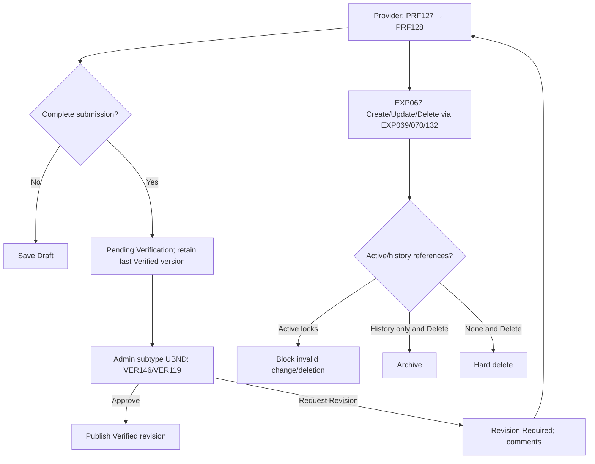

<!-- DBIZ3-SNAPSHOT source=docs/spec/specs/spec-PRF.md sha256=3571497a104596c8607534d986f3964504f812cdd9621b1dda704f0d3e1590e4 taken=2026-10-12T18:36Z -->
<!-- Read-only copy for Spec Kit. Do not edit here. Edit docs/spec/specs/spec-PRF.md, then run:
     uv run tools/start_feature.py --refresh -->

# Spec Document: Profile Management

| **Field**                 | **Value**                                                                                                                                                                                                            |
|---------------------------|----------------------------------------------------------------------------------------------------------------------------------------------------------------------------------------------------------------------|
| Module ID                 | PRF                                                                                                                                                                                                                  |
| Module name               | Profile Management                                                                                                                                                                                                   |
| Spec version | v0.2 — consistency revision |
| Author (team member)      | Group G                                                                                                                                                                                                              |
| Date | 28/09/2026 |
| Status | Revised — pending human approval |
| Approved by (Client role) | Pending human approval |
| DBIZ2 source              | Function List rows **F-PROFILE-01 .. F-PROFILE-07**; Use Case **UC-PRO-01 .. UC-PRO-06**; Screens **PRF019, PRF021, PRF127, PRF128, DSC122, DSC123, EXP067, EXP068, EXP069, EXP070, EXP132, VER146, VER119** |

Shared actor/state/field definitions: [Consistency Contract](../docs/consistency-contract.md). Exact current Function contracts are in §5/5.1. Technical choices and unresolved field-design questions are explicitly separated there.

**1. Purpose and scope (mandatory)**

> The Profile Management module allows Tour Agencies and Local Providers to maintain their own business information while controlling what profile information other actors are allowed to view. It also manages Local Provider Experiences, Provider profile verification by UBND, and optional AI-assisted description refinement.

**In scope**

- View Agency profile according to actor-specific visibility rules.

- Tour Agency updates its own Agency profile.

- View Local Provider profile according to actor-specific visibility rules.

- Local Provider updates its own business profile and media.

- UBND reviews and verifies Local Provider profiles within its assigned village.

- Local Provider creates, updates and deletes Experiences.

- Manage Experience pricing, capacity, images and booking conditions.

- Generate AI-refined Provider or Experience descriptions for Local Provider review.

- Feed saved Experience/Profile information to Explore and AI Tour Matching where applicable.

**Out of scope**

- User account creation, login, password or account-status management.

- HDT/UBND editing Agency or Local Provider business/profile content.

- Local Provider account creation.

- Booking creation or booking lifecycle management.

- Manual creation of On hold / Booked schedule blocks.

- Explore ranking logic.

- AI Tour Matching recommendation logic.

- Automatic publication of AI-generated descriptions without Provider approval.

**Depends on**

| **Dependency**                                     | **Purpose**                                                                                       |
|----------------------------------------------------|---------------------------------------------------------------------------------------------------|
| **AUT – Authentication, Access & User Management** | Role, ownership and data-scope checks before viewing/editing protected profile information.       |
| **Schedule/Booking**                               | Source of operational availability where profile/detail screens display availability information. |
| **Cloudinary**                                     | Provider and Experience image upload/optimization.                                                |
| **OpenAI API / AI Engine**                         | AI Description Refinement for F-PROFILE-07.                                                       |

**2. Actors (mandatory)**

| **Actor**          | **Role in this module**                                                                  | **Where it comes from**                                |
|--------------------|------------------------------------------------------------------------------------------|--------------------------------------------------------|
| **Tour Agency**    | Primary actor for managing own Agency profile and viewing Provider profiles              | F-PROFILE-01, F-PROFILE-02, F-PROFILE-03               |
| **Local Provider** | Primary actor for managing own Provider profile, Experiences and AI-refined descriptions | F-PROFILE-03, F-PROFILE-04, F-PROFILE-06, F-PROFILE-07 |
| **UBND Admin**     | Reviews Provider information and verifies Provider profiles within assigned village      | F-PROFILE-03, F-PROFILE-05                             |
| **HDT Admin**      | Has full-detail read access to profiles but does not edit business/profile content       | F-PROFILE-01, F-PROFILE-03                             |
| **Guest**          | Views only information permitted for public access                                       | F-PROFILE-01, F-PROFILE-03                             |
| **System**         | Generates AI-refined description drafts and enforces visibility/update rules             | F-PROFILE-07 + F-AUTH-16                               |

**3. User scenarios and acceptance criteria (mandatory)**

## **US-1 (P2): Manage Agency Profile — UC-PRO-01**

**Journey.** As a Tour Agency, I want to view and update my own Agency profile so that my business information remains accurate.

### **Acceptance scenarios**

1.  Given the Agency is authenticated and opens its own profile, when the profile loads, then the Agency sees its permitted full profile information.

2.  Given valid profile changes, when the Agency saves them, then the updated information and update timestamp are recorded.

3.  Given an Agency attempts to edit another Agency's profile, when the update is submitted, then the action is denied.

4.  Given an Approved Agency changes Company Name or Tax ID, when the Agency saves the change, then the change is stored as a pending major-change review for HDT. The Agency account remains Approved and operational, and the currently approved legal information remains effective until HDT approves the proposed change.

UC-PRO-01 maps to F-PROFILE-01 and F-PROFILE-02.

## **US-2 (P2): View Agency Profile — UC-PRO-02**

**Journey.** As an authorized platform user or Guest, I want to view permitted Agency information so that I can understand the Agency without accessing restricted information.

### **Acceptance scenarios**

1.  Given an actor opens an Agency profile, when the profile is displayed, then only fields permitted for that actor are shown.

2.  Given HDT views an Agency, then HDT receives the full permitted Agency detail.

3.  Given Guest, UBND or another non-owner actor views an Agency, then restricted Agency information such as Tax ID is not exposed unless explicitly permitted by the visibility rules.

4.  No view-only actor can modify the Agency profile from this use case.

## **US-3 (P1): View Local Provider Profile — UC-PRO-03**

**Journey.** As a Tour Agency, I want to view Local Provider information so that I can evaluate whether the Provider and its Experiences fit my tour needs.

### **Acceptance scenarios**

1.  Given an authenticated Tour Agency selects a Local Provider, when the profile loads, then the Agency sees the full Provider information permitted to Tour Agencies.

2.  Given a Local Provider views its own profile, then its full editable business information is available.

3.  Given another Local Provider views the profile, restricted information such as pricing/contact is not exposed where prohibited.

4.  Given a Guest accesses Provider information, then only public/basic information is shown.

Guest accesses Provider information through the dedicated DSC123 Public Provider Profile and sees public/basic information only. Restricted Provider information such as pricing, private contact information and verification data is not exposed to Guest.

## **US-4 (P1): Manage Provider Profile — UC-PRO-04**

**Journey.** As a Local Provider, I want to complete and update my own Provider profile so that UBND can verify it and Agencies can view accurate information.

### **Acceptance scenarios**

1.  Given the Local Provider is authenticated, when it opens its own profile, then its existing profile information is displayed.

2.  Given the Provider saves an incomplete profile, when Save Changes is selected, then the entered information is stored and profile_verification_status remains Draft.

3.  Given an uploaded image violates the supported file/size/resolution rules, when Save is attempted, then the invalid image is rejected.

4.  Given the Provider chooses AI Refinement, when a description is submitted, then an AI-refined draft is returned without automatically replacing the original text.

5.  Given the Provider accepts or edits the AI draft, only then may it become the saved description.

6.  Given all required Provider profile fields are complete, when Save Changes succeeds for the first completed profile, then the profile is automatically submitted to UBND and profile_verification_status becomes Pending Verification.

7.  Given a previously Verified Provider changes Business Name, Craft Type or Business Registration, when Save Changes succeeds, then the edited revision enters Pending Verification while the last Verified profile version remains publicly visible and continues to be used by Explore and AI Tour Matching.

8.  Given the Provider updates operating_hours, when the profile is saved, then the recurring weekly operating hours become the baseline operating window consumed by F-SCHED-09 for availability calculation.

The current Sequence Diagram includes Provider profile update and optional AI refinement.

## **US-5 (P1): Manage Experiences — UC-PRO-05**

**Journey.** As a Local Provider, I want to manage my Experiences, pricing, media and booking conditions so that Agencies can discover accurate offerings.

### **Acceptance scenarios**

1.  Given valid Experience data, when the Provider creates an Experience, then the Experience is saved under that Provider.

2.  Each Experience must include at least three required image categories: **Activity/Experience**, **Space/Location**, and **Product/Result**.

3.  Given price_per_person \<= 0, max_participants \<= 0, or notice_period \< 0, when Save is attempted, then validation fails.

4.  The Provider can update only its own Experiences.

5.  Given Delete is requested:
    - if the Experience has an On hold or Booked Booking, deletion is blocked;
    - if it is referenced only by Completed or Cancelled historical Bookings, the Experience is archived;
    - if it has no Booking references, it may be permanently deleted.

6.  Given an Experience has an On hold or Booked Booking, price_per_person, group_discounts, special_rates, max_participants, duration and experience_location_address are read-only during edit. Description, images, notice_period and cancellation_policy remain editable.

7.  Given the Provider attempts to delete the last image in Activity/Experience, Space/Location or Product/Result category, the deletion is blocked until a replacement image exists in the same category.

8.  Changes to an Experience belonging to a Verified Provider go live immediately and do not trigger full Provider-profile re-verification.

9.  AI Refinement may be used for an Experience description, but the generated draft cannot replace the original automatically.

F-PROFILE-06 defines Experience creation/edit/delete together with pricing, capacity, image and booking-condition management.

## **US-6 (P1): Verify Provider Profile — UC-PRO-06**

**Journey.** As a UBND Admin, I want to review Provider profiles in my assigned village so that only reviewed Providers become Verified.

### **Acceptance scenarios**

1.  Given a Provider in the UBND's assigned village has submitted a completed profile, when UBND opens it for review, then its submitted profile information is displayed.

2.  When UBND selects **Approve**, then profile_verification_status = Verified.

3.  When UBND selects **Request Revision**, then profile_verification_status = Revision Required and the revision comments are available to the Provider.

4.  Given the Provider belongs to another village, when UBND attempts verification, then access is denied.

5.  UBND cannot directly edit Provider profile content while reviewing it.

6.  Only Verified Provider profiles are eligible for public display and use in Explore / AI Tour Matching.

UC-PRO-06 maps directly to F-PROFILE-05.

### **Edge cases**

- Two users attempt to update the same Provider profile at the same time.

- UBND opens a Provider profile that was changed after it was submitted for review.

- Provider submits fewer than three required Experience images.

- AI refinement service is unavailable.

- Image upload succeeds but profile save fails, or vice versa.

- A Verified Provider makes a major change after verification.

- An Experience is referenced by active or historical bookings when deletion is requested.

- An Experience with active bookings is edited: price/capacity/date-sensitive fields are locked per BR-014; other fields (description, images, policies) remain editable.

- Provider tries to delete the last image in a required category before uploading a replacement: blocked per BR-015 until a replacement in the same category is uploaded.

### Consistency acceptance examples

| AC ID | Given / When | Expected result |
|---|---|---|
| AC-PRF-DRAFT | Provider saves incomplete initial profile | Draft remains; complete required data submits Pending Verification. |
| AC-PRF-REVISION | Verified Provider submits a major revision | Previous Verified version remains public until UBND approves. |
| AC-PRF-LOCK | Experience has On hold booking; Provider changes location | Reject locked-field change; description change remains permitted. |
| AC-PRF-DELETE | Delete Experience with historical bookings only | Archive and preserve history; active references block deletion. |

**4. Flows (mandatory)**

**4.1 Usage flow**



**4.2 Sequence for the main flow**

```mermaid
sequenceDiagram
    actor Agency
    actor Provider
    actor Admin
    participant UI as Frontend
    participant API as Backend
    participant DB as Database
    participant AI as AI Service
    Note over Agency,UI: UC-PRO-01 PRF019→PRF021
    Agency->>UI: Edit own Agency profile
    UI->>API: updateAgencyProfile (F-PROFILE-02)
    API->>API: Check owner and validate fields
    alt Major company_name/tax_id change
        API->>DB: Store pending revision; keep Approved account/current legal version
    else Non-major change
        API->>DB: Apply immediately with change log
    end
    API-->>UI: Updated profile and major_change_review_status
    Note over Provider,UI: UC-PRO-04 PRF127→PRF128
    Provider->>UI: Save own profile including weekly operating hours
    UI->>API: updateProviderProfile (F-PROFILE-04)
    API->>API: Check ownership and validate supplied values
    alt Incomplete initial profile
        API->>DB: Save Draft
    else Complete first submission or major revision
        API->>DB: Save submitted revision Pending Verification; retain existing Verified publication
    else Permitted non-major change
        API->>DB: Apply change and audit
    end
    API-->>UI: Editable/review status and published version status
    Note over Admin,UI: UC-PRO-06 VER146/VER119; ADMIN subtype UBND
    Admin->>UI: Approve or Request Revision with required comments
    UI->>API: reviewProvider (F-PROFILE-05)
    API->>API: Check assigned village, submitted status and comments
    API->>DB: Persist review; Approve publishes Verified version, Request Revision retains last publication
    API-->>UI: verification_status, reviewer_id, reviewed_at; account remains Active
    Note over Admin,UI: UC-ACC-06 VER146 Agency variant; ADMIN subtype HDT
    Admin->>UI: Approve/Request More Information/Reject
    UI->>API: reviewAgency (F-AUTH-18, review_type)
    API->>DB: Persist decision; major-change review does not disable Approved account
    API-->>UI: Target-specific account/revision result plus email/in-app notification status
    opt Request More Information for initial registration
        API->>DB: Store review decision and submission version
        API->>Mail: Send single-use secure edit link
        Guest->>UI: Open REG003 through secure edit link and revise request (F-AUTH-26)
        UI->>API: resubmitRegistration(registration_request_id, token, updated_data)
        API->>DB: Store new submission version; return request to HDT review
    end
    Note over Provider,UI: UC-PRO-05 EXP067/068/069/070/132
    Provider->>UI: Create/Update/Delete Experience
    UI->>API: manageExperience (F-PROFILE-06)
    API->>DB: Check ownership and active/history references
    alt Invalid fields, locked field or active booking deletion
        API-->>UI: Validation error; no mutation
    else Historical references and Delete
        API->>DB: Archive, preserve booking history
    else No references and Delete
        API->>DB: Hard delete
    else Valid Create/Update
        API->>DB: Persist Experience; refresh Explore/matching source
    end
    API-->>UI: Permitted result
    opt AI description refinement on PRF128/EXP069/070
        Provider->>UI: AI Refine
        UI->>API: generateDescription (F-PROFILE-07)
        API->>AI: Request factual rewrite
        AI-->>UI: Draft or service failure
        Provider->>UI: Accept/Edit/Regenerate/Discard
        Note over UI,DB: Only accepted/edited text may be saved through the owning profile action
    end
```

**5. Functional requirements (mandatory)**

| FR ID | Function List ID | Requirement — system MUST | Actor | Priority |
|---|---|---|---|---|
| FR-001 | F-PROFILE-01 | Displays Agency profile information according to actor-specific visibility rules. Guest and another Agency can view public information only: Agency name, company type, location and team size. The owning Agency can view its full profile. Local Provider and UBND may additionally view Agency contact information for collaboration. HDT has full-detail read access. tour_types are not public information. Agency profile does not use a separate verification_status; Agency approval is managed through account status. | Member / Guest | Must |
| FR-002 | F-PROFILE-02 | Allows only the highest-level authorized Agency user (Agency Owner) to edit its own Agency profile. Company Name and Tax ID are major changes requiring HDT re-review. The Agency remains Approved and keeps normal platform access during review. Proposed major changes are stored separately and do not replace the currently approved legal information until HDT approves them. Non-major changes are applied immediately. | Tour Agency | Must |
| FR-003 | F-PROFILE-03 | Displays Local Provider profile information according to actor-specific visibility. Guest accesses the dedicated Public Provider Profile and sees public/basic information only. Tour Agency sees permitted collaboration details. Local Provider sees its own profile in full and public information of other Providers. UBND may view full Provider information within its assigned village for review. HDT has full-detail monitoring access. A Village may contain multiple Local Providers; each Provider belongs to one Village. | Member / Guest | Must |
| FR-004 | F-PROFILE-04 | Allows Local Provider to edit its own profile. Initial verification status is Draft. Save Changes stores incomplete information as Draft; once all required fields are complete, the first successful Save Changes automatically submits the profile and changes status to Pending Verification. Business Name, Craft Type and Business Registration are major fields. If a Verified Provider changes one of these, a new revision enters review while the last Verified version remains publicly visible and continues to be used by Explore and AI Matching until the revision is approved. Provider operating hours are maintained as recurring weekly profile information. They define the Provider's baseline operational window used by Schedule/Booking availability calculations. | Local Provider | Must |
| FR-005 | F-PROFILE-05 | Allows UBND Admin to review a submitted Local Provider profile within its assigned village. Profile information is read-only for UBND. Approve changes the submitted revision to Verified. Request Revision changes it to Revision Required and requires revision comments. Every review decision records reviewer and timestamp. When a revision of an already Verified Provider is approved, it replaces the previously published Verified version. | Admin UBND | Must |
| FR-006 | F-PROFILE-06 | Allows Local Provider to create, update and delete its own Experiences and manage information, location, pricing, capacity, images and booking conditions. Every Experience must maintain at least one image in each required category: Activity/Experience, Space/Location and Product/Result. When an Experience has an active Booking in On hold or Booked status, price, capacity and schedule-sensitive fields are locked; description, images and booking-condition/policy content remain editable. The final image in a required category cannot be deleted until a replacement exists. Experience edits go live immediately. Delete is blocked when an active Booking exists; Experiences referenced only by historical Completed/Cancelled Bookings are archived; Experiences with no Booking references may be permanently deleted.<br><br>For an Experience referenced by at least one On hold or Booked Booking, the following fields are locked:<br>price_per_person, group_discounts, special_rates, max_participants, duration and experience_location_address<br><br>Description, images, notice_period and cancellation_policy remain editable. | Local Provider | Must |
| FR-007 | F-PROFILE-07 | Generates an AI-refined version of a Local Provider or Experience description while preserving factual meaning. The original description is retained. The generated draft is never published automatically. Provider may Accept, Edit, Regenerate or Discard it; only an explicitly accepted or edited draft may become the saved description. | Local Provider / System | Should |

**5.1 Input / Output contract**

| FR ID | Input fields and validation | Required | Output fields | Notes |
|---|---|---|---|---|
| FR-001 | agency_id (ID; Optional — omitted when viewing own profile) | As specified per field | Public fields:<br>agency_name (String; Required)<br>company_type (Enum[Travel Agency, Tour Operator, TMC]; Required)<br>location (Object{street, ward, district, city_province}; Required)<br>team_size (see F-AUTH-02; Required)<br>Authenticated collaboration field:<br>contact (Object; Optional — visible to Local Provider, UBND and HDT)<br>Full-detail fields — own Agency / HDT:<br>tax_id (String; Required)<br>contact (Object; Required)<br>tour_types (Array<Enum>; Required)<br>description (Text, max 1000; Optional)<br>images (Array<Image>; Optional)<br>account_status (Enum[Pending Approval, Approved, Rejected, Disabled]; Optional — own Agency / HDT only) | Same contract as F-PROFILE-01; optional fields are not required. |
| FR-002 | agency_id (ID; Required — own organization)<br>company_name (String, max 255; Optional)<br>tax_id (String, 10 or 13 numeric digits; Optional)<br>location (Object{street, ward, district, city_province}; Optional)<br>description (Text, max 1000; Optional)<br>contact_info (Object{contact_person_name, phone_number, business_email}; Optional)<br>team_size (Integer > 0; Optional)<br>tour_types (Array<Enum>; Optional)<br>images (Array<Image: JPG/JPEG/PNG/WEBP, max 10MB, min 1280×720>; Optional) | As specified per field | updated_profile (Object; Required)<br>success_message (String; Required)<br>updated_at (DateTime; Required)<br>change_log_entry (Object{editor_id, changed_fields, edited_at, ip_address}; Required)<br>requires_hdt_rereview (Boolean; Required)<br>major_change_review_status (Enum[Not Required, Pending Review, Approved, Rejected]; Required)<br>account_status (Enum[Approved]; Required while major-change review is pending) | Same contract as F-PROFILE-02; optional fields are not required. |
| FR-003 | provider_id (ID; Optional — omitted when viewing own profile) | As specified per field | Public: provider_name (String; Required)<br>craft_type (Enum[Ceramics, Silk/Textile, Woodcarving, Food/Culinary, Metalwork, Paper/Painting, Other]; Required)<br>general_description (Text; Required)<br>public_images (Array<Image>; Required)<br>participant_capacity (Object{min_pax,max_pax}; Optional — public Experience summary)<br>availability_summary (Object; Optional — anonymous public summary only)<br>Full: experiences (Array<Object>; Required)<br>pricing (Decimal, VND; Required)<br>capacity (Integer; Required)<br>contact (Object; Required)<br>availability (Object; Required)<br>booking_conditions (Object; Required)<br>verification_status (Enum[Draft, Pending Verification, Verified, Revision Required]; Optional — own Provider / UBND / HDT)<br>HDT only: quality_metrics (Object{total_bookings, average_booking_value, cancellation_rate, profile_completeness_score}; Optional) | Same contract as F-PROFILE-03; optional fields are not required. |
| FR-004 | provider_id (ID; Required)<br>business_name (String, max 255; Required for submission)<br>craft_type (Enum[Ceramics, Silk/Textile, Woodcarving, Food/Culinary, Metalwork, Paper/Painting, Other]; Required for submission)<br>artisan_names (Array<String>; Optional)<br>business_registration_number (String; Required for submission)<br>business_registration_certificate (File[PDF/JPG/JPEG/PNG], max 10MB; Required for submission)<br>location_address (String; Required for submission)<br>description (Text, max 1000; Optional)<br>operating_hours (<br>  Object{<br>    Monday: Array<TimeRange> Optional,<br>    Tuesday: Array<TimeRange> Optional,<br>    Wednesday: Array<TimeRange> Optional,<br>    Thursday: Array<TimeRange> Optional,<br>    Friday: Array<TimeRange> Optional,<br>    Saturday: Array<TimeRange> Optional,<br>    Sunday: Array<TimeRange> Optional<br>  };<br>  Optional — recurring weekly Provider operating hours used as the baseline availability source for F-SCHED-09<br>)<br>booking_conditions (Object; Optional)<br>profile_images (Array<Image: JPG/JPEG/PNG/WEBP, max 10MB, min 1280×720>; Optional) | As specified per field | updated_profile (Object; Required)<br>success_message (String; Required)<br>updated_at (DateTime; Required)<br>change_log_entry (Object; Required)<br>profile_verification_status (Enum[Draft, Pending Verification, Verified, Revision Required]; Required — current editable/review version)<br>published_profile_version_status (Enum[None, Verified]; Required)<br>rereview_required (Boolean; Required) | Same contract as F-PROFILE-04; optional fields are not required. |
| FR-005 | provider_id (ID; Required)<br>decision (Enum[Approve, Request Revision]; Required)<br>revision_comments (Text; Required when decision = Request Revision, otherwise Optional) | As specified per field | submitted_profile_view (UI View, read-only; Required)<br>verification_status (Enum[Verified, Revision Required]; Required)<br>reviewer_id (ID; Required)<br>reviewed_at (DateTime; Required for every decision)<br>revision_comments (Text; Optional)<br>published_version_updated (Boolean; Required — true when an approved revision replaces a previous Verified version) | Same contract as F-PROFILE-05; optional fields are not required. |
| FR-006 | provider_id (ID; Required)<br><br>operation (Enum[Create, Update, Delete]; Required)<br><br>experience_id (<br>  ID;<br>  Required for Update/Delete;<br>  omitted for Create<br>)<br><br>name (<br>  String;<br>  Required for Create;<br>  Optional for Update;<br>  omitted for Delete<br>)<br><br>description (<br>  Text;<br>  Required for Create;<br>  Optional for Update;<br>  omitted for Delete<br>)<br><br>category (<br>  Enum[Workshop/Hands-on, Sightseeing, Culinary/Tasting, Cultural Show, Combo];<br>  Required for Create;<br>  Optional for Update;<br>  omitted for Delete<br>)<br><br>duration (<br>  Integer > 0, minutes;<br>  Required for Create;<br>  Optional for Update;<br>  omitted for Delete<br>)<br><br>images (<br>  Array<Image: JPG/JPEG/PNG/WEBP, max 10MB, min 1280×720>;<br>  Required for Create;<br>  Optional for Update;<br>  omitted for Delete<br>)<br><br>price_per_person (<br>  Decimal > 0, VND;<br>  Required for Create;<br>  Optional for Update;<br>  omitted for Delete<br>)<br><br>max_participants (<br>  Integer > 0;<br>  Required for Create;<br>  Optional for Update;<br>  omitted for Delete<br>)<br><br>notice_period (<br>  Integer >= 0, hours;<br>  Required for Create;<br>  Optional for Update;<br>  omitted for Delete<br>)<br><br>cancellation_policy (<br>  Object{rules: Array<Object{threshold_hours, fee_percentage}>, notes: Text Optional};<br>  Required for Create;<br>  Optional for Update;<br>  omitted for Delete<br>)<br>experience_location_address (String; Required for Create; Optional for Update; omitted for Delete)<br>group_discounts (Array<Object{pax_threshold: Integer > 0, discount_percentage: Decimal 0–100}>; Optional — existing PRF Q23 rule schema)<br>special_rates (Array<Object{pax_threshold: Integer > 0, discount_percentage: Decimal 0–100}>; Optional — existing PRF Q23 rule schema) | As specified per field | experience (Object; Optional — Create/Update)<br>success_message (String; Required)<br>explore_listing_updated (Boolean; Required)<br>matching_data_refreshed (Boolean; Required)<br>deletion_result (Enum[Hard Deleted, Archived, Blocked by Active Booking]; Optional — Delete only)<br>archived_at (DateTime; Optional — historical Booking references)<br>validation_errors (Array<Enum[Active Booking Field Locked, Active Booking Prevents Deletion, Required Image Category Missing, Last Required Category Image Cannot Be Deleted, Invalid Price, Invalid Capacity, Invalid Notice Period]>; Optional) | Same contract as F-PROFILE-06; optional fields are not required. |
| FR-007 | original_description (Text; Required)<br>source_type (Enum[Provider, Experience]; Required)<br>experience_type (Enum; Optional — Experience only)<br>profile_context (Object{business_name, craft_type, location, target_audience, raw_description}; Optional) | As specified per field | refined_description_draft (Text; Required)<br>original_description (Text; Required — retained) | Same contract as F-PROFILE-07; optional fields are not required. |

**5.2 Business rules**

| **Rule ID** | **Rule**                                                                                                                                  | **Why it exists**                                                   |
|-------------|-------------------------------------------------------------------------------------------------------------------------------------------|---------------------------------------------------------------------|
| **BR-001**  | Only the highest-level authorized Agency user (Agency Owner) may edit its own Agency profile. Other Agency users follow their assigned read/access permissions. | Protects organization ownership and Agency-level edit authority. |
| **BR-002**  | A Local Provider can edit only its own Provider profile and Experiences.                                                                  | Prevents cross-provider modification.                               |
| **BR-003**  | HDT and UBND have read-only access to profile content; account-management authority does not grant profile-edit authority.                | Separates identity administration from business content ownership.  |
| **BR-004**  | Profile fields displayed to a user must follow actor-specific visibility rules.                                                           | Prevents disclosure of restricted commercial/contact information.   |
| **BR-005**  | UBND may verify only Local Providers within its assigned village.                                                                         | Enforces local administrative scope.                                |
| **BR-006**  | A newly created Provider profile begins in Draft. Incomplete Save Changes keeps the profile in Draft. The first successful Save Changes after all required fields are complete automatically submits the profile and changes its verification status to Pending Verification. | Supports controlled Provider submission and verification. |
| **BR-007**  | Only Verified Provider profile versions are eligible for public display and use in Explore / AI Tour Matching. When a major revision of a previously Verified Provider is pending review or requires revision, the last Verified profile version remains published until the new revision is approved. | Prevents unreviewed Provider data from entering discovery/matching while preserving the last approved public version. |
| **BR-008**  | Provider/profile images must use JPG/JPEG/PNG/WEBP, maximum 10MB and minimum 1280×720.                                                    | Ensures usable media quality.                                       |
| **BR-009**  | Each Experience requires at least three image types: Activity/Experience, Space/Location and Product/Result.                              | Provides sufficient visual representation.                          |
| **BR-010**  | Experience price must be greater than 0, capacity greater than 0, and notice period at least 0.                                           | Prevents invalid Experience configuration.                          |
| **BR-011**  | AI refinement must preserve the factual meaning of the original description.                                                              | Prevents invented Provider information.                             |
| **BR-012**  | The original description must be retained and the AI draft cannot be saved as the final description without explicit Provider acceptance. | Keeps the Provider in control of published content.                 |
| **BR-013**  | AI refinement may be Accepted, Edited, Regenerated or Discarded.                                                                          | Supports human review of generated content.                         |
| **BR-014**  | When an Experience has at least one On hold or Booked Booking, price_per_person, group_discounts, special_rates, max_participants, duration and experience_location_address are locked during edit. Description, images, notice_period and cancellation_policy remain editable. | Prevents changes that would invalidate pax, price, capacity or schedule/location details already committed to an active Booking. |
| **BR-015**  | The last remaining image in a required category (Activity/Experience, Space/Location, Product/Result) cannot be deleted until a replacement image in that same category has been uploaded. | Keeps the Experience compliant with BR-009 at every point in time, not only at save. |
| **BR-016**  | Tapping a gallery image on the Experience Detail – Owner View opens a lightbox showing that image full-size, with navigation to browse the other images in the same gallery. | Lets the Provider inspect image quality/detail without leaving the screen or entering edit mode. |
| **BR-017**  | Company Name and Tax ID are major Agency-profile fields. Changing either creates an HDT review request while the existing Agency account remains Approved and the currently approved legal information remains effective until approval. | Prevents unapproved legal-information changes from replacing the approved Agency record. |
| **BR-018**  | Business Name, Craft Type and Business Registration are major Provider-profile fields. Changes by a previously Verified Provider require UBND re-verification while the last Verified version remains published. | Preserves a reviewed public Provider version during major-profile re-review. |
| **BR-019**  | Experience deletion is blocked while On hold or Booked Bookings exist. An Experience referenced only by Completed/Cancelled historical Bookings is archived; an Experience with no Booking references may be permanently deleted. | Preserves Booking history and prevents deletion of actively referenced Experiences. |
| **BR-020**  | Experience edits for a Verified Provider go live immediately and do not require full Provider-profile re-verification. | Avoids unnecessary administrative re-verification for ordinary Experience changes. |
| **BR-021**  | Provider operating_hours are recurring weekly profile information maintained through F-PROFILE-04 and are the canonical baseline for F-SCHED-09 availability calculation. Experience-level operating_hours and manually configured blackout/ad-hoc unavailable periods are outside MVP scope. | Maintains one canonical source for baseline operating availability. |

**6. Key entities (mandatory)**

| **Entity**                       | **Attributes (from Input/Output fields)**                                                                                                                             | **Relationships**                                                           |
|----------------------------------|-----------------------------------------------------------------------------------------------------------------------------------------------------------------------|-----------------------------------------------------------------------------|
| **Agency Profile**               | agency_id, company_name, company_type, tax_id, location, description, contact_info, team_size, tour_types, images, account_status                                      | belongs to one Tour Agency account                                          |
| **Local Provider Profile**       | provider_id, business_name, craft_type, artisan_names, business_registration_number, business_registration_certificate, location_address, description, operating_hours, booking_conditions, profile_images, profile_verification_status, published_profile_version_status | belongs to one Local Provider; associated with one Village                  |
| **Provider Verification Review** | provider_id, decision, revision_comments, reviewer_id, reviewed_at, verification_status                                                                               | belongs to one Provider profile; performed by UBND                          |
| **Experience**                   | experience_id, provider_id, name, description, category, duration, experience_location_address, price_per_person, group_discounts, special_rates, max_participants, notice_period, cancellation_policy | belongs to one Local Provider                                               |
| **Experience Image**             | image, image category/type, media metadata                                                                                                                            | belongs to one Experience                                                   |
| **Profile Image**                | image/media metadata                                                                                                                                                  | belongs to Agency or Provider Profile                                       |
| **AI Refined Description Draft** | original_description, source_type, refined_description_draft, profile_context                                                                                         | generated for one Provider or Experience description                        |
| **Village**                      | village_id                                                                                                                                                            | has one or more Local Providers; Provider verification is scoped by Village |

**7. Screens involved**

| Screen ID | Screen name | Functions in this module |
|---|---|---|
| DSH018 | Local Provider Dashboard | F-PROFILE-03 |
| EXP067 | Experience Management | F-PROFILE-03, F-PROFILE-06 |
| EXP068 | Experience Detail – Owner View | F-PROFILE-06 |
| EXP069 | Add Experience | F-PROFILE-06, F-PROFILE-07 |
| EXP070 | Edit Experience | F-PROFILE-06, F-PROFILE-07 |
| EXP132 | Delete Experience Confirmation | F-PROFILE-06 |
| PRF019 | Agency Profile | F-PROFILE-01 |
| PRF021 | Edit Agency Profile | F-PROFILE-02 |
| PRF127 | Provider Profile | F-PROFILE-03 |
| PRF128 | Edit Provider Profile | F-PROFILE-04, F-PROFILE-07 |
| VER119 | Account Information | F-PROFILE-05 |
| VER146 | View Submitted Profile | F-PROFILE-05 |
| VIL030 | Village Profile | F-PROFILE-03 |

**8. Success criteria (mandatory)**

| **SC ID**  | **Criterion**                                                                                                  | **How it is measured**                                                |
|------------|----------------------------------------------------------------------------------------------------------------|-----------------------------------------------------------------------|
| **SC-001** | An Agency can update its own profile but cannot modify another Agency's profile.                               | Test own-profile update and cross-Agency update attempt.              |
| **SC-002** | A Local Provider can update only its own profile and Experiences.                                              | Attempt updates against own and another Provider's records.           |
| **SC-003** | Restricted profile information is hidden from actors without the corresponding visibility permission.          | Compare rendered fields across Guest, Agency, LP, UBND and HDT roles. |
| **SC-004** | UBND can verify only Provider profiles belonging to its assigned village.                                      | Test own-village and cross-village verification attempts.             |
| **SC-005** | A Provider profile approved by UBND reaches Verified status, while Request Revision reaches Revision Required. | Execute both review decisions and inspect resulting state.            |
| **SC-006** | An Experience cannot be saved as valid without the required image set, positive price and positive capacity.   | Submit invalid boundary-value Experience data.                        |
| **SC-007** | AI refinement never replaces the Provider's original description without explicit Provider acceptance.         | Generate a draft and exit/discard without accepting.                  |
| **SC-008** | Admin profile review does not allow HDT/UBND to directly modify Provider business content.                     | Review Admin screen actions and attempt profile-content modification. |

**9. Assumptions**

- A Local Provider belongs to a Village, and a Village may contain multiple Local Providers.

- Provider profile verification status is separate from account status.

- Local Provider account creation occurs before profile completion; therefore a Provider can log in while its business profile is not yet Verified.

- F-PROFILE-07 AI Description Refinement is an inline supporting function rather than a standalone Profile screen.

- Provider operating_hours are maintained in Profile Management through F-PROFILE-04. Schedule/Booking consumes these recurring operating hours together with active Booking blocks to calculate operational availability through F-SCHED-09.

- The MVP does not support Experience-specific operating hours, manually configured blackout dates or ad-hoc unavailable periods.

- Current mappings are UC-PRO-04 Manage Provider Profile, UC-PRO-05 Manage Experiences and UC-PRO-06 Verify Provider Profile.

- Historical DBIZ2 diagrams are retained; current Markdown includes UC-PRO-06 Provider verification.

**10. Open questions**

| **\#** | **Question**                                                                                                                                                            | **Blocking?** | **Owner**     | **Status** | **Answer/Decision**                                                                                                                                                                                    |
|--------|-------------------------------------------------------------------------------------------------------------------------------------------------------------------------|---------------|---------------|------------|--------------------------------------------------------------------------------------------------------------------------------------------------------------------------------------------------------|
| 1 | What are the allowed values for company_type, and where is it initially captured? | No | BA | Closed | **Enum:** Travel Agency, Tour Operator, TMC. Captured during the initial Account Registration form (F-AUTH-02). |
| 2 | Is Agency location required, and what format should it use? | No | BA | Closed | **Yes, required.** Format: Structured address (Street, Ward, District, City/Province). |
| 3 | Are Agency tour_types public information? | No | Client / BA | Closed | **No.** Only visible to the Agency itself and Admin (HDT). |
| 4 | Which actors may see Agency contact information? | No | Client | Closed | **All authenticated actors** (Provider, HDT, UBND) can view it to facilitate collaboration. |
| 5 | What does Agency verification_status mean when Agency approval is already stored as account status? | No | BA | Closed | **Duplicate field.** Remove verification_status from Agency Profile. Account status (Pending/Approved/Rejected) handles this. |
| 6 | Which Agency fields constitute a **major change** requiring re-review? | No | Client | Closed | **Company Name** and **Tax ID**. Changing these triggers an HDT re-review. |
| 7 | Can any Agency staff user edit the Agency profile, or only the highest-level authorized Agency user as stated in the Screen List? | No | Client / BA | Closed | **Only the highest-level authorized user** (Owner role within the Agency). |
| 8 | What technical validation rules apply to Agency profile images? | No | UI/UX / Tech | Closed | Format: JPG/JPEG/PNG/WEBP. Max size: 10MB. Min resolution: 1280x720. Auto-crop supported. |
| 9 | What is the canonical craft_type enum? | No | BA | Closed | **Enum:** Ceramics, Silk/Textile, Woodcarving, Food/Culinary, Metalwork, Paper/Painting, Other. |
| 10 | For Guests, is Provider information shown only as Explore preview, or through dedicated screen DSC123 Public Provider Profile? | No | UI/UX / BA | Closed | **Dedicated screen (DSC123).** Information is shown directly through the DSC123 Public Provider Profile screen. |
| 11 | What is the Provider verification state before first submission: Incomplete, Draft, or another value? | No | BA | Closed | **Draft.** Changes to "Pending Verification" upon submission. |
| 12 | What are the HDT-only quality_metrics referenced by F-PROFILE-03? | No | BA | Closed | **Aggregated metrics:** Total Bookings, Average Booking Value, Cancellation Rate, Profile Completeness Score. |
| 13 | Is business_registration a registration number, uploaded document, or both? | No | Client / BA | Closed | **Both.** Requires inputting the Registration Number and uploading a PDF/Image of the certificate. |
| 14 | What is the canonical structure of Provider location — address only or address + coordinates? | No | Tech / BA | Closed | Address only. |
| 15 | How does profile operating_hours relate to F-SCHED-09 Manage Provider Availability? | No | BA | Closed | operating_hours is recurring weekly Provider profile information configured through F-PROFILE-04 and is the canonical baseline operating window. F-SCHED-09 calculates available/occupied periods from these operating hours together with On hold / Booked Booking blocks. Manually configured blackout dates or ad-hoc unavailable periods are outside MVP scope. |
| 16 | Which Provider profile changes count as major changes requiring re-verification? | No | Client | Closed | Business Name, Craft Type, and Business Registration details. |
| 17 | Must revision_comments be required when UBND chooses Request Revision? | No | Client | Closed | **Yes.** Mandatory to explain what needs fixing. |
| 18 | Is reviewed_at recorded for Request Revision as well as approval? | No | Tech | Closed | **Yes.** Every review decision logs a timestamp. |
| 19 | What is the allowed Experience category enum? | No | BA | Closed | **Enum:** Workshop/Hands-on, Sightseeing, Culinary/Tasting, Cultural Show, Combo. |
| 20 | Does an Experience have a separate group_size field in addition to max_participants? | No | BA | Closed | **No.** There is no separate `group_size` field on Experience in the MVP. Capacity is expressed only by `max_participants` (the hard limit); the Explore card shows the range 1..max_participants (aligns with spec-EXP §386 and the F-PROFILE-06 IO contract). `group_size` exists only on a Booking, as the agreed number of guests for that Booking (F-SCHED-03). |
| 21 | What unit is used for Experience duration? | No | BA | Closed | **Minutes** (can be converted to Hours/Days on UI). |
| 22 | What currency is used for Experience pricing? | No | Client | Closed | **VND (Vietnamese Dong)** as the system base currency. |
| 23 | What is the structure of group_discounts and special_rates? | No | BA | Closed | **JSON Object:** \[{"pax_threshold": 10, "discount_percentage": 5}, ...\]. |
| 24 | Is notice_period stored in hours or days? | No | BA | Closed | Hours. |
| 25 | Is cancellation_policy free text or structured rules? | No | BA | Closed | **Structured rules** (e.g., Free before X hours, Y% fee if \< X hours) + an optional Free Text field for notes. |
| 26 | After a Verified Provider edits an Experience, does the change go live immediately or require re-verification? | No | Client | Closed | **Goes live immediately.** Experience edits do not trigger a full profile re-verification to reduce admin bottleneck. |
| 27 | Which Provider/Profile fields may be sent to the AI as profile_context? | No | Tech / Client | Closed | Business Name, Craft Type, Location, Target Audience, and existing raw Description. |
| 28 | EXP131 Repin Location exists in Screen List but no explicit Experience location input exists in F-PROFILE-06. Should Experience location be added to the Function List? | No | BA | Closed | experience_location_address is in F-PROFILE-06 input; defaults may be prefilled from the Provider, and active On hold/Booked references lock it. |
| 29 | What exact UI/action submits a completed Provider profile for UBND verification? | No | UI/UX / BA | Closed | **"Save Changes" button.** Incomplete saves remain Draft. The first successful Save Changes after all required fields are complete automatically submits the Provider profile for UBND verification and changes the editable revision to Pending Verification. |
| 30 | UC-PRO-06 Provider Verification is absent from the current Sequence Diagram. Should Module 2 Sequence be updated to include the UBND verification flow? | No | BA | Closed | **Yes.** Update the Sequence Diagram to show UBND retrieving profiles (Status: Pending) and executing Approve/Request Revision. |

**11. Traceability to DBIZ2**

| **Spec section**               | **DBIZ2 source**           | **Location**                                                                                                                                                 |
|--------------------------------|----------------------------|--------------------------------------------------------------------------------------------------------------------------------------------------------------|
| **1. Purpose**                 | Schematic design 1.1 / 1.2 | **sheet Schematic1, sections 1.1 System Objectives and 1.2 System Main Functions – Profile Management**                                                       |
| **4.1 Usage flow**             | Usage Flow figure          | **sheet Schematic2, Local Provider flow: “Upload Media & Edit Info” → “Update Tour & Experience Profile”; Admin flow: “View all Profiles (Read-only Mode)”** |
| **4.2 Sequence**               | Sequence Diagram figure    | **sheet Schematic2, Module 2: Profile Management – Tour Agency profile sequence and Local Provider profile/Experience sequence**                             |
| **5. Functional requirements** | Function List              | **sheet FL&Cost1, F-PROFILE-01 .. F-PROFILE-07**                                                                                                             |
| **7. Screens**                 | Screen List                | **sheet ST, PRF019, PRF021, PRF127, PRF128, DSC122, DSC123, EXP067, EXP068, EXP069, EXP070, EXP132, VER146, VER119**                                 |
