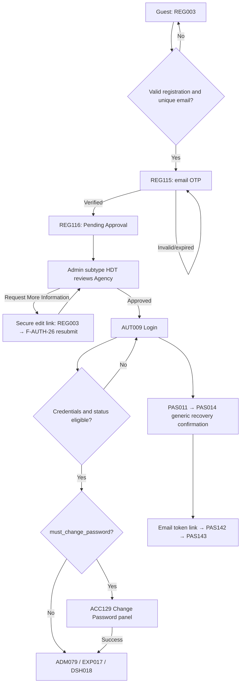
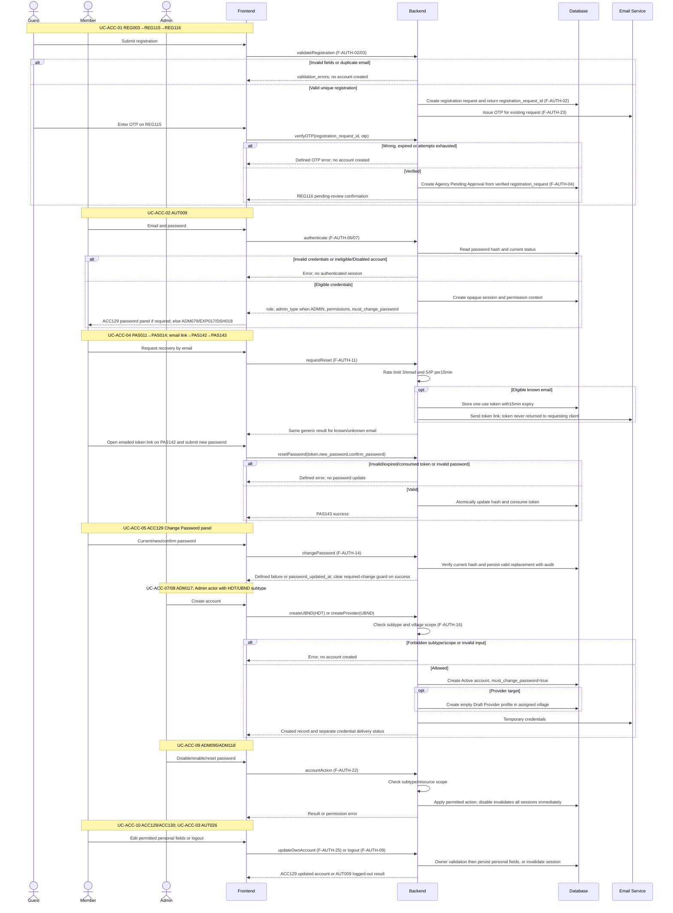

<!-- DBIZ3-SNAPSHOT source=docs/spec/specs/spec-AUT.md sha256=bd8824fed7726c718aef210743201852b77dce7defa3b2c714dc500a07e2505c taken=2026-10-28T17:02Z -->
<!-- Read-only copy for Spec Kit. Do not edit here. Edit docs/spec/specs/spec-AUT.md, then run:
     uv run tools/start_feature.py --refresh -->

# Spec Document: Authentication, Access & User Management

| **Field**                 | **Value**                                                                                                                                                                                          |
|---------------------------|----------------------------------------------------------------------------------------------------------------------------------------------------------------------------------------------------|
| Module ID                 | AUT                                                                                                                                                                                                |
| Module name               | Authentication, Access & User Management                                                                                                                                                           |
| Spec version | v0.2 — consistency revision |
| Author (team member)      | Group G                                                                                                                                                                                            |
| Date | 28/09/2026 |
| Status | Revised — pending human approval |
| Approved by (Client role) | Pending human approval |
| DBIZ2 source              | Function List rows F-AUTH-01 .. F-AUTH-26; Use Case UC-ACC-01 .. UC-ACC-10; Screens AUT009, AUT026, PAS011, PAS014, PAS142, PAS143, REG003, REG115, REG116, ADM095, ADM117, ADM118, VER119, VER146 |

Shared actor/state/field definitions: [Consistency Contract](../docs/consistency-contract.md). Exact current Function contracts are in §5/5.1. Technical choices and unresolved field-design questions are explicitly separated there.

**1. Purpose and scope (mandatory)**

> The Authentication, Access & User Management module controls how users enter Artisan Bridge, obtain accounts, recover or change credentials, and access functions appropriate to their role and permitted data scope. It also supports the account lifecycle for Tour Agencies, UBND administrators and Local Providers, including Agency approval and administrative account management.

**In scope**

- Tour Agency self-registration with email OTP and submission for HDT approval.

- My Account/Edit My Account through F-AUTH-24/25; Change Password panel on ACC129.

- Login and logout for Tour Agency, Local Provider, HDT and UBND.

- Password recovery through a **15-minute secure token link**.

- Change password for authenticated members.

- Role-Based Access Control and data-scope validation.

- Periodic account-status and role consistency checks.

- HDT approval / Request More Information / rejection of Agency registrations.

- HDT creation of UBND accounts with one assigned village.

- UBND creation of Local Provider accounts within its assigned village.

- HDT/UBND account listing, disable, enable and permitted password reset.

- Role-specific post-login routing.

**Out of scope**

- Editing Agency or Local Provider **business/profile content** by HDT or UBND.

- Local Provider self-registration.

- SMS OTP and OTP-based password recovery. Registration uses email OTP; recovery uses a15-minute token link.

- Local Provider profile verification, which belongs to **Profile Management**.

- Editing login email, assigned role or business content through personal-account screens; F-AUTH-24/25 cover permitted personal information.

- Creation or manipulation of bookings.

- AI Matching, Explore ranking and Chat business logic.

**Depends on**

| **Dependency**                        | **Purpose**                                                                                                           |
|---------------------------------------|-----------------------------------------------------------------------------------------------------------------------|
| **Profile Management**                | Business/profile information remains owner-managed; LP profile completion/verification occurs after account creation. |
| **Admin Dashboard**                   | HDT/UBND post-login landing and account-management navigation.                                                        |
| **Role-specific application modules** | Destination after successful role-based login.                                                                        |
| **Email Delivery Service**            | Reset links, temporary credentials and Agency approval-status emails.                                                 |

**2. Actors (mandatory)**

| **Actor**          | **Role in this module**                                                           | **Source**            |
|--------------------|-----------------------------------------------------------------------------------|-----------------------|
| **Guest**          | Primary actor for Tour Agency registration; can open Login and Password Recovery  | F-AUTH-01–05          |
| **Member**         | Tour Agency, Local Provider, HDT or UBND using login/logout/password functions    | F-AUTH-05–14          |
| **Tour Agency**    | Account applicant whose registration requires HDT approval                        | UC-ACC-01, UC-ACC-06  |
| **HDT Admin**      | Approves Agency accounts, creates UBND accounts, manages platform-scoped accounts | F-AUTH-18, 19, 21, 22 |
| **UBND Admin**     | Creates and manages Local Provider accounts in its assigned village               | F-AUTH-20–22          |
| **Local Provider** | Receives an admin-created Active account and logs in to complete its profile      | F-AUTH-20             |
| **System**         | Initializes permissions, checks access scope and re-validates account/role status | F-AUTH-15–17          |

**3. User scenarios and acceptance criteria (mandatory)**

**US-1 (P1):** Register Tour Agency Account — UC-ACC-01

**Journey.** As a Guest representing a Tour Agency, I want to submit my account and company information so that HDT can review my registration.

**Acceptance scenarios**

1.  Given the Guest enters all required valid data and documents, when the submitted registration request passes duplicate checking and the Guest successfully verifies the email OTP, then the system creates a Tour Agency account with status **Pending Approval** exactly once.

2.  Given an email already exists, when the Guest submits registration, then no duplicate account is created and an appropriate error is shown.

3.  Given the Guest attempts to register as a Local Provider, then Local Provider self-registration is not offered.

UC-ACC-01 maps to F-AUTH-01–04 and F-AUTH-23.

**US-2 (P2):** Log In — UC-ACC-02

**Journey.** As a registered member, I want to log in so that I can access functions and data permitted for my role.

**Acceptance scenarios**

1.  Given valid credentials and an eligible account status, when the member logs in, then the correct role/permission context is loaded and the member is routed to the permitted landing screen.

2.  Given an Agency is Pending Approval, Rejected or Disabled, when login is attempted, then access is denied.

3.  Given an HDT, UBND or Local Provider account is Disabled, when login is attempted, then access is denied.

**US-3 (P3):** Log Out — UC-ACC-03

**Journey.** As an authenticated member, I want to log out so that my active session is ended.

**Acceptance scenarios**

1.  Given an authenticated member confirms Logout, when logout completes, then the active session is terminated and the member is returned to Login.

2.  Given the terminated session is reused, then protected access is denied.

## **US-4 (P2): Forgot Password — UC-ACC-04**

**Journey.** As a registered member who cannot remember the password, I want a secure reset link so that I can set a new password.

**Acceptance scenarios**

1.  Given a valid registered email, when a password reset is requested, then a secure reset link valid for **15 minutes** is issued by email.

2.  Given a valid unexpired token and valid new password, when the password is reset, then the token becomes unusable and the member can return to Login.

3.  Given an expired or already-used token, when reset is attempted, then the password is not changed.

The Function List explicitly specifies token-link recovery rather than OTP.

## **US-5 (P2): Change Password — UC-ACC-05**

**Journey.** As an authenticated member, I want to change my password so that I can maintain control of my account.

**Acceptance scenarios**

1.  Given the correct current password and a valid new password, when Change Password is submitted, then the password is updated and the action is recorded.

2.  Given the current password is incorrect, then no change is made and an error is shown.

## **US-6 (P1): Verify Agency — UC-ACC-06**

**Journey.** As an HDT Admin, I want to review a pending Agency registration so that only reviewed Agencies receive platform access.

**Acceptance scenarios**

1.  Given a Pending Approval Agency, when HDT selects **Approve**, then status becomes Approved and the Agency becomes eligible to log in.

2.  When HDT selects **Request More Information**, the account remains Pending Approval, the requested changes are recorded, and the Agency receives a secure edit link to revise and resubmit the registration request.

3.  When HDT selects **Reject**, status becomes Rejected and the rejection reason is recorded.

The final Function List defines all three decisions.

## **US-7 (P1): Create UBND Account — UC-ACC-07**

**Journey.** As an HDT Admin, I want to create an UBND account and assign one village so that the Local Authority can manage Providers in that village.

**Acceptance scenarios**

1.  Given valid UBND staff information and an unassigned valid village, when HDT creates the account, then an Active UBND account and fixed village assignment are created.

2.  The new UBND user receives temporary login credentials and must change the password on first login.

3.  A non-HDT actor cannot create an UBND account.

## **US-8 (P1): Create Local Provider Account — UC-ACC-08**

**Journey.** As an UBND Admin, I want to create an account for a Local Provider in my assigned village so that the Provider can log in and complete its profile.

**Acceptance scenarios**

1.  Given valid Provider data within the UBND's assigned village, when UBND creates the account, then an Active Local Provider account with temporary credentials is created.

2.  Given the Provider belongs to another village, when the UBND attempts account creation, then the action is denied.

3.  Account activation does **not** mean that the Provider business profile is already verified.

UC-ACC-07 and UC-ACC-08 map respectively to F-AUTH-19 and F-AUTH-20.

## **US-9 (P1): Manage Accounts — UC-ACC-09**

**Journey.** As an authorized HDT/UBND Admin, I want to view and manage accounts within my administrative scope so that invalid or inaccessible accounts can be controlled.

**Acceptance scenarios**

1.  HDT can view platform-wide accounts; UBND sees only Local Provider accounts in its assigned village.

2.  When an authorized Admin disables an account, then its active sessions become invalid and further access is denied.

3.  UBND may reset passwords only for Local Providers in its assigned village.

4.  Neither HDT nor UBND can modify business/profile content through account management.

UC-ACC-09 maps to F-AUTH-21, F-AUTH-22 and F-AUTH-16.

**US-10 (P1):** Revise and Resubmit Agency Registration — UC-ACC-06

**Journey.** As an Agency applicant whose registration needs more information, I want to update and resubmit the same registration request so that HDT can review the corrected information.

**Acceptance scenarios**

1. Given HDT requested more information, when the Guest opens the valid single-use edit link, then the current request is loaded and the account remains Pending Approval.
2. Given the Guest submits corrected fields or documents, when validation succeeds, then a new submission version is stored and the request returns to Pending Approval for HDT review.
3. Given an expired or already-used resubmission token, when the Guest attempts to edit, then access is denied and no data is changed.

UC-ACC-06 also maps to F-AUTH-26.

### **Edge cases**

- Duplicate registration email.

- Email delivery fails after account/reset record has already been created.

- Reset token expires exactly while the user is submitting a new password.

- Two HDT users attempt to review the same Agency registration concurrently.

- An account is disabled while the user is already logged in.

- UBND attempts to act on a Provider from another village.

- A Request More Information Agency resubmits information while another HDT reviewer has the record open.

- Repeated reset-password requests exceed the configured rate limit.

### Consistency acceptance examples

| AC ID | Given / When | Expected result |
|---|---|---|
| AC-AUT-OTP | Guest validates REG003 then enters invalid/expired OTP | No account is created; correct valid OTP creates Pending Approval only once. |
| AC-AUT-SESSION | Admin disables an account while its session is open | Next protected request is denied immediately; no5-minute grace. |
| AC-AUT-PERSONAL | Member changes own phone on ACC130 | Save updates own account; supplied role/email/business changes are rejected. |
| AC-AUT-ROUTING | New Provider logs in with must_change_password=true | ACC129 password panel precedes DSH018; completion link opens PRF128. |

**4. Flows (mandatory)**

**4.1 Usage flow**

**4.2 Sequence for the main flow**

**5. Functional requirements (mandatory)**

| FR ID | Function List ID | Requirement — system MUST | Actor | Priority |
|---|---|---|---|---|
| FR-001 | F-AUTH-01 | Displays the registration form allowing a Guest to self-register a Tour Agency account. The form collects Agency registration information and provides guidance that Local Provider accounts cannot be self-registered and must be created by the assigned UBND. | Guest | Must |
| FR-002 | F-AUTH-02 | Captures and validates Tour Agency registration data for completeness, format and required-field rules. After validation succeeds and F-AUTH-03 confirms that the email is not duplicated, the system creates exactly one server-side registration request containing the validated data and documents, then returns its opaque ID for F-AUTH-23. Invalid or duplicate submissions do not create a registration request. | Guest | Must |
| FR-003 | F-AUTH-03 | Checks if the provided email address already exists in the system database to prevent duplicate accounts. | Guest | Must |
| FR-004 | F-AUTH-04 | Creates a new Tour Agency user/account record only after the server-side registration request has been validated, duplicate email checking has passed, and the registration email has been successfully verified through F-AUTH-23. Sets account_status = "Pending Approval", assigns the Tour Agency role, securely stores the submitted registration information and registration documents, and makes the registration available for HDT review. The client cannot authorize creation by sending an email_verified boolean. | Guest | Must |
| FR-005 | F-AUTH-05 | Displays the login form interface with Email and Password input fields for registered users to access the system. Visible to all non-logged-in users (Guest). | Member / Guest | Must |
| FR-006 | F-AUTH-06 | Captures the email and password entered by the user and performs initial empty-field validation check. Does NOT authenticate against DB yet. | Member | Must |
| FR-007 | F-AUTH-07 | Compares credentials against DB using secure password hashing. Verifies account status is "Approved" (for Agency) or "Active" (for HDT/UBND/Local Provider). Retrieves user role and initializes RBAC permission context. Creates authenticated session token. Status checking: (1) Agency: "Approved" only → can login. "Pending Approval" / "Rejected" / "Disabled" → deny with message. (2) UBND/HDT/Local Provider: "Active" only → can login. "Disabled" → deny. | Member | Must |
| FR-008 | F-AUTH-08 | After successful login, a member with must_change_password=true first opens the Change Password panel on ACC129. After successful password change: Admin (HDT or UBND) opens ADM079; Tour Agency opens EXP017; Local Provider opens DSH018. PRF128 is reached through the incomplete-profile action on DSH018, not an unconditional login redirect. | Member | Must |
| FR-009 | F-AUTH-09 | Invalidates the current user session and authentication token upon logout request, then displays confirmation message. Clears all browser session data. Applies to all authenticated users (HDT, UBND, Agency, Local Provider). | Member | Must |
| FR-010 | F-AUTH-10 | Display the form allowing a registered user to initiate password reset by entering their email address. Email will contain a secure TOKEN LINK (not OTP code) for verification. Available to any registered user (Agency, UBND, HDT, Local Provider) who is locked out or forgot password. | Member | Must |
| FR-011 | F-AUTH-11 | Verifies if the email exists in system database, generates a secure time-limited recovery token (15 min expiry),  and sends recovery email containing TOKEN LINK ONLY (not OTP).  Email template: includes clickable link (e.g., https://platform.com/reset?token=xxx) | Member | Must |
| FR-012 | F-AUTH-12 | Validates that recovery token exists and has not expired (15 min window), ensures new password meets complexity requirements, hashes new password using secure algorithm, updates user record, and invalidates the used recovery token. Applies to all user types. | Member | Must |
| FR-013 | F-AUTH-13 | Provides the form interface within user settings for a logged-in member to update their password. Collects current password, new password, and password confirmation. Available to all authenticated users (HDT, UBND, Agency, Local Provider). | Member | Must |
| FR-014 | F-AUTH-14 | Validates new password meets complexity requirements and matches confirmation, hashes new password, updates user record with new password hash and timestamp. Logs change in audit trail for all user types. | Member | Must |
| FR-015 | F-AUTH-15 | Triggered automatically after successful authentication (F-AUTH-07). Fetches user's role definition, loads all permissions associated with role, builds access control list (ACL), and stores permission context in session for use throughout user session. Role-specific initialization: (1) HDT: Permissions = platform-scoped actions in the shared matrix, Data scope = platform-wide. (2) UBND: Permissions = account mgmt + analytics for 1 village, Data scope = assigned village + all agencies (view only). (3) Agency: Permissions = browse, match, booking, Data scope = own org + all public villages. (4) Local Provider: Permissions = manage own profile + bookings, Data scope = own org + all agencies (view only). | System | Must |
| FR-016 | F-AUTH-16 | On any user action (view, edit, create, delete), system calls this function to verify the user's role has permission for the action AND the resource belongs to user's data scope. Returns allow/deny decision.   PERMISSION MATRIX: - HDT: Can Disable/Enable any account, Reset password and VIEW all profiles (Read-only). - UBND: Can Disable/Enable/Reset Password for Local Provider accounts within its assigned village; VIEW Local Provider profiles within the assigned village in read-only mode; cannot edit profile content. - Agency: Agency Owner can EDIT own Agency profile; other Agency users follow their assigned permissions. Agency users may view other profiles according to public/permitted visibility rules. - Local Provider: Can EDIT own profile (village info, experiences, pricing, images), view other profiles (public info)  Neither Admin subtype can create or activate ranking versions; F-EXPLORE-17 is an internal System job. CRITICAL: Admin (HDT/UBND) CANNOT EDIT profile content. Only account status + password management. | System | Must |
| FR-017 | F-AUTH-17 | Runs periodically (every 5 min) and on critical actions. Verifies user's account status (Approved/Pending/Rejected/Disabled), checks role matches organization/village assignment, validates role was not revoked, and checks for conflicting permissions. If account disabled, forces immediate logout. Status by role: (1) Agency: Checks status="Approved"; if not, deny access. (2) UBND/HDT: Checks status="Active"; if disabled, revoke. (3) Local Provider: Checks status="Active"; if disabled, revoke. The periodic 5-minute validation is a secondary safety check. When an account is disabled through F-AUTH-22, all active sessions are invalidated immediately rather than waiting for the next periodic validation. | System | Must |
| FR-018 | F-AUTH-18 | HDT reviews: (1) initial Tour Agency registrations awaiting approval, and (2) pending major Agency profile changes to Company Name or Tax ID.  For initial registration, HDT may Approve, Request More Information, or Reject.  For an already Approved Agency submitting a major legal-information change, the existing Agency account remains Approved and operational while the proposed change is reviewed separately. Approved changes replace the current legal information; rejected changes are discarded and the last approved information remains effective.  HDT cannot directly edit Agency business/profile content. | Admin HDT | Must |
| FR-019 | F-AUTH-19 | HDT staff creates a new UBND account during platform setup or when adding a new regional administrator. Validates input data, auto-generates a temporary password, creates a user record with role `ADMIN` and admin_type `UBND`, sets account_status="Active", and assigns one fixed village. Sends login credentials to the UBND email. UBND accounts are not self-registered. | Admin HDT | Must |
| FR-020 | F-AUTH-20 | UBND staff creates a new user account for a Local Provider within its assigned village. Local Provider self-registration is not allowed. The system validates input data, checks email uniqueness, creates the user with role "Local_Provider", sets account_status = "Active", generates a temporary password, and sends login credentials to the Provider email. | Admin UBND | Must |
| FR-021 | F-AUTH-21 | HDT and UBND staff view user accounts, but with different scope restrictions. (1) HDT: Views ALL user accounts on platform (Agency, UBND, Local Provider). Can filter by organization, role, status, created date. (2) UBND: Views ONLY Local Provider accounts within assigned village. Cannot view Agency accounts, other UBND accounts, or Local Providers from other villages. Returns user list with status, role, last_login, created_date, and inline account-management actions (Disable, Enable, Reset Password). | Admin HDT/UBND | Must |
| FR-022 | F-AUTH-22 | HDT and UBND trigger ACCOUNT MANAGEMENT actions (status/authentication only), NOT profile content editing. Actions: Disable (set account_status), Enable (restore previous eligible status), Reset Password (send temporary credentials). IMPORTANT: Admin CANNOT edit Profile description, images, pricing, or Provider/Agency details. For profile edits, only the Owner (Local Provider / Agency) can do so. Admin can manage account status and the specified credential-reset action, not profile content. Disable immediately sets the account to Disabled and invalidates all active sessions. Enable restores the account status that was effective immediately before Disable; it does not automatically approve an account that had not previously been approved. | Admin HDT/UBND | Must |
| FR-023 | F-AUTH-23 | Issues, resends and verifies the registration-email OTP for an existing server-side registration request created by F-AUTH-02. The Guest enters the OTP to verify ownership of the request email before the Agency account is created. Only successful verification permits F-AUTH-04. OTP resend is limited to 3 resends per email within 15 minutes. Issuing a new OTP invalidates the previously active OTP for the same registration request. | Guest | Must |
| FR-024 | F-AUTH-24 | Displays the current authenticated user’s personal account information, assigned role/admin subtype and linked organization. Business data and permissions are read-only here. | Member | Must |
| FR-025 | F-AUTH-25 | Updates only the current user’s permitted personal fields through ACC130. Login email, role, admin subtype, permissions and linked business are read-only. Business editing uses PRF021/PRF128. | Member | Must |
| FR-026 | F-AUTH-26 | Allows a Guest whose Agency registration was marked Request More Information to open a secure single-use edit link valid for 24 hours, update the requested registration fields/documents, and resubmit the same registration request for HDT review. Issuing a new token or completing a successful resubmission invalidates all older active tokens for that request. The Agency account remains Pending Approval until HDT approves it. A resubmission creates a new submission version and preserves the review history. | Guest | Must |

**5.1 Input / Output contract**

| FR ID | Input fields and validation | Required | Output fields | Notes |
|---|---|---|---|---|
| FR-001 | None | As specified per field | registration_form (UI View; Required) | Same contract as F-AUTH-01; optional fields are not required. |
| FR-002 | full_name (String, max 100; Required) email (Email, max 254; Required) password (String, 8–64 characters; Required — must contain at least 1 uppercase letter, 1 lowercase letter, 1 number and 1 special character; whitespace not allowed) confirm_password (String; Required — must exactly match password) company_name (String, max 255; Required) company_type (Enum[Travel Agency, Tour Operator, TMC]; Required) tax_id (String; Required — 10 or 13 numeric digits) location (Object{street: String, ward: String, district: String, city_province: String}; Required) contact_information (Object{contact_person_name: String, phone_number: String, business_email: Email Optional}; Required — phone accepts 10–15 digits with optional leading +) team_size (Integer > 0; Required — current Agency headcount) tour_types (Array<Enum[Cultural/Heritage, Craft Village/Experiential, Culinary, Educational/Study Tour, Corporate/MICE, Family/Leisure, Other]>; Required — at least 1 value) registration_documents (Array<File>; Required — at least Business Registration Certificate; Travel Service Business License required when applicable; allowed formats PDF/JPG/JPEG/PNG; max 10MB/file; max 5 files) | As specified per field | is_valid (Boolean; Required) registration_request_id (ID; Optional — returned only after validation and duplicate checking succeed and the server-side request is created) validated_registration_data (Object; Optional — returned when all validation succeeds) validation_errors (Array<Object{field: String, message: String}>; Optional — returned when validation fails) | Same contract as F-AUTH-02; optional fields are not required. |
| FR-003 | email (Email; Required) | As specified per field | is_duplicate (Boolean; Required) error_message (String; Optional — "Email already exists" when duplicate) | Same contract as F-AUTH-03; optional fields are not required. |
| FR-004 | registration_request_id (ID; Required — server-side request whose validation, duplicate check and OTP verification are complete) password_hash (String; Required — server-side value) company_information (Object; Required — loaded from the verified registration request) registration_documents (Array<File>; Required — loaded from the verified registration request) | As specified per field | user_id (ID; Required) agency_account_id (ID; Required) account_status (Enum["Pending Approval"]; Required) success_message (String; Required) confirmation_email_status (Enum[Success, Fail]; Required) | Same contract as F-AUTH-04; optional fields are not required. |
| FR-005 | None | As specified per field | login_page (UI View; Required) forgot_password_link (URL; Required) | Same contract as F-AUTH-05; optional fields are not required. |
| FR-006 | email (Email; Required) password (String, masked; Required) | As specified per field | captured_credentials (Object{email, password}; Required) empty_field_errors (Array<String>; Optional — returned when a field is empty) | Same contract as F-AUTH-06; optional fields are not required. |
| FR-007 | email (Email; Required) password (String, plain text; Required) | As specified per field | session_token (String; Optional — on success; cryptographically random opaque server-side session token) role (Enum[ADMIN, Tour_Agency, Local_Provider]; Optional — on success) admin_type (Enum[HDT, UBND]; Optional — required for ADMIN on success) permission_set (Array<String>; Optional — on success) must_change_password (Boolean; Optional — on success, from the account credential flag) error_message (Enum[Invalid credentials, Account not approved, Account disabled]; Optional — on failure) | Same contract as F-AUTH-07; optional fields are not required. |
| FR-008 | session_token (String; Required) role (Enum; Required) | As specified per field | landing_screen_id (Enum[ACC129, ADM079, EXP017, DSH018]; Required) admin_type (Enum[HDT, UBND]; Optional — ADMIN only) | Same contract as F-AUTH-08; optional fields are not required. |
| FR-009 | session_token (String; Required) | As specified per field | session_terminated (Boolean; Required) confirmation_message (String; Required) redirect_url (URL; Required) | Same contract as F-AUTH-09; optional fields are not required. |
| FR-010 | None | As specified per field | recovery_page (UI View; Required) | Same contract as F-AUTH-10; optional fields are not required. |
| FR-011 | email (Email; Required) | As specified per field | result_message (String; Required — always return the same generic message whether or not the email exists: "If an account exists for this email, a password reset link has been sent.")  recovery_token (String; Optional — generated/stored only when the email exists; never returned to the client)  token_expires_at (DateTime; Optional — issued_at + 15 minutes when token is generated)  email_delivery_status (Enum[Success, Fail, Not Applicable]; Required)  rate_limit (Object{   max_requests_per_email: 3,   max_requests_per_ip: 5,   window_minutes: 15 }; Required) | Same contract as F-AUTH-11; optional fields are not required. |
| FR-012 | recovery_token (String; Required)  new_password (String, masked, 8–64 characters; Required — must contain at least 1 uppercase letter, 1 lowercase letter, 1 number and 1 special character; whitespace not allowed)  confirm_password (String, masked; Required — must exactly match new_password) | As specified per field | success_message (String; Optional — on success) redirect_url (URL; Optional — on success) error_message (Enum[Token invalid, Token expired, Password does not meet requirements, Passwords do not match]; Optional — on failure) | Same contract as F-AUTH-12; optional fields are not required. |
| FR-013 | None | As specified per field | change_password_form (UI View; Required) security_reminder_text (String; Required) | Same contract as F-AUTH-13; optional fields are not required. |
| FR-014 | current_password (String, masked; Required)  new_password (String, masked, 8–64 characters; Required — must contain at least 1 uppercase letter, 1 lowercase letter, 1 number and 1 special character; whitespace not allowed)  confirm_new_password (String, masked; Required — must exactly match new_password) | As specified per field | success_message (String; Optional — on success) password_updated_at (DateTime; Optional — on success) error_message (Enum[Current password incorrect, New password does not meet requirements, Passwords do not match]; Optional — on failure) audit_log_id (ID; Optional — on success) | Same contract as F-AUTH-14; optional fields are not required. |
| FR-015 | user_id (ID; Required) role_id (ID; Required) | As specified per field | role (Enum; Required) admin_type (Enum[HDT, UBND]; Optional — required for ADMIN) permission_set (Array<String>; Required) data_scope (Enum[Platform-wide, Assigned village, Own organization]; Required) assigned_village_id (ID; Optional — UBND only) acl_matrix (Object{   role: Enum[ADMIN, Tour_Agency, Local_Provider],   admin_type: Enum[HDT, UBND] Optional — required for ADMIN,   permissions: Array<String>,   data_scope: Enum[Platform-wide, Assigned village, Own organization],   organization_id: ID Optional,   assigned_village_id: ID Optional }; Required) | Same contract as F-AUTH-15; optional fields are not required. |
| FR-016 | session_context (Object{role, admin_type Optional, permission_set, data_scope}; Required)  required_permission (String; Required)  resource_id (ID; Required)  resource_owner_org_id (ID; Optional — required only for organization-owned resources)  resource_village_id (ID; Optional — required only for village-scoped resources; UBND scope is the assigned village) | As specified per field | access_granted (Boolean; Required) error_message (String; Optional — when denied) | Same contract as F-AUTH-16; optional fields are not required. |
| FR-017 | user_id (ID; Required)  session_id (String; Required)  role_assignment (Object{   role_id: ID,   organization_id: ID Optional,   village_id: ID Optional }; Required — organization_id applies to Agency/Local Provider where applicable; village_id applies to UBND scope) | As specified per field | validation_result (Enum[Valid, Account Disabled, Role Revoked, Status Changed]; Required) force_logout (Boolean; Required) | Same contract as F-AUTH-17; optional fields are not required. |
| FR-018 | agency_id (ID; Required)  review_type (Enum[Initial Registration, Major Profile Change]; Required)  decision (Enum[Approve, Request More Information, Reject]; Required)  review_comment (Text; Required when decision = Request More Information or Reject; Optional when Approve) | As specified per field | submitted_registration_or_change_view (UI View, read-only; Required)  decision_record (Object{decision, hdt_user_id, decided_at}; Required)  account_status (Enum[Pending Approval, Approved, Rejected]; Optional — applicable to Initial Registration review only; an already Approved Agency remains Approved during Major Profile Change review)  major_change_review_status (Enum[Not Applicable, Pending Review, Approved, Rejected]; Required)  review_history_entry (Object; Required)  notification_status (Object{   in_app: Enum[Success, Fail],   email: Enum[Success, Fail] }; Required) | Same contract as F-AUTH-18; optional fields are not required. |
| FR-019 | name (String; Required)  email (Email; Required)  phone (String; Required — 10–15 digits with optional leading +)  assigned_village_id (ID; Required)  role (Enum[ADMIN]; Required — system-assigned) admin_type (Enum[UBND]; Required — system-assigned) | As specified per field | user_id (ID; Required) account_status (Enum["Active"]; Required) must_change_password (Boolean; Required — true) credential_email_status (Enum[Success, Fail]; Required) village_assignment (Object{ubnd_user_id, village_id}; Required) success_notification (String; Required) | Same contract as F-AUTH-19; optional fields are not required. |
| FR-020 | provider_name (String; Required)  address (String; Required)  contact (Object{   contact_person_name: String,   phone_number: String }; Required)  email (Email; Required)  role (Enum[Local_Provider]; Required)  village_id (ID; Required — taken from the UBND assignment, not entered manually) | As specified per field | user_id (ID; Required)  account_status (Enum[Active]; Required)  must_change_password (Boolean; Required — true)  credential_email_status (Enum[Success, Fail]; Required)  success_notification (String; Required)  provider_profile_id (ID; Required — an empty Provider Profile is created automatically)  profile_verification_status (Enum[Draft]; Required) | Same contract as F-AUTH-20; optional fields are not required. |
| FR-021 | organization_id (ID; Optional) role (Enum; Optional) status (Enum[Pending Approval, Approved, Rejected, Active, Disabled]; Optional) date_from (Date; Optional) date_to (Date; Optional) admin_role (Enum[ADMIN]; Required — from session) admin_type (Enum[HDT, UBND]; Required — from session) page (Integer; Optional — default 1) page_size (Integer; Optional — default 50) | As specified per field | users (Array<Object>; Required), each with: - user_id (ID; Required) - email (Email; Required) - name (String; Required) - organization (String; Required — Agency/Provider: organization name; HDT: "Hanoi Department of Tourism"; UBND: "UBND - {assigned_village_name}") - role (Enum; Required) - status (Enum; Required) - last_login (DateTime; Optional — null if never logged in) - created_date (DateTime; Required) - available_actions (Array<Enum[Disable, Enable, Reset Password]>; Required — HDT according to platform scope; UBND may Disable, Enable and Reset Password only for Local Provider accounts within its assigned village)  total_count (Integer; Required) | Same contract as F-AUTH-21; optional fields are not required. |
| FR-022 | user_id (ID; Required) action_type (Enum[disable, enable, reset_password]; Required) reason (Text; Optional — for disable) admin_role (Enum[ADMIN]; Required — from session) admin_type (Enum[HDT, UBND]; Required — from session) | As specified per field | account_status (Enum[Pending Approval, Approved, Rejected, Active, Disabled]; Optional — for disable/enable; Enable restores status_before_disable)  sessions_invalidated (Boolean; Required for disable — true after all active sessions are revoked)  temporary_password_email_status (Enum[Success, Fail]; Optional — reset_password only)  user_notification_status (Enum[Success, Fail]; Required)  audit_log_id (ID; Required) | Same contract as F-AUTH-22; optional fields are not required. |
| FR-023 | registration_request_id (ID; Required)  email (Email; Required)  otp_code (String, exactly 6 numeric digits; Required — valid for 10 minutes; maximum 5 verification attempts per OTP) | As specified per field | otp_verified (Boolean; Required — server result, never trusted from client) verified_email (Email; Optional — on success) verified_at (DateTime; Optional — on success) error_message (Enum[Invalid OTP, Expired OTP, Maximum Attempts Exceeded, Resend Limit Exceeded, Verification Failed]; Optional — on failure) | Same contract as F-AUTH-23; optional fields are not required. |
| FR-024 | user_id (ID; Required — from session) | As specified per field | account_view (Object{full_name, title, email, phone, avatar_url, role, admin_type Optional, organization_id Optional}; Required) | Same contract as F-AUTH-24; optional fields are not required. |
| FR-025 | user_id (ID; Required — from session) full_name (String, max100; Required) title (String; Required) phone (String, 10–15 digits with optional leading +; Required) avatar (File[JPG/PNG], max2MB; Optional) remove_avatar (Boolean; Optional) | As specified per field | updated_account (Object; Required) success_message (String; Required) validation_errors (Array<Object>; Optional) | Same contract as F-AUTH-25; optional fields are not required. |
| FR-026 | registration_request_id (ID; Required — secure link scoped to the request) updated_registration_data (Object; Required) updated_registration_documents (Array<File>; Optional) resubmission_token (String; Required — server-issued, single-use, expires 24 hours after issue) | As specified per field | registration_request_id (ID; Required) submission_version (Integer; Required) review_status (Enum[Pending Approval]; Required) success_message (String; Required) notification_status (Object{in_app: Enum[Success, Fail], email: Enum[Success, Fail]}; Required) | Same contract as F-AUTH-26; optional fields are not required. |

**5.2 Business rules**

| **Rule ID** | **Rule**                                                                                                           | **Why it exists**                                                                  |
|-------------|--------------------------------------------------------------------------------------------------------------------|------------------------------------------------------------------------------------|
| **BR-001**  | Guest self-registration is permitted for **Tour Agency only**.                                                     | Local Providers are onboarded through local administration.                        |
| **BR-002**  | Every self-registered Agency starts in Pending Approval.                                                           | HDT review is mandatory before login access.                                       |
| **BR-003**  | Agency login is permitted only when account status is Approved.                                                    | Prevents unreviewed/rejected access.                                               |
| **BR-004**  | HDT, UBND and Local Provider login requires Active status.                                                         | Enforces account status control.                                                   |
| **BR-005**  | Password recovery uses **token link only**, valid for 15 minutes; OTP is not used.                                 | Provides one consistent recovery method.                                           |
| **BR-006**  | A used password-reset token cannot be reused.                                                                      | Prevents repeated reset from one link.                                             |
| **BR-007**  | HDT creates UBND accounts; UBND is the operational creator of Local Provider accounts.                             | Separates platform-level and local administrative duties.                          |
| **BR-008**  | Each UBND account is assigned to exactly one fixed village.                                                        | Defines UBND data scope.                                                           |
| **BR-009**  | UBND may manage only Local Provider accounts in its assigned village.                                              | Prevents cross-village administration.                                             |
| **BR-010**  | Account management and profile-content management are separate. Admins cannot edit owner business/profile content. | Maintains ownership boundaries.                                                    |
| **BR-011**  | Permission checks require both role permission and resource/data scope.                                            | Role alone is insufficient for authorization.                                      |
| **BR-012**  | Account status and role consistency are revalidated every five minutes and on critical actions.                    | Allows mid-session revocation.                                                     |
| **BR-013**  | Disabling an account invalidates active access.                                                                    | Ensures a disabled user cannot continue working.                                   |
| **BR-014**  | Request More Information does not create a new Agency account status; the account remains Pending Approval.        | Keeps the Agency lifecycle simple.                                                 |
| **BR-015**  | Local Provider account Active status is separate from Provider **profile verification**.                           | Allows the Provider to log in and complete its profile before UBND profile review. |
| **BR-016**  | A resubmission token is single-use and expires 24 hours after issue. Issuing a replacement or completing resubmission invalidates older active tokens for the same request. | Prevents parallel or stale edit links from updating one registration request. |

**6. Key entities (mandatory)**

| **Entity**                   | **Attributes derived from I/O**                                            | **Relationships**                                   |
|------------------------------|----------------------------------------------------------------------------|-----------------------------------------------------|
| **User Account**             | user_id, email, password_hash, status, last_login, created_date            | has one role; may belong to an organization/village |
| **Role**                     | role_id, role_code                                                         | has many permissions; assigned to users             |
| **Permission**               | permission_code, action/resource definition                                | many-to-many with Role                              |
| **Session**                  | session_id/token, user_id, role context, expiry                            | belongs to one User                                 |
| **Tour Agency Registration** | agency_account_id, company information, tax ID, documents, approval status | belongs to a Tour Agency account; reviewed by HDT   |
| **Agency Review Record**     | decision, comments, hdt_user_id, decided_at                                | belongs to Agency registration                      |
| **Password Reset Token**     | token, user_id, issued_at, expires_at, used flag                           | belongs to User                                     |
| **UBND Village Assignment**  | ubnd_user_id, village_id                                                   | one UBND account ↔ one assigned village             |
| **Local Provider Account**   | provider account/user ID, village ID, account status                       | created by assigned UBND                            |
| **Audit Log**                | actor, action, target, timestamp, change/result                            | records security/account actions                    |

**7. Screens involved**

| Screen ID | Screen name | Functions in this module |
|---|---|---|
| ACC129 | My Account | F-AUTH-24, F-AUTH-13, F-AUTH-14 |
| ACC130 | Edit My Account | F-AUTH-25 |
| ADM095 | User Management | F-AUTH-21, F-AUTH-22 |
| ADM117 | Create Account | F-AUTH-19, F-AUTH-20 |
| ADM118 | Account Information & Access Actions | F-AUTH-22 |
| ADM145 | View Submitted Profile | F-AUTH-21 |
| AUT009 | Login | F-AUTH-05, F-AUTH-06, F-AUTH-07, F-AUTH-08, F-AUTH-15, F-AUTH-17 |
| AUT026 | Logout Confirmation | F-AUTH-09 |
| PAS011 | Enter Registered Email | F-AUTH-10, F-AUTH-11 |
| PAS014 | Check Your Email | F-AUTH-11 |
| PAS142 | Set New Password | F-AUTH-12 |
| PAS143 | Password Updated | F-AUTH-12 |
| REG003 | Agency Registration | F-AUTH-01, F-AUTH-02, F-AUTH-03, F-AUTH-26 |
| REG115 | OTP Verification Input | F-AUTH-23 |
| REG116 | Registration Status | F-AUTH-04, F-AUTH-26 |
| VER119 | Account Information | F-AUTH-18 |
| VER146 | View Submitted Profile | F-AUTH-18 |

**8. Success criteria (mandatory)**

| **SC ID**  | **Criterion**                                                                                                               | **How it is measured**                                                        |
|------------|-----------------------------------------------------------------------------------------------------------------------------|-------------------------------------------------------------------------------|
| **SC-001** | A valid Tour Agency registration reaches Pending Approval without manual administrator data entry.                          | End-to-end registration test with complete valid data.                        |
| **SC-002** | Only Approved Agencies and Active HDT/UBND/LP accounts can enter protected areas.                                           | Test all defined account statuses against Login.                              |
| **SC-003** | Users cannot perform actions or access records outside their role/data scope.                                               | Authorization tests across Agency ownership and UBND village boundaries.      |
| **SC-004** | A password-reset link becomes unusable after 15 minutes or after successful use.                                            | Boundary and token-reuse tests.                                               |
| **SC-005** | HDT can create an UBND account assigned to exactly one village, and that UBND cannot manage Providers outside that village. | Account creation + cross-village access test.                                 |
| **SC-006** | Disabling an account invalidates all active sessions immediately; the next protected request is denied. | Disable an active account and observe access revocation.                      |
| **SC-007** | Admin account-management actions do not alter Provider or Agency profile content.                                           | Compare profile data before/after disable, enable and password-reset actions. |
| **SC-008** | Every Agency approval decision and Admin account-management action is traceable to actor and time.                          | Review audit/history records for completed test actions.                      |

**9. Assumptions**

- Member means an authenticated Tour Agency, Local Provider, HDT Admin or UBND Admin.

- The clarified Function List is authoritative over older Screen List or diagram wording where the two conflict.

- Village is the canonical UBND administrative scope; references to region in older material are treated as stale wording.

- Authentication uses opaque server-side sessions. Lifetime and transport are explicit Plan choices.

- Current Screen Specs are supplied and reference the existing PNG mockups; §7 lists actual Screen IDs and functions.

**10. Open questions**

| **\#** | **Question**                                                                                                                                                                 | **Blocking?** | **Owner**         | **Status** | **Answer / Decision**                                                                                                                                                                                                                                                                |
|--------|------------------------------------------------------------------------------------------------------------------------------------------------------------------------------|---------------|-------------------|------------|--------------------------------------------------------------------------------------------------------------------------------------------------------------------------------------------------------------------------------------------------------------------------------------|
| 1 | What exact password complexity rules apply to registration, reset and Change Password? | No | BA / Client | Closed | Password8–64 chars, at least one uppercase/lowercase/number/special character; no whitespace. Same registration/reset/change policy. |
| 2 | What Tax ID format/length should F-AUTH-02 validate? | No | BA / Client | Closed | Tax ID is 10 or 13 numeric digits (F-AUTH-02). |
| 3 | Which Agency registration documents are mandatory, and what file types/max sizes are allowed? | No | BA / Client | Closed | Business Registration Certificate required; travel license when applicable. PDF/JPG/JPEG/PNG,<=10MB each,max5 files. |
| 4 | What exact sub-fields make up contact_information for Agency and Provider? | No | BA / Client | Closed | contact_information includes contact_person_name, phone_number and optional business_email; structured location is separate. |
| 5 | Is team_size an integer or enum range, and is it mandatory? | No | BA | **Closed** | Integer, **mandatory**, with a value **≥ 1**. No enum is required for the MVP. |
| 6 | What is the allowed tour_types enumeration, and is at least one required? | No | BA | Closed | Use the seven tour_types values defined in F-AUTH-02. |
| 7 | For Forgot Password, should an unknown email return an explicit error or the same generic success message? | No | Security / Client | **Closed** | Return the **same generic success message** for both existing and unknown emails to prevent email enumeration. |
| 8 | What is the reset-request rate limit per email/IP/time window? | No | Tech Lead | Closed | Use 3 requests/email and 5/IP per 15 minutes. Recovery token is internal, expires in 15 minutes and is single-use. |
| 9 | What are the canonical stored role codes for HDT, UBND, Tour Agency and Local Provider? | No | Tech Lead | Closed | One Admin actor with role=ADMIN and admin_type=HDT or UBND; see the shared permission matrix. |
| 10 | What is the exact ACL/permission-set structure returned by F-AUTH-15? | No | Tech Lead | Closed | ACL includes role, admin_type when ADMIN, permissions, data_scope and applicable organization/village IDs as F-AUTH-15. |
| 11 | Which protected actions are considered “critical actions” for immediate F-AUTH-17 revalidation? | No | Tech Lead | Closed | Revalidate on all protected actions; credential/account/review/booking mutations require current authorization. No new change-email or role-delegation function is introduced. |
| 12 | Must a review comment be mandatory for **Reject** and **Request More Information** in F-AUTH-18? | No | Client | Closed | review_comment is required for Reject or Request More Information. |
| 13 | Are Agency approval/rejection/revision notifications email-only or email + in-app? | No | Client | **Closed** | Notifications are sent via **email + in-app notification** for Approval, Rejection, and Request More Information. |
| 14 | Is UBND staff phone required during account creation? | No | Client | Closed | UBND requires name,email,phone and assigned_village_id. role=ADMIN/admin_type=UBND and permissions are fixed by the shared matrix, not freely entered. |
| 15 | Does F-AUTH-20 create an empty Local Provider Profile record immediately together with the account? | No | BA / Tech Lead | Closed | Yes. F-AUTH-20 creates an empty Draft Provider profile with the Active account. First login applies the password-change guard, then DSH018. |
| 16 | When an Agency account is re-enabled after being Disabled, does it return to Approved automatically? | No | Client | **Closed** | **Yes.** When an Agency is re-enabled after being Disabled, its status returns to **Approved**, provided it was previously Approved. |
| 17 | Is a Rejected Agency permanently rejected, or can HDT explicitly reopen it for resubmission? | No | Client | **Closed** | **Rejection is not permanent.** The original registration form is **dismissed**. If the Agency wants to register again, it must submit a **new registration form from the beginning** rather than continuing with the previous form. |
| 18 | What is the Screen ID for Change Password? | No | UI/UX | Closed | Change Password is an authenticated panel on ACC129, mapped to F-AUTH-13/14; ACC129 is My Account. |
| 19 | Are ADM145 View Submitted Profile and VER146 View Submitted Profile two separate screens or duplicates that should be consolidated? | No | UI/UX | **Closed** | **Keep them as two separate screens** because they belong to different actor/context flows, although they may reuse the same UI component/template. |
| 20 | What is the official Tour Agency post-login landing screen? Function List says Agency Dashboard, while Screen List identifies EXP017 Explore as the main screen after login. | No | UI/UX / BA | Closed | Agency landing is EXP017. Bookings and schedule are separate navigation entries. |
| 21 | Should ACC130 Edit My Account be removed from the Screen List or supported by a new Function List requirement? | No | BA | Closed | ACC129/130 are in scope under F-AUTH-24/25 and UC-ACC-10. |
| 22 | OTP resend limit: how is "3 resends within 15 minutes" counted against the resend_sequence cap of 3, and what must the Guest do after the limit is reached? | No | BA / Tech Lead | Open | Interim (pending confirmation): the 15-minute window is counted from issued_at per email and is independent of the 10-minute OTP validity; after 3 resends the Guest restarts registration. |
| 23 | Duplicate tax_id: what happens when two registrations use the same tax_id (pending, approved or rejected)? | No | BA / Client | Open | Interim (pending confirmation): a unique violation on agency_profiles_tax_uq is rolled back and returned to the Guest as a validation error. |

**11. Traceability to DBIZ2**

| **Spec section**               | **DBIZ2 source**           | **Location**                                                                                                                                 |
|--------------------------------|----------------------------|----------------------------------------------------------------------------------------------------------------------------------------------|
| **1. Purpose**                 | Schematic design 1.1 / 1.2 | **sheet Schematic1, sections 1.1 System Objectives and 1.2 System Main Functions – Authentication, Access & User Management**                 |
| **4.1 Usage flow**             | Usage Flow figure          | **sheet Schematic2, Authentication-related Usage Flows: Admin and Tour Agency flows**                                                        |
| **4.2 Sequence**               | Sequence Diagram figure    | **sheet Schematic2, Module 1: Authentication, Access & User Management – UC-ACC-01 .. UC-ACC-10**                                            |
| **5. Functional requirements** | Function List              | **sheet FL&Cost1, F-AUTH-01 .. F-AUTH-25**                                                                                                   |
| **7. Screens**                 | Screen List                | **sheet ST, AUT009, AUT026, PAS011, PAS014, PAS142, PAS143, REG003, REG115, REG116, ADM079, ADM095, ADM117, ADM118, ADM145, VER146, VER119** |
